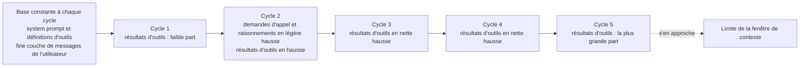

# Chapitre 9 — Ne charger dans le contexte que ce qui sert : la divulgation progressive

Dans ce chapitre, vous verrez comment composer le contexte d'un agent qui travaille sur plusieurs cycles. Vous apprendrez à mesurer ce qui occupe la fenêtre, puis à ne faire entrer les informations qu'au moment où elles deviennent utiles : un sommaire d'abord, le détail à la demande, et des résultats d'outils bornés qui disent ce qu'ils omettent. Le chapitre 10 traite le versant opposé : réduire ce qui s'est accumulé lorsque la conversation dure.

## Pourquoi les réponses se dégradent quand le contexte s'allonge

L'agent du chapitre 7 enchaîne les appels et sert désormais trois métiers. Sur les demandes courtes, il répond bien. Sur les demandes longues, quelque chose se dérègle. Il oublie une consigne pourtant donnée dans le *system prompt*. Parfois, l'appel échoue purement et simplement : la limite de la fenêtre est dépassée.

À modèle et outils inchangés, l'allongement du texte soumis à chaque cycle peut expliquer ces difficultés.

Une requête qui renvoie quelques centaines de lignes, trois ou quatre consultations détaillées, une page de documentation : il n'en faut pas davantage pour qu'une seule demande occupe plus d'espace que toute une conversation d'assistant.

## De quoi le contexte est fait

À chaque cycle de la boucle, le programme soumet au modèle une séquence composée de plusieurs éléments : les consignes rédigées par le concepteur n'en représentent qu'une petite partie. Choisir à chaque cycle ce qui entre dans cette séquence, et sous quelle forme, relève de ce qu'on nomme de plus en plus souvent l'**ingénierie du contexte** (*context engineering*), à laquelle une première synthèse académique a été consacrée (Mei et al., 2025). Le tableau 9-1 recense ces éléments.

*Tableau 9-1 — Ce qui compose le contexte*

| Élément | Qui l'écrit | Évolution au fil de la conversation |
|---|---|---|
| *System prompt* | Le concepteur | Stable |
| Définitions d'outils | Le concepteur | Stables |
| Messages de l'utilisateur | L'utilisateur | Croissent à chaque message de l'utilisateur |
| Réponses et raisonnements du modèle | Le modèle | Croissent à chaque cycle |
| Demandes d'appel d'outil | Le modèle | Croissent à chaque cycle |
| Résultats d'outils | Les systèmes interrogés | Croissent à chaque cycle, souvent fortement |
| État de conversation | Le programme | Petit et à place fixe ; remplacé quand la conversation change d'objet (chapitre 8) |

Le *system prompt* et les définitions d'outils constituent une occupation fixe de la fenêtre, présente avant même le premier message de l'utilisateur. La mise en cache du début de la séquence, évoquée au chapitre 3, peut en alléger le coût et le délai. Elle laisse cet espace occupé.

Dans un agent qui interroge des données, la croissance vient souvent surtout des résultats d'outils. Une liste de commandes peut être bien plus longue que les messages ayant conduit à sa consultation. Sa taille dépend des données récupérées ; elle doit être maîtrisée avant leur transmission au modèle. La figure 9-1 montre cette croissance d'un cycle à l'autre.

*Figure 9-1 — La croissance du contexte au fil des cycles*

*Description du schéma :* une série de barres verticales empilées, une par cycle d'un même tour (cycle 1 à cycle 5). Chaque barre comporte, de bas en haut, une base constante « *system prompt* et définitions d'outils », une fine couche « messages de l'utilisateur », une couche « demandes d'appel et raisonnements » qui s'épaissit légèrement, et une couche « résultats d'outils » qui grossit nettement à chaque cycle. Une ligne horizontale en pointillés, en haut, marque « limite de la fenêtre de contexte ». La dernière barre s'en approche.

La base ne bouge pas d'un cycle à l'autre : c'est la couche des résultats d'outils qui rapproche le contexte de la limite.

> **Point clé**
>
> Dans un agent, une grande part du contexte provient des outils. Celui qui conçoit un outil décide, souvent sans y penser, de ce que le modèle aura sous les yeux pendant tout le reste du tour.

Pour connaître ces proportions dans votre système, mesurez-les. Le nombre de *tokens* d'un texte se calcule avec le même découpage que celui du modèle, et les services indiquent, pour chaque appel, le nombre de *tokens* lus et produits. Une pratique simple consiste à relever, à chaque cycle, la taille de chacun des éléments du tableau 9-1. Ce relevé permet d'identifier ceux qui remplissent la fenêtre et de choisir où intervenir ; il servira aussi, au chapitre 10, à fixer le moment de la compaction.

## Pourquoi plus de contexte n'est pas toujours mieux

Donner toutes les informations au modèle pour le laisser trier paraît commode. Cette approche conduit d'abord à traiter la limite de la fenêtre dans l'urgence, lorsqu'il faut déjà retirer du contenu.

Avant même d'atteindre la limite, l'accumulation pèse sur le coût et la latence. Un résultat volumineux obtenu au début du tour peut être relu à chaque cycle suivant, alors qu'une petite partie seulement sert encore à la tâche. Chaque cycle ajoute un appel au modèle, et chacun relit un contexte plus long que le précédent : le coût d'un tour croît plus vite que le nombre de ses cycles. Or la plupart des moyens d'améliorer la fiabilité allongent l'attente : un raisonnement plus développé, un cycle de découverte supplémentaire, une vérification par un second appel, un modèle plus capable et plus lent. Vous arbitrez donc en permanence entre qualité, délai et prix ; l'attention portée à la seule exactitude conduit à des agents inutilement complexes et coûteux (Kapoor et al., 2024). Choisir le modèle selon la requête, par exemple au moyen d'une cascade qui n'appelle un modèle plus coûteux que si un modèle moins coûteux ne suffit pas (Chen et al., 2023), relève du même arbitrage.

La qualité mérite aussi d'être examinée. Vous avez vu au chapitre 2 que l'utilisation d'une information dépend notamment de sa position dans le contexte (Liu et al., 2023). Des expériences ont montré une baisse de performance de raisonnement lorsque l'entrée est allongée sans changer la tâche (Levy et al., 2024). D'autres montrent qu'un contenu sans rapport avec la question peut détourner un modèle de la bonne réponse (Shi et al., 2023).

> **Attention — Zone d'incertitude**
>
> Ces travaux portent sur des tâches de laboratoire, et sur des modèles qui ont été remplacés depuis. L'ampleur de l'effet dépend du modèle, de la tâche et de la nature du contenu. Il n'existe pas de seuil général au-delà duquel un contexte serait « trop long ». Il faut l'observer sur son propre système.

Pour composer le contexte, partez de la décision à prendre au prochain cycle. Quelles informations sont nécessaires ? Lesquelles pourraient le devenir plus tard ? Cette distinction vous aide à garder le contenu utile accessible sans charger d'emblée tout ce que la fenêtre peut accueillir.

## Divulguer le contexte progressivement

La **divulgation progressive** (*progressive disclosure*) consiste à rendre les informations accessibles au moment où elles deviennent utiles. Le modèle reçoit les moyens de les obtenir, sans devoir toutes les lire dès le début. Du point de vue de l'agent, il s'agit de découvrir son contexte à mesure qu'il avance dans la tâche : ce livre ne parle de découverte qu'en ce sens, et nomme le principe divulgation progressive.

Les outils de découverte du chapitre 6 en sont une première application. Plutôt que d'inscrire dans le *system prompt* la structure complète des données de l'application, dont une demande n'utilise qu'une fraction, ils laissent l'agent s'orienter d'abord parmi les sources, puis ne charger que la description de celle qu'il compte interroger.

> **Sur le terrain**
>
> Quand la liste des sources devient longue, une pratique courante consiste à remplacer sa lecture par une recherche : l'agent décrit en quelques mots ce qu'il cherche, et l'outil propose les sources les plus proches. L'agent s'oriente alors en un appel, au lieu de parcourir une liste qui occupe à elle seule une part de la fenêtre.

Le même principe s'applique aux données. Une liste n'a pas besoin de porter tout le détail de chaque enregistrement : quelques champs suffisent souvent pour s'orienter, comme la référence, la date et l'état d'une commande. Le détail d'un enregistrement s'obtient ensuite par un outil de consultation, pour celui qui intéresse la demande. Le tableau 9-2 résume ces deux niveaux.

*Tableau 9-2 — Sommaire et détail*

| Niveau | Ce que l'agent reçoit | Ce qu'il lui permet de décider |
|---|---|---|
| Sommaire | La liste des sources, ou quelques champs par enregistrement | Ce qu'il faut examiner de plus près |
| Détail | La description d'une source, ou l'enregistrement complet | La réponse ou l'appel suivant |

L'agent a désormais besoin d'appels supplémentaires pour s'orienter. La réduction du contexte doit donc être mise en regard du temps passé à s'orienter. Vous pourrez juger l'intérêt de cette organisation en mesurant le volume évité et la durée des cycles ajoutés.

Le principe est général. Vous le retrouverez au chapitre 13 pour les *skills* : montrer d'abord un sommaire, puis le détail à la demande.

## Borner les résultats en préservant leur sens

Un résultat d'outil peut lui-même être divulgué progressivement. Lorsqu'une interrogation peut renvoyer un grand nombre de lignes, l'outil n'en transmet qu'une portion, déclare ce qu'il a omis et offre le moyen d'obtenir la suite. Cette décision se prend avant que le résultat n'entre dans le contexte : elle relève de la divulgation progressive, et non de la compaction traitée au chapitre 10, qui agit sur ce que le contexte contient déjà. Un résultat volumineux qu'il faudrait ensuite résumer aurait de toute façon été lu, payé et exposé aux erreurs du résumé.

Borner ne suffit pas : il faut préserver les informations permettant au modèle de comprendre ce que représente la portion reçue. Imaginez un outil qui ne renvoie qu'un nombre limité de lignes. L'utilisateur demande combien de commandes sont en retard. L'outil en trouve davantage que sa limite et ne renvoie que les premières. Le modèle, qui ne voit que celles-là, les compte et annonce ce nombre comme le total. La réponse est fausse, et rien dans la trajectoire ne permet de s'en apercevoir.

Pour que le modèle interprète correctement un résultat borné et sache comment obtenir la suite, accompagnez les données des indications suivantes.

- **Le nombre de lignes renvoyées.**
- **Le nombre total de lignes correspondant à la demande**, lorsqu'il est connu.
- **Le statut de ce total** : exact, ou simple minimum.
- **Le moyen d'obtenir la suite** : la position de la portion suivante, ou les critères qui permettraient d'affiner la recherche.

Le statut du total dépend de la récupération. Pour protéger le système interrogé, l'outil peut plafonner le nombre de lignes qu'il va chercher, en plus de limiter celles qu'il affiche. Lorsque le plafond de récupération est atteint, il sait qu'il existe au moins autant de lignes, sans connaître leur nombre exact. Présenter ce plafond comme un total exact produirait à nouveau un décompte faux.

Le résultat doit donc distinguer la limite d'affichage du plafond de récupération. Le tableau 9-3 précise ce que chacune doit signaler.

*Tableau 9-3 — Limite d'affichage et plafond de récupération*

| Limite | Ce qu'elle protège | Ce qu'elle doit signaler |
|---|---|---|
| Limite d'affichage | La fenêtre de contexte | « Voici une partie des résultats ; le total est de tant ; la suite est accessible. » |
| Plafond de récupération | Le système interrogé | « Il existe au moins tant de résultats ; le total exact n'est pas connu. » |

Ces deux signalements doivent figurer dans le résultat lui-même, et non dans les seules consignes.

> **Attention**
>
> L'outil doit signaler la troncature dans son résultat pour que le modèle puisse l'expliquer. Une consigne demandant d'annoncer les résultats partiels ne compense pas une troncature silencieuse.

Lorsque l'utilisateur veut un total, une moyenne ou une répartition, faites calculer l'agrégat par le système interrogé. Le modèle reçoit alors un résultat calculé sur les données pertinentes, sans avoir à lire et compter une liste de lignes. Vous réduisez le contexte tout en évitant les erreurs de calcul liées à la génération.

> **Sur le terrain**
>
> Un outil démarre parfois avec une seule limite, chargée à la fois de protéger le système interrogé et la fenêtre. Prévoyez deux réglages distincts dès la première version : les séparer après coup oblige à revoir tous les décomptes que l'agent annonçait.

## Atelier 9 — La divulgation progressive

L'atelier applique la divulgation progressive à l'outil d'interrogation, qui peut renvoyer beaucoup de lignes.

### La décision à prendre

L'outil d'interrogation du chapitre 6 ne connaît aucune limite : il renvoie toutes les lignes qui correspondent au filtre, avec leur détail. Un chargé de clientèle demande : « Quelles sont les commandes en retard chez ce client, et combien y en a-t-il ? », puis « Montre-moi le détail de la plus ancienne. » La réponse à la première question peut compter trois lignes ou plusieurs centaines. Il faut décider de ce que l'outil fait entrer dans le contexte, de ce qu'il dit du reste, et de la manière dont l'agent obtient ce qu'il n'a pas reçu.

### Les options

Cinq options se présentent.

- **Tout renvoyer.** L'outil remet toutes les commandes, avec leur détail ; le modèle trie.
- **Tronquer.** L'outil renvoie les premières lignes, sans autre information.
- **Borner et déclarer.** L'outil renvoie un nombre limité de lignes, accompagné du nombre total, de son statut et du moyen d'obtenir la portion suivante.
- **Sommaire, puis détail.** Le résultat ne porte que quelques champs par commande ; le détail s'obtient par l'outil de consultation d'une commande, déjà disponible depuis le chapitre 4.
- **Agréger.** Pour la partie « combien », l'agent demande le décompte, que l'outil fait calculer par le système interrogé depuis le chapitre 6.

### Le choix retenu et son coût

L'équipe écarte l'envoi de toutes les commandes, qui pourrait saturer la fenêtre, ainsi que la troncature silencieuse, qui fausserait les décomptes. Les trois autres options se combinent : elles organisent la divulgation progressive à trois niveaux, le décompte, la liste résumée et le détail.

- Sans champs demandés, l'outil ne renvoie, pour chaque commande, que sa référence, sa date, son état et sa date de livraison prévue. Le détail d'une commande s'obtient par l'outil de consultation.
- L'outil applique une limite d'affichage basse par défaut. Il renvoie les lignes, le nombre de lignes renvoyées, le nombre total et un paramètre de position qui permet d'obtenir la portion suivante.
- Lorsque le plafond de récupération est atteint, il déclare que le total est un minimum, pas une valeur exacte.
- Pour les questions de décompte, la description de l'outil oriente le modèle vers l'agrégat, qui renvoie le nombre de commandes sans les lignes.
- Ces limites s'appliquent dans le serveur d'outils, qui valide déjà les paramètres, et valent aussi pour les regroupements du chapitre 6.
- Le *system prompt* demande à l'agent de dire à l'utilisateur, en clair, lorsqu'il ne montre qu'une partie des résultats, et de proposer d'afficher la suite ou d'affiner la recherche.
- Le programme relève à chaque cycle la taille des éléments du contexte et l'inscrit dans la trace, afin que la limite d'affichage soit réglée sur des mesures.

La structure des données est déjà divulguée progressivement depuis le chapitre 6 ; l'atelier étend le même principe aux lignes renvoyées.

Le détail d'une commande coûte désormais un cycle supplémentaire, et l'utilisateur qui veut parcourir une longue liste doit la demander portion par portion, ou préciser sa demande. L'outil d'interrogation doit gérer des limites distinctes, une position et un décompte qualifié. Ces comportements nécessitent des vérifications, en particulier aux seuils de troncature et à la dernière portion.

Ces règles ralentissent le remplissage de la fenêtre sans l'empêcher : chaque détail consulté et chaque portion affichée restent dans l'historique. Le chapitre 10 décide de ce que devient cet historique lorsque la conversation s'allonge.

### L'état de l'agent

Le tableau 9-4 indique ce qui change par rapport au chapitre 7.

*Tableau 9-4 — Ce qui change dans l'agent au chapitre 9*

| Composant | Changement |
|---|---|
| Consignes | Une règle s'ajoute : annoncer les résultats partiels et proposer la suite ou une recherche plus précise |
| Outils | L'outil d'interrogation ne renvoie par défaut qu'un résumé de chaque ligne, gagne une limite d'affichage, un décompte déclaré et un paramètre de position ; le détail passe par l'outil de consultation |
| Contrôles | Plafond de récupération |
| Contexte | Divulgation progressive des lignes : décompte, liste résumée, puis détail à la demande ; résultats bornés et déclarés ; taille du contexte relevée à chaque cycle dans la trace |

### Le critère de réussite

Une interrogation des commandes d'un client par l'outil d'interrogation générique renvoie au plus la limite d'affichage, en lignes résumées sans le détail des commandes, accompagnées du nombre de lignes renvoyées et du total ; elle déclare que ce total est un minimum lorsque le plafond de récupération est atteint. La portion suivante s'obtient par le paramètre de position, sans répéter les lignes déjà reçues. Une demande de décompte renvoie le nombre de commandes sans les lignes. Le détail d'une commande est obtenu par l'outil de consultation. La réponse annonce qu'elle ne montre qu'une partie des résultats, et la trace contient la taille du contexte à chaque cycle. Les tests de bout en bout de cet atelier se trouvent dans le dossier *workshops/09-progressive-disclosure/tests/* du dépôt compagnon.

## Ce qu'il faut retenir

Six idées résument ce chapitre.

- L'ingénierie du contexte compose, à chaque cycle, tout ce que le modèle lit ; les consignes n'en sont qu'une partie.
- Dans un agent qui interroge des données, les résultats d'outils fournissent souvent l'essentiel du contexte, et ils croissent à chaque cycle. Mesurez-les.
- Un contexte long coûte plus cher et peut gêner l'utilisation des informations pertinentes.
- La divulgation progressive montre un sommaire, puis le détail à la demande : elle échange de l'espace contre du temps.
- Un résultat borné est une divulgation progressive : l'outil dit ce qu'il a omis, distingue un total exact d'un minimum et donne le moyen d'obtenir la suite.
- Faites calculer les agrégats par le système interrogé plutôt que par le modèle.

L'agent ne fait plus entrer dans son contexte que ce qui sert la décision suivante. Mais tout ce qui y est entré y reste : une conversation qui dure finit par approcher la limite de la fenêtre. Le chapitre 10 montre comment compacter ce contexte sans perdre ce dont la tâche a encore besoin.

## Références

Les travaux cités dans ce chapitre sont les suivants.

- Chen, L., Zaharia, M., et Zou, J. (2023). *FrugalGPT: How to Use Large Language Models While Reducing Cost and Improving Performance*. arXiv:2305.05176. https://doi.org/10.48550/arXiv.2305.05176.
- Kapoor, S., Stroebl, B., Siegel, Z. S., et al. (2024). *AI Agents That Matter*. arXiv:2407.01502. https://doi.org/10.48550/arXiv.2407.01502.
- Levy, M., Jacoby, A., et Goldberg, Y. (2024). *Same Task, More Tokens: the Impact of Input Length on the Reasoning Performance of Large Language Models*. arXiv:2402.14848. https://doi.org/10.48550/arXiv.2402.14848.
- Liu, N. F., Lin, K., Hewitt, J., et al. (2023). *Lost in the Middle: How Language Models Use Long Contexts*. arXiv:2307.03172. https://doi.org/10.48550/arXiv.2307.03172.
- Mei, L., Yao, J., Ge, Y., et al. (2025). *A Survey of Context Engineering for Large Language Models*. arXiv:2507.13334. https://doi.org/10.48550/arXiv.2507.13334.
- Shi, F., Chen, X., Misra, K., et al. (2023). *Large Language Models Can Be Easily Distracted by Irrelevant Context*. arXiv:2302.00093. https://doi.org/10.48550/arXiv.2302.00093.
