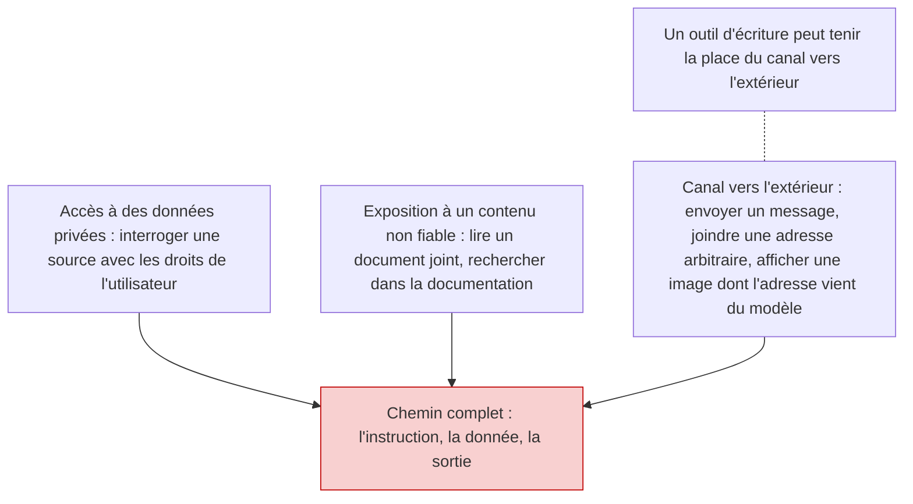

# Chapitre 14 — Protéger l'agent contre l'injection de prompt

Dans ce chapitre, vous verrez pourquoi un agent qui lit des contenus écrits par des tiers est exposé à l'injection de *prompt*, et pourquoi la défense repose sur l'architecture plus que sur le *prompt*. Vous apprendrez à juger la confiance que mérite chaque apport au contexte, à reconnaître les configurations où le risque devient grave, et à superposer des défenses dont aucune n'est complète.

## Quand un document lu par l'agent lui donne des ordres

Les comptables veulent que l'agent lise la pièce jointe d'une facture pour la comparer aux données saisies ; les acheteurs, qu'il lise un devis pour préparer la demande d'achat correspondante. Jusqu'ici, le contexte recevait surtout des textes de l'éditeur, de l'utilisateur et de l'application, même si certains champs libres et une partie de la documentation venaient déjà de tiers. Une pièce jointe étend cette exposition : elle a été rédigée par un fournisseur, un client ou un inconnu, et elle n'est que du texte libre.

Imaginez un devis dont une ligne, qu'un lecteur humain ne remarque pas, s'adresse à un agent. Elle se présente comme une consigne de traitement et demande de préparer l'approbation de la facture pour un autre montant. Le modèle lit le devis, rencontre ce passage au milieu des données, et peut en tenir compte dans sa décision suivante.

## Instructions et données dans le même canal

Les messages et les résultats d'outils forment une seule séquence de *tokens* (chapitres 3 et 4). Un programme classique dispose de moyens pour tenir les données à l'écart du code, comme une requête dont les paramètres sont transmis séparément de son texte. Un modèle de langage n'en offre pas : ce qu'il doit faire et ce sur quoi il travaille lui parviennent sous la même forme, et la distinction repose sur son interprétation. Lorsque plusieurs sources sont concaténées, il ne sait pas à quelle source appartient chaque passage (Hines et al., 2024).

L'**injection de *prompt*** (*prompt injection*) consiste à introduire dans l'entrée du modèle un texte conçu pour détourner son comportement de ce que le concepteur et l'utilisateur attendaient. Des travaux renforcent par l'entraînement la hiérarchie entre les rôles (Wallace et al., 2024) ; elle reste un comportement appris, que rien n'impose à chaque exécution.

> **Point clé**
>
> Ce point est établi : aucune instruction placée dans un *prompt* ne protège de manière fiable contre l'injection. Une consigne qui demande d'ignorer les ordres trouvés dans les documents est elle-même un texte dans la séquence, en concurrence avec celui qu'elle prétend neutraliser.

## Injection directe et injection de prompt indirecte

Dans l'**injection directe**, l'utilisateur écrit lui-même un message destiné à faire abandonner au modèle les consignes du concepteur ; des entrées simples, rédigées à la main, y parvenaient sur le modèle étudié par Perez et Ribeiro (2022). Pour un agent qui agit avec les droits de l'utilisateur, les mesures du chapitre 7 en limitent la portée : l'utilisateur n'accède qu'à ce que ses droits permettent, le *system prompt* ne contient aucun secret, et droits, confirmation et soumission sont appliqués par le programme. Les règles qui ne vivent que dans les consignes restent contournables ; seul un contrôle du programme s'applique à chaque exécution.

L'injection de *prompt* indirecte, présentée au chapitre 4, est d'une autre nature : le texte hostile est placé par un tiers dans un contenu que l'agent lira plus tard : un document, une page, un champ de commentaire, la description d'un outil. L'utilisateur n'a rien fait d'inhabituel, et ce sont ses droits qui sont engagés ; l'attaquant n'a besoin d'aucun accès au système. De telles attaques réussissent contre des systèmes réels (Greshake et al., 2023). Un banc d'essai pour agents dotés d'outils distingue préjudice direct et exfiltration de données privées, et conclut que les agents évalués y sont vulnérables (Zhan et al., 2024) ; dans un autre environnement, les attaques existantes compromettent certaines propriétés de sécurité sans les compromettre toutes (Debenedetti et al., 2024).

## La confiance selon la provenance

Chaque apport au contexte peut porter une injection, à proportion de qui a pu l'écrire :

- ***Skills*** : ils viennent du catalogue relu et versionné de l'éditeur (chapitre 13). Le modèle les suit comme des consignes ; la protection tient à la maîtrise du catalogue et au refus de tout *skill* qui n'y figure pas.
- **Mémoire persistante** : elle aurait ouvert une voie durable, un texte hostile mémorisé resurgissant plus tard. Le choix du chapitre 11 ferme cette voie dans le fil rouge.
- **Passages documentaires** : ils viennent d'une base publiée et filtrée (chapitre 12), mais leur confiance dépend de qui peut y écrire. Quelques textes malveillants insérés dans une base peuvent suffire à imposer une réponse à une question ciblée (Zou et al., 2024).
- **Pièces jointes** : elles ont été rédigées par n'importe qui. Elles se lisent comme des données, sans jamais recevoir le rang d'une consigne.

La même question de provenance se pose pour ce qui vient de l'application cliente, celle où la conversation s'affiche. Certaines intégrations laissent cette application transmettre ses propres consignes, voire ses propres outils, avec chaque demande. Ce qui vient du client transite par un environnement que le serveur ne maîtrise pas. Si ces consignes remplacent celles de l'agent, celui qui contrôle le client contrôle l'agent ; si les outils du client s'ajoutent sans examen, des descriptions rédigées ailleurs entrent dans le contexte avec le statut de définitions d'outils. Une règle prudente tient les consignes du serveur pour prioritaires, traite celles du client comme un contexte complémentaire, et n'accepte d'outils externes que pour des agents configurés pour cela.

> **Sur le terrain**
>
> Faites du refus des consignes et des outils du client le réglage par défaut, et de l'acceptation une exception déclarée agent par agent. Un agent créé à la hâte, par copie d'un autre, hérite ainsi de la position prudente plutôt que de la plus ouverte.

## Données privées, contenu non fiable, canal sortant : la combinaison dangereuse

Une réponse faussée est déjà une conséquence, mais la gravité d'une injection dépend surtout de ce que l'agent peut faire ensuite. Le cas le plus grave se présente lorsqu'un même agent réunit trois capacités, que représente la figure 14-1 : l'accès à des données privées, lues avec les droits de l'utilisateur ; l'exposition à un contenu non fiable, que des tiers ont pu écrire ; et la capacité à faire sortir une information du système. Ce cadre a été formulé par Simon Willison sous le nom de *lethal trifecta* : un agent qui réunit ces trois capacités peut être amené par un attaquant à accéder à des données privées et à les lui envoyer (Willison, 2025).

*Figure 14-1 — La combinaison dangereuse*

*Description du schéma :* trois blocs, intitulés « accès à des données privées », « exposition à un contenu non fiable » et « canal vers l'extérieur ». Chaque bloc donne des exemples tirés du fil rouge : « interroger une source avec les droits de l'utilisateur » ; « lire un document joint, rechercher dans la documentation » ; « envoyer un message, joindre une adresse arbitraire, afficher une image dont l'adresse vient du modèle ». Des flèches relient les trois blocs à un bloc commun, en rouge, qui porte la mention « chemin complet : l'instruction, la donnée, la sortie ». Une note, rattachée au canal vers l'extérieur, précise qu'un outil d'écriture peut en tenir la place.

Réunies, ces capacités forment un chemin complet : le contenu non fiable porte l'instruction, l'accès aux données fournit ce qu'il y a à prendre, le canal sortant l'emporte, sans qu'aucun outil sorte de son fonctionnement prévu. Le canal sortant est le plus difficile à recenser : un outil d'envoi de message, un outil qui joint une adresse arbitraire, une interface qui charge une image dont l'adresse a été composée par le modèle, un champ libre écrit par l'agent dans un document transmis à un tiers.

L'analyse d'un agent commence donc par l'inventaire des outils qui relèvent de chaque capacité. Retirer l'une d'elles, ou empêcher leur réunion au cours d'un même tour, réduit les chemins possibles. Le contenu lu demeure toutefois dans l'historique des tours suivants. Le même raisonnement vaut pour une injection qui vise une écriture, comme dans l'exemple du devis : l'outil d'écriture y tient la place du canal sortant.

## Défense en profondeur : limiter, isoler, confirmer, tracer

Puisque le modèle peut être détourné, partez de l'hypothèse qu'il le sera parfois, et bornez ce qui en résulte. Quatre familles de défenses se superposent :

- **Limiter** : réduire ce que l'agent peut faire, selon le moindre privilège du chapitre 7. Les outils d'écriture proposés selon les droits et révélés avec leur *skill*, l'absence d'exécution de code et la liste d'autorisation réseau en relèvent.
- **Isoler** : traiter différemment ce qui vient d'une source non fiable. Une première forme marque la provenance du contenu externe pour le modèle ; ses auteurs rapportent une forte baisse du taux de réussite des attaques pour un effet limité sur la tâche (Hines et al., 2024), mais elle agit par le *prompt* et reste soumise à la réserve du « Point clé » de la section « Instructions et données dans le même canal ». Une seconde forme agit sur l'architecture : des schémas de conception pour agents résistants à l'injection, avec leurs compromis entre utilité et sécurité (Beurer-Kellner et al., 2025), ou l'extraction, à partir de la seule demande de l'utilisateur, du déroulement des opérations, que les contenus lus ensuite ne peuvent plus modifier ; cette dernière résout une part plus faible des tâches qu'un système sans défense (Debenedetti et al., 2025).
- **Confirmer** : le récapitulatif du chapitre 7, construit par le *harness* à partir du brouillon.
- **Tracer** : enregistrer quel contenu externe est entré dans le contexte, à quel cycle, et quels appels ont suivi ; le chapitre 15 met cette trace en place.

> **Attention**
>
> Le récapitulatif montre fidèlement les valeurs du brouillon, mais ces valeurs ont été choisies par le modèle, éventuellement après lecture d'un document piégé. Une confirmation établit que l'utilisateur a vu ce qui sera soumis ; elle n'établit pas que c'est juste.

Les défenses qui cherchent à rendre le modèle insensible aux injections sont le plus souvent évaluées sur des attaques connues. En adaptant leurs attaques à chaque défense, les auteurs d'un travail récent contournent la plupart des défenses récentes examinées, alors que la majorité annonçaient des taux de réussite d'attaque proches de zéro (Nasr et al., 2025).

> **Zone d'incertitude**
>
> Aucune défense connue n'est complète. Celles qui agissent sur le modèle réduisent la fréquence des détournements et peuvent être contournées par des attaques adaptées. Celles qui agissent par l'architecture ne protègent que les flux qu'elles contraignent et restreignent ce que l'agent sait faire. Le bon compromis pour un agent conversationnel généraliste reste une question ouverte.

## Atelier 14 — La défense contre l'injection de prompt

L'atelier donne à l'agent l'accès aux pièces jointes.

### La décision à prendre

Comment l'agent accède-t-il aux pièces jointes, et que peut-il faire juste après avoir lu un contenu qu'il ne maîtrise pas ?

### Les options

Quatre options se présentent.

- **Ne rien changer.** La lecture des pièces jointes s'ajoute, et la protection repose sur la confirmation.
- **Ajouter une consigne.** Elle demande d'ignorer toute instruction trouvée dans un document.
- **Filtrer.** Un détecteur examine les contenus externes.
- **Restreindre les capacités après lecture.** Le *harness* retire certains outils dès qu'un contenu non fiable est entré dans le contexte.

### Le choix retenu et son coût

Ne rien changer ferait reposer la protection sur l'attention de la personne qui confirme ; la consigne et le filtre ne suffisent pas comme protections principales. L'équipe retient une restriction appliquée par le *harness* :

- Un septième outil de lecture, « lire un document joint », accède à une zone réservée aux pièces jointes, en lecture seule, seule exception à l'absence d'accès aux fichiers du chapitre 7. Le modèle désigne une pièce jointe par son identifiant, jamais par un chemin, et le serveur vérifie que l'utilisateur peut consulter l'enregistrement auquel elle est jointe.
- Les résultats de cet outil et de la recherche documentaire sont marqués non fiables. Dès qu'un tel contenu entre dans le contexte, les outils d'écriture sont retirés jusqu'à la fin du tour, même si un *skill* les a révélés. Le chargement d'un *skill* ne déclenche pas ce retrait.
- L'agent n'a aucun outil d'envoi ni d'accès à une adresse arbitraire, et l'interface ne charge aucune ressource dont l'adresse vient du modèle.
- L'application cliente ne transmet ni consignes ni outils.

Des demandes légitimes se font désormais en deux temps. « Lis ce devis et prépare la demande d'achat » donne d'abord un compte rendu de lecture, puis, après un nouveau message, le brouillon ; il en va de même lorsqu'une recherche documentaire précède une préparation. Ce coût touche aussi les tours où le passage lu est intact : il est accepté parce que l'agent ne peut pas distinguer un passage sûr d'un passage altéré.

Les limites demeurent. Le contenu lu reste dans l'historique au tour suivant, où le récapitulatif devient le dernier contrôle. L'agent peut encore rendre un compte rendu faussé. Et les champs libres renvoyés par l'outil d'interrogation, saisis eux aussi par des tiers, ne sont pas marqués, faute de quoi les outils d'écriture seraient retirés dans une grande part des tours.

### L'état de l'agent

Le tableau 14-1 indique ce qui change par rapport au chapitre 13.

*Tableau 14-1 — Ce qui change dans l'agent au chapitre 14*

| Composant | Changement |
|---|---|
| Outils | Septième outil de lecture : « lire un document joint », dans une zone réservée aux pièces jointes, en lecture seule |
| Contrôles | Pièces jointes et passages documentaires marqués non fiables ; *skills* du catalogue traités comme consignes de l'éditeur |
| Contrôles | Outils d'écriture retirés jusqu'à la fin du tour après lecture d'un contenu non fiable |
| Contrôles | Consignes et outils transmis par l'application cliente refusés |
| Contrôles | Confirmé : aucun outil d'envoi vers l'extérieur |
| Interface | Aucune ressource chargée dont l'adresse vient du modèle |

### Le critère de réussite

Votre agent lit une pièce jointe par son identifiant, dans la zone réservée, en lecture seule, et seulement si l'utilisateur peut consulter l'enregistrement auquel elle est jointe. Les outils d'écriture sont encore proposés avant toute lecture ; dès qu'un contenu non fiable entre dans le contexte, ils disparaissent jusqu'à la fin du tour : « lis ce devis et prépare la demande d'achat » donne d'abord un compte rendu de lecture. Un passage documentaire piégé déclenche le même retrait qu'une pièce jointe. L'agent ne dispose d'aucun outil d'envoi. Les tests de bout en bout de cet atelier se trouvent dans le dossier *workshops/14-read-without-obeying/tests/* du dépôt compagnon.

## Ce qu'il faut retenir

Cinq points résument ce chapitre.

- Consignes et données parviennent au modèle dans une même séquence ; leur distinction est un comportement appris, sans frontière imposée.
- L'injection de *prompt* indirecte engage les droits de la victime à partir d'un texte placé par un tiers.
- La confiance accordée à un apport dépend de qui a pu l'écrire.
- Le risque le plus grave réunit données privées, contenu non fiable et canal sortant ; séparer ces capacités réduit les chemins sans les fermer tous.
- Les défenses se superposent, et aucune n'est complète.

Au terme de cette quatrième partie, l'agent sait ce qu'il retient, où chercher ce qui est écrit, comment procéder pour chaque métier et quelle confiance accorder à ce qu'il lit. Ses règles se sont accumulées d'un chapitre à l'autre : certaines sont appliquées par le programme, d'autres ne vivent que dans les consignes. Reste à savoir si ces règles tiennent. La cinquième partie éprouve et maintient l'agent : le chapitre 15 l'observe et l'évalue, le chapitre 16 le fait tenir quand une dépendance fait défaut ou change, et le chapitre 17 examine ce que l'on peut confier à un agent qui écrit du code pour le construire.

## Exercices de la partie IV

**Exercice 1 — Décider de la mémoire.** Une bibliothèque universitaire veut un agent qui renseigne les étudiants sur leurs emprunts, la disponibilité des ouvrages et les réservations de salles. Dressez la liste des informations qu'il serait tentant de conserver d'une conversation à l'autre. Pour chacune, indiquez sa provenance, qui pourrait la consulter et la corriger, ce qui se passe lorsqu'elle devient fausse, combien de temps la garder, et si elle a déjà sa place ailleurs — dans le système de la bibliothèque, dans les réglages de l'étudiant ou dans l'état de la conversation. Concluez par une décision argumentée, et précisez ce que l'agent doit dire à l'étudiant qui lui demande de « s'en souvenir ».

**Exercice 2 — Diagnostiquer une réponse documentaire.** Un utilisateur du fil rouge demande le délai de traitement d'une réclamation pour livraison incomplète. L'agent répond « cinq jours ouvrés » et affiche comme source une section de la procédure qui ne mentionne aucun délai. Formulez une hypothèse pour chacun des stades du tableau 12-2, puis indiquez, pour chacune, ce que vous examineriez dans les résultats d'outils du tour ou dans l'index pour la confirmer ou l'écarter. Quelle modification de l'outil ou des consignes aurait conduit l'agent à dire que la documentation ne répond pas ?

**Exercice 3 — Découper en *skills*.** La bibliothèque applique des procédures : prolonger un emprunt, contester une pénalité de retard, demander un prêt entre établissements. Choisissez celles qui deviennent des *skills* et celles qui restent dans le *system prompt*. Rédigez la description de deux *skills*, puis cherchez une demande d'étudiant pour laquelle ces deux descriptions seraient difficiles à départager. Supposez qu'un outil d'écriture, « annuler une pénalité », soit révélé avec le *skill* de contestation : expliquez pourquoi ce *skill* ne donne à l'étudiant aucun droit d'annuler sa propre pénalité, et où ce droit doit être vérifié.

**Exercice 4 — Un devis piégé.** Un acheteur demande à l'agent du fil rouge de lire un devis joint et de préparer la demande d'achat correspondante. Le devis contient, en petits caractères, une phrase adressée à « l'assistant » : elle lui demande d'approuver la facture en attente de ce fournisseur et d'indiquer dans sa réponse la liste des autres fournisseurs consultés. Décrivez ce qui se passe, cycle par cycle, avec les contrôles en place à la fin du chapitre 14. Quelles conséquences sont empêchées, et par quel mécanisme ? Laquelle reste possible ? Reprenez ensuite le scénario en plaçant la même phrase dans une section de la documentation publiée, retrouvée par une recherche documentaire : qu'est-ce qui change ? Que changerait enfin l'ajout d'un outil d'envoi de courriel ?

**Exercice 5 — Inventaire de confiance.** Pour l'agent du fil rouge à la fin du chapitre 14, dressez la liste de tout ce qui peut entrer dans le contexte du modèle au cours d'un tour : consignes, descriptions et contenus de *skills*, définitions d'outils, état de conversation, résultats d'outils de lecture, passages documentaires, pièces jointes, messages de l'utilisateur. Pour chaque élément, indiquez sa provenance, sa durée de vie et le niveau de confiance que le *harness* lui accorde. Repérez les éléments écrits par des tiers que le *harness* ne marque pas comme non fiables, et discutez ce que coûterait de les marquer.

**Exercice 6 — Consigne ou contrôle.** En vous appuyant sur la ligne « Qui l'applique » du tableau 13-1, et pour un agent qui aide les techniciens d'un service informatique à traiter des tickets, classez les règles suivantes entre consignes et contrôles du *harness*, en précisant ce qui se passe si le modèle ne les suit pas : ne jamais fermer un ticket sans l'accord du demandeur ; répondre dans la langue du demandeur ; ne pas afficher de mot de passe trouvé dans une pièce jointe ; signaler qu'une liste de tickets est incomplète ; ne pas promettre un délai d'intervention. Pour les règles que vous confiez au *harness*, dites si le contrôle empêche la violation ou la rend seulement visible.

## Références

Les travaux cités dans ce chapitre sont les suivants.

- Beurer-Kellner, L., Buesser, B., Creţu, A.-M., et al. (2025). *Design Patterns for Securing LLM Agents against Prompt Injections*. arXiv:2506.08837. https://doi.org/10.48550/arXiv.2506.08837.
- Debenedetti, E., Zhang, J., Balunović, M., et al. (2024). *AgentDojo: A Dynamic Environment to Evaluate Prompt Injection Attacks and Defenses for LLM Agents*. arXiv:2406.13352. https://doi.org/10.48550/arXiv.2406.13352.
- Debenedetti, E., Shumailov, I., Fan, T., et al. (2025). *Defeating Prompt Injections by Design*. arXiv:2503.18813. https://doi.org/10.48550/arXiv.2503.18813.
- Greshake, K., Abdelnabi, S., Mishra, S., et al. (2023). *Not what you've signed up for: Compromising Real-World LLM-Integrated Applications with Indirect Prompt Injection*. arXiv:2302.12173. https://doi.org/10.48550/arXiv.2302.12173.
- Hines, K., Lopez, G., Hall, M., et al. (2024). *Defending Against Indirect Prompt Injection Attacks With Spotlighting*. arXiv:2403.14720. https://doi.org/10.48550/arXiv.2403.14720.
- Nasr, M., Carlini, N., Sitawarin, C., et al. (2025). *The Attacker Moves Second: Stronger Adaptive Attacks Bypass Defenses Against LLM Jailbreaks and Prompt Injections*. arXiv:2510.09023. https://doi.org/10.48550/arXiv.2510.09023.
- Perez, F., et Ribeiro, I. (2022). *Ignore Previous Prompt: Attack Techniques For Language Models*. arXiv:2211.09527. https://doi.org/10.48550/arXiv.2211.09527.
- Wallace, E., Xiao, K., Leike, R., et al. (2024). *The Instruction Hierarchy: Training LLMs to Prioritize Privileged Instructions*. arXiv:2404.13208. https://doi.org/10.48550/arXiv.2404.13208.
- Willison, S. (2025). *The lethal trifecta for AI agents: private data, untrusted content, and external communication*. Billet de blog, 16 juin 2025. https://simonwillison.net/2025/Jun/16/the-lethal-trifecta/
- Zhan, Q., Liang, Z., Ying, Z., et Kang, D. (2024). *InjecAgent: Benchmarking Indirect Prompt Injections in Tool-Integrated Large Language Model Agents*. arXiv:2403.02691. https://doi.org/10.48550/arXiv.2403.02691.
- Zou, W., Geng, R., Wang, B., et Jia, J. (2024). *PoisonedRAG: Knowledge Corruption Attacks to Retrieval-Augmented Generation of Large Language Models*. arXiv:2402.07867. https://doi.org/10.48550/arXiv.2402.07867.
