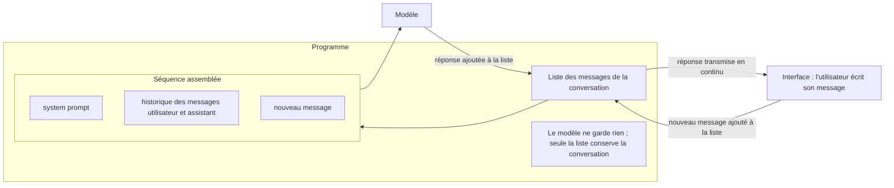

# Chapitre 3 — Du modèle à l'assistant : rôles, consignes et harness

Dans ce chapitre, vous verrez comment organiser une conversation autour d'un modèle de langage, à l'aide de rôles, d'un *system prompt* et d'une boucle conversationnelle. Vous donnerez un nom, le *harness*, au programme qui entoure le modèle, et vous en dresserez une première carte que le livre complétera partie après partie. Vous construirez la première version de l'assistant qui sert de fil rouge au livre.

## Le fil rouge : un assistant pour une application de gestion

Imaginez une application de gestion utilisée par des entreprises pour suivre leurs commandes, préparer leurs achats et valider leurs factures. Ses utilisateurs sont des gens de métier : chargés de clientèle, acheteurs, comptables. Ils connaissent leur travail, pas nécessairement tous les écrans de l'application.

L'éditeur de cette application veut leur offrir un interlocuteur à qui poser des questions en langage naturel. La première demande retenue est modeste : permettre à un chargé de clientèle de savoir où en est une commande.

Ce cas est fictif. Il est construit pour ressembler à ce que l'on rencontre sur le terrain, sans désigner aucune organisation. Il évoluera à chaque chapitre.

Pour l'instant, le modèle prolonge une séquence de *tokens*, ne conserve pas les messages échangés et ignore les données de l'application. Vous allez lui présenter les messages sous une forme qui lui permette de participer à un dialogue.

## De la complétion au dialogue : les rôles

Un modèle de langage prolonge un texte. Rien, dans ce mécanisme, ne prévoit une alternance entre deux interlocuteurs. Le dialogue est une convention que l'on ajoute par-dessus.

Cette convention consiste à structurer la séquence en **messages**, chacun attribué à un **rôle**. Pour commencer, vous utiliserez les rôles suivants.

- **Système** : le rôle qui porte les consignes fixées par le concepteur de l'application.
- **Utilisateur** : le rôle qui porte ce que la personne a écrit.
- **Assistant** : le rôle qui porte ce que le modèle a répondu.

La séquence soumise au modèle devient une transcription : un message système, puis une alternance de messages utilisateur et assistant, terminée par un message utilisateur. Le modèle prolonge cette transcription en écrivant le message d'assistant qui manque. Concrètement, les frontières entre messages sont marquées par des *tokens* spéciaux, réservés à cet usage.

Les modèles employés pour le dialogue ont été entraînés à ce format. Après leur pré-entraînement sur du texte brut, ils sont ajustés sur des exemples de consignes suivies de réponses appropriées, avec l'aide de jugements humains sur la qualité de ces réponses (Ouyang et al., 2022). Cet entraînement leur apprend à produire une suite qui répond à la demande exprimée dans la transcription. Des travaux plus récents cherchent à leur apprendre aussi une hiérarchie : accorder aux consignes du concepteur une priorité supérieure à celles de l'utilisateur, et à celles-ci une priorité supérieure au contenu venu de tiers (Wallace et al., 2024).

> **Point clé**
>
> La priorité accordée à un rôle est un comportement appris. Les messages restent dans une même séquence de *tokens*, sans séparation étanche entre les consignes et les autres contenus. Le chapitre 14 examine les problèmes de sécurité qui en découlent.

## Le system prompt : les consignes du concepteur

Le ***system prompt***, ou message système, est le texte que le concepteur place en tête de chaque conversation pour orienter le comportement de l'assistant. L'interface ne l'affiche généralement pas, mais le modèle peut être amené à le restituer. Considérez donc qu'il peut être lu par l'utilisateur et n'y placez aucune information secrète.

Pour rédiger votre *system prompt*, précisez les points suivants.

- **Mission** : qui est l'assistant, le contexte dans lequel il intervient, les personnes auxquelles il s'adresse.
- **Périmètre** : les sujets sur lesquels il répond, et ceux qu'il doit décliner.
- **Expression** : le registre, la longueur attendue, la langue.
- **Règles** : ce qu'il doit toujours faire, ce qu'il ne doit jamais faire.

L'exemple 3-1 applique ces quatre points à un cas distinct du fil rouge : l'assistant en ligne d'un réseau de bibliothèques municipales.

*Exemple 3-1 — Un system prompt court pour l'assistant d'une bibliothèque municipale*

```text
Tu es l'assistant en ligne du réseau des bibliothèques municipales. Tu aides les usagers inscrits à trouver un livre et à suivre leurs prêts.

Tu réponds aux questions sur le catalogue, les prêts, les réservations et les horaires. Pour toute autre demande, indique que tu ne peux pas aider et oriente l'usager vers l'accueil de sa bibliothèque.

Réponds en deux ou trois phrases, dans la langue de l'usager, sur un ton cordial.

N'affirme jamais qu'un livre est disponible ou qu'un prêt est en cours sans l'avoir vérifié dans une source. Ne donne aucune information sur le compte d'un autre usager.
```

Chaque paragraphe de l'exemple répond à l'un des quatre points : mission, périmètre, expression, règles.

Le modèle a appris à accorder du poids aux consignes du message système, sans en assurer le respect à chaque exécution. Une règle qui ne doit jamais être enfreinte exige donc un contrôle dans le programme. Le chapitre 13 donne une règle pour répartir les responsabilités entre ces contrôles et les consignes (tableau 13-1).

> **Sur le terrain**
>
> Il arrive souvent que des consignes soient ajoutées dans l'urgence, puis retirées quelques jours plus tard sans que personne sache pourquoi. Versionnez le *system prompt* comme du code, et notez avec chaque modification le problème qu'elle devait corriger.

Gardez aussi à l'esprit que le *system prompt* est renvoyé à chaque appel. Chaque phrase ajoutée occupe de la place dans la fenêtre et participe à ce que le modèle doit traiter. Les fournisseurs proposent souvent une mise en cache du début de la séquence, qui réduit le coût et le délai lorsque ce début ne change pas. La place occupée dans la fenêtre reste la même.

> **Attention**
>
> La tentation est d'ajouter une ligne au *system prompt* à chaque problème observé. Au bout de quelques mois, il contient des consignes qui se contredisent, et plus personne ne sait lesquelles sont encore utiles. Le chapitre 13 présente une manière de sortir de cette impasse.

## La boucle conversationnelle

Vous savez que le modèle ne retient rien d'un appel à l'autre. Pourtant, un assistant répond en tenant compte de ce qui a été dit plus tôt. La **boucle conversationnelle** organise cette continuité.

Le programme qui héberge l'assistant conserve la liste des messages échangés. À l'arrivée d'un nouveau message, le déroulement est le suivant.

1. Il ajoute le message de l'utilisateur à la liste.
2. Il soumet au modèle la liste entière, précédée du *system prompt*.
3. Il reçoit la réponse du modèle et l'ajoute à la liste.
4. Il affiche la réponse et attend le message suivant.

Ce parcours, de l'arrivée d'un message de l'utilisateur à la réponse qui lui est rendue, s'appelle un **tour**. Dans cette première boucle, un tour ne compte qu'un appel au modèle ; dès le chapitre 4, il pourra en compter plusieurs. Le modèle relit toute la conversation à chaque tour, comme s'il la découvrait. La figure 3-1 montre comment le programme compose cette entrée.

*Figure 3-1 — La boucle conversationnelle*



*Description du schéma :* à gauche, l'interface où l'utilisateur écrit son message. Au centre, le programme, qui tient la liste des messages de la conversation. Une flèche montre l'ajout du nouveau message à la liste. Le programme assemble alors une séquence empilée en trois couches : en haut « *system prompt* », au milieu « historique des messages utilisateur et assistant », en bas « nouveau message ». Cette séquence part vers le bloc « modèle », à droite. La réponse revient au programme, qui l'ajoute à la liste et la transmet en continu à l'interface. Une annotation sous le programme précise : « le modèle ne garde rien ; seule la liste conserve la conversation ».

En conservant la liste, le programme peut aussi en choisir le contenu. Il peut raccourcir l'historique, le résumer ou y insérer une information. Le modèle produit sa réponse à partir de la version qui lui est présentée. Cette maîtrise de l'entrée sera essentielle à l'état de conversation et à la gestion du contexte, aux chapitres 8 à 10.

> **Point clé**
>
> Dans cette première boucle, le programme conserve l'historique et le renvoie intégralement à chaque tour. C'est cette relecture qui permet au modèle de tenir compte des messages précédents.

## L'historique, une ressource qui se remplit

L'historique intégral a cependant une durée de vie limitée. La liste s'allonge à chaque tour, ce qui augmente le volume à traiter, le coût et la latence. Les consignes initiales et les informations anciennes deviennent aussi plus difficiles à exploiter au milieu des messages accumulés.

Lorsque la fenêtre est pleine, le programme doit retirer des messages. Supprimer les plus anciens est une solution simple, qui fait perdre au modèle le début de la conversation. Si l'interface ne le signale pas, l'utilisateur continue la conversation sans savoir que certaines de ses précisions sont devenues inaccessibles. Jusqu'au chapitre 10, l'agent du fil rouge ne retire rien : lorsqu'une conversation dépasse la fenêtre, l'appel au modèle échoue, et le tour se termine par une erreur.

Pour un assistant qui répond à des questions brèves, ces effets restent discrets. Ils deviendront centraux dès que le système enchaînera plusieurs appels au modèle par demande.

## Transmettre la réponse en continu

La génération produit les *tokens* un par un. Rien n'oblige à attendre le dernier pour montrer le premier. La **transmission en continu** (*streaming*) consiste à envoyer la réponse à l'interface à mesure qu'elle est produite.

L'utilisateur peut ainsi commencer à lire pendant la génération. Le temps total reste le même, mais l'écran montre une activité en cours. Cette visibilité aide à distinguer l'attente normale d'une panne.

Ce choix oblige à prévoir les vérifications nécessaires avant l'affichage : les mots déjà lus par l'utilisateur ne peuvent plus être retirés de son expérience. Il faut également traiter l'interruption d'une réponse en cours de transmission.

> **Sur le terrain**
>
> Prévoyez la transmission en continu dès la première version, avant les fonctions métier. L'ajouter plus tard oblige à revoir le traitement des erreurs et des interruptions, qui n'ont pas été pensés pour une réponse affichée par morceaux.

## Le harness, programme qui entoure le modèle

Depuis le début de ce chapitre, un acteur intervient tout au long de la boucle conversationnelle sans avoir reçu de nom : le programme qui place le *system prompt* en tête de la séquence, conserve l'historique, appelle le modèle, transmet sa réponse à l'interface et devra un jour décider quels messages retirer. On le désigne par le mot ***harness*** (littéralement, le harnais) : l'ensemble du code qui entoure le modèle pour en faire un assistant, puis un agent, utilisable. Les chapitres suivants parlent souvent simplement du « programme » ; c'est de lui qu'il s'agit.

### Le modèle propose, le harness dispose

Le modèle produit du texte : une réponse pour l'instant, une demande d'action dès le chapitre suivant. Ce texte n'a aucun effet par lui-même. Le *harness* compose l'entrée du modèle — les consignes et l'historique aujourd'hui, plus tard les définitions d'outils et les résultats de leur exécution —, appelle le modèle, interprète ce qu'il a produit, exécute ce qui doit l'être, contrôle ce qui doit l'être et transmet le résultat à l'interface. C'est aussi lui qui choisit ce que le modèle lira à l'appel suivant.

Les capacités réelles d'un assistant ou d'un agent sont donc bornées par ce que son *harness* accepte d'exécuter et par ce qu'il place dans le contexte. Le modèle ne peut consulter une commande que si le *harness* lui en donne le moyen. Il ne peut tenir compte d'une précision de l'utilisateur que si le *harness* la lui remet. La frontière entre ce qui est confié au modèle et ce qui est confié au programme est la question de conception qui traverse tout le livre.

> **Attention — Zone d'incertitude**
>
> Le mot *harness* vient de la pratique et n'a pas de définition arrêtée. Les travaux académiques décrivent plutôt un agent par ses composants — mémoires, espace d'actions, procédure de décision (Sumers et al., 2023). La définition retenue ici est une convention de ce livre.

### Une première carte

Le *harness* de l'assistant construit dans ce chapitre est encore mince. Le tableau 3-1 situe ses responsabilités et indique où le livre les développe.

*Tableau 3-1 — Les responsabilités du harness*

| Responsabilité | Ce que fait le *harness* | Où le livre la développe |
|---|---|---|
| Composer l'entrée | Assemble les consignes et l'historique, plus tard les outils, leurs résultats et d'autres informations utiles | Ce chapitre ; partie III (mémoire de travail, contexte) ; partie IV (souvenirs, documents, procédures) |
| Conduire le tour | Appelle le modèle, décide de poursuivre ou de s'arrêter | Ce chapitre ; partie II (boucle agentique) |
| Interpréter et exécuter | Lit les demandes d'action du modèle, les vérifie, les exécute | Chapitre 4 ; partie II (outils) |
| Encadrer | Applique les limites, les droits et les validations | Chapitre 7 (droits et validations) ; chapitre 14 (contenus de tiers) |
| Conserver l'état | Garde l'historique de chaque conversation et ce dont la tâche a besoin | Ce chapitre ; partie III |
| Communiquer avec l'interface | Transmet la réponse en continu, puis informe l'utilisateur de ce que fait l'agent | Ce chapitre ; partie II |

Pour l'instant, seules la composition de l'entrée, la conduite d'un tour réduit à un appel, la conservation de l'historique et la transmission en continu existent. La partie II traitera de la boucle, des capacités de l'agent et des droits avec lesquels il les exerce, la partie III du contexte qu'il garde utile au fil de la conversation, la partie IV de ce que le *harness* remet dans le contexte, la partie V de la manière de l'éprouver et de le maintenir.

Chacune de ces responsabilités est réalisée par du code ordinaire, qui se spécifie et se teste avec les moyens habituels du génie logiciel. Le modèle, lui, s'évalue par l'observation de ses sorties sur des exécutions répétées.

### Un même modèle, deux harness

Imaginez le même modèle confié à deux équipes. La première place dans le *system prompt* une longue description de l'application et rejoue l'historique entier jusqu'à remplir la fenêtre. La seconde garde des consignes courtes et choisit ce qu'elle remet au modèle à chaque tour. Après une longue conversation, le premier assistant traite un volume croissant où les précisions utiles se perdent ; le second lit une entrée plus courte, composée pour la question posée. Les deux assistants partagent le même modèle et ne se comportent pas de la même manière.

La recherche fournit des indices dans le même sens. Dans le domaine du génie logiciel, des travaux rapportent que la conception de l'interface entre un agent et son environnement peut modifier son comportement et ses résultats (Yang et al., 2024). Une analyse des pratiques d'évaluation des agents relève par ailleurs que l'on a confondu les besoins de ceux qui développent des modèles et de ceux qui construisent des applications, ce qui rend difficile de savoir quel agent convient à un usage donné (Kapoor et al., 2024).

> **Point clé**
>
> Un résultat d'évaluation porte sur un couple formé d'un modèle et d'un *harness*. Le classement d'un modèle sur un banc d'essai général ne suffit pas à prévoir le comportement de l'assistant que vous construirez avec lui. Le chapitre 15 montre comment mesurer ce couple.

## Ce qu'un assistant sans outil ne peut pas faire

À ce stade, vous disposez d'un assistant complet au sens le plus simple : un modèle, des rôles, un *system prompt*, une boucle. Il converse, reformule, explique, rédige.

Pour renseigner un utilisateur sur une commande, il lui manque cependant les données de l'application. Le modèle ne connaît ni les commandes en cours ni leur état de livraison. Même la date du jour doit lui être fournie. Et s'il peut expliquer une procédure d'annulation, aucun composant ne lui permet encore de la déclencher.

Vous pouvez enrichir le contexte avec la date, le nom de l'utilisateur ou un extrait de documentation. Pour une information ciblée, c'est utile. Charger toutes les commandes de tous les clients dépasserait les capacités de cette approche : il faudra obtenir les données pertinentes au moment où la question se pose.

## Atelier 3 — Le system prompt

À partir de ce chapitre, la plupart des chapitres comportent un atelier qui fait évoluer l'agent du fil rouge. Vous le réalisez sur votre propre agent, avec le **dépôt compagnon** et ses tests de bout en bout, en respectant un contrat d'interface qui fait laisser à chaque tour une **trace minimale**. L'annexe A décrit ce dépôt, ce contrat et la manière dont les tests vérifient le critère de réussite. Les numéros des dossiers de tests ne suivent pas toujours ceux des chapitres : le tableau A-1 de l'annexe A indique le dossier de chaque atelier.

Chaque atelier applique le chapitre au cas fil rouge : une décision à prendre, les options, le choix retenu et son coût, l'état de l'agent, puis le critère de réussite que votre agent doit atteindre.

### La décision à prendre

L'éditeur veut un assistant qui renseigne les chargés de clientèle sur l'état des commandes. Avant de lui donner accès à quoi que ce soit, il faut décider de ce que contient son *system prompt*, et constater ce qu'il sait faire avec cela seul.

### Les options

Vous pouvez enrichir progressivement le message système.

- **Le minimum.** Le rôle de l'assistant et le public auquel il s'adresse. On laisse le modèle faire de son mieux.
- **Une documentation.** Une description de l'application, de ses notions métier et de ses écrans, pour que l'assistant puisse au moins guider l'utilisateur.
- **Des bornes.** Ce que l'assistant ne doit pas faire, en particulier ne jamais affirmer l'état d'une commande qu'il ne peut pas connaître.

### Le choix retenu et son coût

L'équipe retient un *system prompt* court. Il présente l'assistant comme une aide aux chargés de clientèle et limite son périmètre aux commandes. Il demande des réponses brèves, dans la langue de l'utilisateur, ainsi qu'une règle de prudence : ne jamais avancer d'information sur une commande précise sans l'avoir obtenue d'une source.

La description détaillée de l'application est écartée. Elle allongerait chaque appel pour un bénéfice incertain, et elle devrait être tenue à jour à chaque évolution des écrans.

À la question « où en est la commande de tel client ? », l'assistant devrait donc répondre qu'il ne dispose pas de cette information. Cette réponse expose correctement sa limite. Pour rendre le service attendu, il lui faudra encore un moyen de consulter la commande.

La règle « ne jamais avancer d'information sans source » reste à ce stade une consigne sans contrôle d'exécution. Vous devrez observer si le modèle la suit, notamment lorsque l'utilisateur insiste.

### L'état de l'agent

Le tableau 3-2 décrit le point de départ. Les ateliers suivants n'indiqueront que ce qui change ; l'état complet se reconstitue en cumulant ces tableaux d'atelier en atelier.

*Tableau 3-2 — L'état initial de l'agent*

| Composant | État |
|---|---|
| Modèle | Un LLM généraliste, utilisé tel quel |
| Consignes | Un *system prompt* court : rôle, périmètre, registre, une règle |
| Boucle | Boucle conversationnelle : l'historique est rejoué à chaque tour ; transmission en continu |
| Outils | Aucun |
| Identité | Sans objet : aucun outil n'interroge encore l'application |
| Contrôles | Aucun ; chaque tour laisse une trace minimale |
| Contexte | Non géré : l'historique s'allonge |
| Mémoire | Aucune en dehors de l'historique rejoué |
| Autonomie | Le modèle rédige ; le programme fait le reste |
| Actions d'écriture | Aucune |
| Interface | Une fenêtre de conversation ; réponse transmise en continu |

### Le critère de réussite

Votre agent répond avec un *system prompt* court, sans outil ni documentation de l'application, et rejoue l'historique à chaque tour. Interrogé sur l'état d'une commande précise, il répond qu'il ne dispose pas de cette information, y compris lorsque l'utilisateur insiste ; ce point est apprécié sur des exécutions répétées par un modèle juge, c'est-à-dire un second modèle qui note la réponse selon une grille (annexe A, chapitre 15). Chaque tour respecte le contrat d'interface et laisse sa trace minimale. Les tests de bout en bout de cet atelier se trouvent dans le dossier *workshops/03-system-prompt/tests/* du dépôt compagnon.

## Ce qu'il faut retenir

Retenez de ce chapitre les points suivants.

- Le dialogue est une convention : des messages attribués à des rôles, que le modèle a appris à prolonger.
- Le *system prompt* oriente chaque appel ; une règle impérative exige aussi un contrôle dans le programme.
- La mémoire apparente de l'assistant vient de l'historique que le programme lui renvoie à chaque tour.
- Cet historique grandit : il faudra un jour en retirer quelque chose.
- Le *harness* compose l'entrée du modèle, l'appelle, interprète, exécute, contrôle et transmet ; les capacités réelles de l'agent dépendent de lui.
- Une évaluation porte sur le couple formé du modèle et du *harness*.
- Chaque atelier fixe un critère de réussite vérifiable, que les tests du dépôt compagnon mettent à l'épreuve sur votre propre agent.

Le chapitre 4 donne à l'assistant son premier outil : le moyen d'obtenir l'état réel d'une commande.

## Références

Les travaux cités dans ce chapitre sont les suivants.

- Kapoor, S., Stroebl, B., Siegel, Z. S., et al. (2024). *AI Agents That Matter*. arXiv:2407.01502.
- Ouyang, L., Wu, J., Jiang, X., et al. (2022). *Training language models to follow instructions with human feedback*. arXiv:2203.02155.
- Sumers, T. R., Yao, S., Narasimhan, K., et Griffiths, T. L. (2023). *Cognitive Architectures for Language Agents*. arXiv:2309.02427.
- Wallace, E., Xiao, K., Leike, R., et al. (2024). *The Instruction Hierarchy: Training LLMs to Prioritize Privileged Instructions*. arXiv:2404.13208.
- Yang, J., Jimenez, C. E., Wettig, A., et al. (2024). *SWE-agent: Agent-Computer Interfaces Enable Automated Software Engineering*. arXiv:2405.15793.
