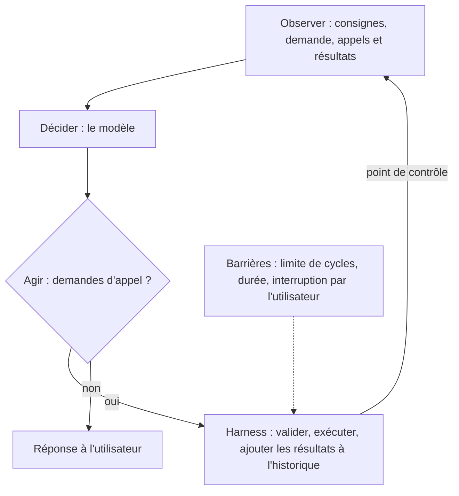

# Chapitre 5 — La boucle agentique : quand le modèle décide de l'étape suivante

Dans ce chapitre, vous verrez ce qui distingue un agent d'un assistant : qui décide de l'étape suivante. Vous apprendrez à situer un système sur un continuum d'autonomie et à choisir entre un enchaînement prédéfini et un agent, puis à construire la boucle qui permet au modèle d'enchaîner ses décisions : raisonnement intermédiaire, appels parallèles, conditions d'arrêt. Vous apprendrez aussi à reconnaître les erreurs qui se propagent au cours d'un tour, et à tenir l'utilisateur informé pendant que l'agent travaille.

## Une question qui ne tient pas en un appel

L'assistant du chapitre 4 sait consulter une commande. Un chargé de clientèle lui écrit maintenant : « Ce client s'inquiète pour ses livraisons en retard. Que puis-je lui dire ? », en donnant le nom du client.

Aucun outil ne répond à cela d'un seul coup. Il faut retrouver le client, lister ses commandes en cours, examiner l'état de livraison de chacune, repérer celles qui sont en retard, peut-être consulter la documentation sur les délais, puis rédiger une synthèse. Le nombre d'étapes n'est pas connu d'avance : il dépend de ce que l'on trouve en chemin.

Avec le mécanisme du chapitre 4, le modèle demande un appel d'outil, reçoit le résultat, et répond. Même doté d'un outil de recherche de clients, il n'obtiendrait que l'identifiant du client, et rien d'autre : il ne pourrait pas répondre à la question.

Vous pouvez prévoir cet enchaînement dans le programme ou laisser le modèle le déterminer à partir des résultats obtenus. La répartition de cette responsabilité vous servira à préciser ce que ce livre appelle un agent.

## Qui décide de l'étape suivante ?

Le chapitre 1 a donné des définitions provisoires du *chatbot* et de l'assistant ; les chapitres 3 et 4 ont construit un assistant pièce par pièce. Retenez-en un trait : dans un assistant, l'utilisateur conduit l'échange. Il pose une question, reçoit une réponse, pose la suivante.

Un **agent** est plus délicat à définir, et la littérature ne s'accorde pas. Les synthèses du domaine le décrivent le plus souvent par ses composants : un modèle de langage qui tient lieu de centre de décision, entouré de modules de mémoire, de planification et d'action (Wang et al., 2023a). Cet inventaire laisse une ambiguïté : un assistant doté d'un outil possède déjà une capacité d'action et un historique de conversation. Il faut examiner comment ces composants sont utilisés.

Examinez donc qui décide de l'étape suivante. Ce critère est une convention de l'ouvrage, choisie pour guider la conception ; il ne constitue pas une définition établie dans la littérature.

> **Point clé**
>
> Un système est un agent dans la mesure où c'est le modèle, et non le programme, qui décide de la prochaine étape — quel outil appeler, avec quoi, s'il faut continuer, et quand la tâche est terminée.

Dans l'assistant du chapitre 4, le modèle choisit d'appeler ou non l'outil de consultation. Une fois le résultat reçu, il doit répondre. Le programme a fixé ce déroulement : au plus un appel, puis une réponse. La part de décision confiée au modèle est limitée.

Pour traiter la demande sur le client inquiet, un agent peut commencer par chercher le client, puis utiliser le résultat pour demander ses commandes. La liste obtenue détermine quelles consultations supplémentaires sont nécessaires. Le modèle choisit ces étapes et décide quand il dispose d'assez d'informations pour répondre. Le programme exécute les demandes sans avoir prescrit leur nombre ni leur ordre.

Les deux systèmes ont les mêmes composants : un modèle, des consignes, des outils, une boucle. Ils diffèrent par la répartition de la décision.

Dans les deux cas, le modèle ne fait que demander des appels : il ne les exécute jamais. C'est le *harness*, le programme qui entoure le modèle (chapitre 3), qui exécute chaque demande, renvoie le résultat et décide de rappeler le modèle. La boucle appartient au *harness*, et c'est en la modifiant que l'on passe de l'assistant à l'agent.

## Enchaînement prédéfini ou agent : quand renoncer à l'agent

La première manière de traiter la demande — écrire la suite d'étapes dans le programme — porte un nom : l'**enchaînement prédéfini** ou *workflow*. Le concepteur a prévu le chemin : le programme appelle le modèle à des points précis, pour des tâches délimitées, comme extraire le nom du client ou rédiger la réponse.

Dans un agent, le programme fournit un objectif, des outils et une boucle. Le modèle choisit ses demandes d'appel à mesure que les résultats arrivent, jusqu'à déclarer avoir terminé. La trajectoire se construit au cours de l'exécution. Le tableau 5-1 compare les deux organisations.

*Tableau 5-1 — Workflow et agent*

| | *Workflow* | Agent |
|---|---|---|
| Qui fixe la suite des étapes | Le concepteur, à l'avance | Le modèle, en cours de route |
| Nombre d'étapes | Connu | Variable |
| Demandes imprévues | Mal traitées, ou refusées | Traitées, avec un résultat incertain |
| Prévisibilité | Élevée | Plus faible |
| Diagnostic d'un échec | On sait à quelle étape chercher | Il faut relire le parcours |

Lorsque vous pouvez décrire un déroulement fiable dans le programme, vous avez peu de raisons de le faire reconstruire par le modèle à chaque demande. Choisissez l'organisation qui rend le service attendu avec une fiabilité suffisante : l'autonomie ajoute de la souplesse et de l'incertitude, et doit répondre à un besoin identifié. Les situations suivantes invitent à la limiter, voire à choisir une autre interface.

- **Le chemin est connu.** Si la tâche se décompose toujours de la même manière, écrivez cette décomposition. Vous y gagnerez en vitesse, en coût et en prévisibilité.
- **L'erreur n'est pas tolérable.** Si une étape mal choisie a des conséquences graves et irréversibles, la décision ne doit pas reposer sur un composant non déterministe, ou alors sous le contrôle d'une personne.
- **La réponse doit être immédiate.** Si l'utilisateur attend une réaction instantanée, l'enchaînement de plusieurs appels au modèle est exclu.
- **Un formulaire suffirait.** Si la demande se résume à trois champs à remplir, une conversation n'apporte rien et ralentit.

Une pratique courante, et saine, consiste à partir de la solution la plus simple et à n'ajouter de l'autonomie que là où l'on constate qu'elle manque. Les deux approches se combinent d'ailleurs très bien : un agent peut disposer, parmi ses outils, d'un *workflow* complet qu'il déclenche d'un seul appel lorsque la demande s'y prête.

## Un continuum d'autonomie

La responsabilité des étapes peut être confiée au modèle de façon graduelle. L'échelle du tableau 5-2, propre à ce livre, permet de décrire cette répartition. D'autres échelles existent, par exemple selon le rôle laissé à l'utilisateur face à l'agent, et elles partagent une idée : le niveau d'autonomie est une décision de conception, distincte de ce dont le modèle est capable (Feng et al., 2025).

*Tableau 5-2 — Les positions du continuum d'autonomie*

| Position | Le modèle | Ce que cela recouvre |
|---|---|---|
| 1 | Rédige | Le programme fait tout le reste. Il n'y a pas d'outil. |
| 2 | Choisit un outil | Il décide s'il en faut un et lequel, puis répond. C'est l'assistant du chapitre 4. |
| 3 | Enchaîne | Il peut demander plusieurs appels successifs avant de répondre, dans la limite fixée par le *harness*. |
| 4 | Planifie et se corrige | Il décompose l'objectif, constate qu'une piste ne donne rien, en essaie une autre. |
| 5 | Agit sur la durée | Il poursuit un objectif pendant de nombreux appels, avec peu d'interventions humaines. |

Un même système occupe souvent plusieurs positions selon la demande. Il répond directement à une salutation, appelle un outil pour une question simple, et enchaîne une dizaine d'appels pour une demande complexe.

Après avoir renvoyé le résultat, le programme peut accepter une nouvelle demande d'appel au lieu d'exiger une réponse à l'utilisateur. Le modèle poursuit alors ses recherches jusqu'à disposer de quoi répondre. Cette modification fait passer le système de la position 2 à la position 3 : le reste de ce chapitre construit la boucle qui la permet.

## La boucle agentique : observer, décider, agir

Avant de décrire la boucle, fixez son vocabulaire. Ce livre appelle **cycle** une exécution de la boucle : un appel au modèle, puis, s'il a demandé des appels d'outils, leur exécution. Le chapitre 3 a nommé tour ce qui sépare la demande de l'utilisateur de la réponse finale ; dans un agent, un tour compte un ou plusieurs cycles. La suite des décisions prises et des résultats obtenus au cours d'un tour s'appelle la **trajectoire**. Deux trajectoires différentes peuvent mener à la même réponse ; une même demande peut donner deux trajectoires différentes. Le mot « étape », enfin, reste réservé aux opérations métier que l'interface montre à l'utilisateur, comme la recherche d'un client.

La **boucle agentique** répète le cycle suivant.

1. **Observer.** Le modèle reçoit l'état courant : les consignes, la demande, et tout ce qui s'est passé jusque-là — appels effectués, résultats obtenus.
2. **Décider.** Il produit soit une ou plusieurs demandes d'appel d'outil, soit une réponse destinée à l'utilisateur.
3. **Agir.** Si le modèle a demandé des appels, le *harness* les exécute et ajoute leurs résultats à l'historique. Un nouveau cycle commence. Si le modèle a rédigé une réponse, la boucle se termine.

La figure 5-1 représente cette boucle et les points où le *harness* reprend la main.

*Figure 5-1 — La boucle agentique*

*Description du schéma :* un cercle formé de trois flèches étiquetées « observer », « décider », « agir ». Au centre, le bloc « modèle ». Sur l'arc « agir », un losange de décision : « demandes d'appel ? ». La branche « oui » mène au bloc « *harness* : valider, exécuter, ajouter les résultats à l'historique », qui renvoie vers « observer ». La branche « non » sort du cercle vers « réponse à l'utilisateur ». Trois petites barrières sont posées sur le cercle, étiquetées « limite de cycles », « durée », « interruption par l'utilisateur ». Une note indique que chaque passage par le *harness* est un point de contrôle.

Cette organisation a été décrite et étudiée sous le nom de *ReAct* : faire alterner au modèle des traces de raisonnement et des actions, de sorte que le raisonnement guide le choix de l'action et que le résultat de l'action nourrisse le raisonnement suivant (Yao et al., 2022). Beaucoup d'agents actuels en reprennent le principe.

> **Point clé**
>
> À chaque cycle, le *harness* appelle le modèle, reçoit sa sortie et décide s'il doit le rappeler. Vous pouvez placer des contrôles à ces points de passage pour compter les cycles, vérifier les demandes ou interrompre le tour.

## Raisonner et planifier avant d'agir

Le chapitre 2 a établi que la réponse d'un modèle se constitue *token* après *token*, et que ce qui est écrit conditionne ce qui suit. Il en découle une technique simple : amener le modèle à écrire son raisonnement avant sa conclusion. Il a été montré que cette pratique, dite de la chaîne de pensée, améliore les résultats sur des tâches qui demandent plusieurs étapes de raisonnement (Wei et al., 2022). Le gain n'est pas uniforme : une méta-analyse conclut qu'il se concentre sur les tâches de calcul et de raisonnement symbolique, et qu'il est faible ailleurs (Sprague et al., 2024).

Dans un agent, ce raisonnement intermédiaire précède chaque décision : « l'identifiant du client est connu ; il faut maintenant ses commandes en cours ». Certains modèles le produisent dans un espace distinct de la réponse, que l'utilisateur ne voit pas. Prévoyez la place et le temps nécessaires à sa production à chaque cycle. Lorsque vous pouvez le consulter, il renseigne sur la trajectoire suivie. Il reste toutefois un texte généré, dont la fidélité doit être examinée : des explications plausibles peuvent ne pas refléter ce qui a réellement déterminé la réponse (Turpin et al., 2023). Pour évaluer une décision, regardez aussi les appels effectués et leurs résultats.

Le raisonnement peut aussi porter sur la suite du travail. Dans la boucle décrite jusqu'ici, le modèle choisit l'action suivante au vu de ce qu'il sait, sans rédiger de plan préalable, ce qui convient aux tâches courtes. Pour une tâche plus longue, vous pouvez lui demander de rédiger une liste d'étapes avant de commencer. Sur des problèmes de raisonnement, cette manière de formuler la consigne a permis de réduire les étapes oubliées (Wang et al., 2023b). Dans un agent, elle apporte aussi une possibilité d'interface : montrer le plan à l'utilisateur pour lui donner une idée du travail envisagé. Une approche plus coûteuse explore plusieurs pistes, les évalue et revient sur une piste qui échoue (Yao et al., 2023) ; la multiplication des appels qui en résulte est rarement compatible avec le temps d'attente d'une conversation.

> **Attention — Zone d'incertitude**
>
> La capacité des modèles de langage à planifier est débattue. Une position argumentée soutient qu'ils ne savent pas, par eux-mêmes, produire ni vérifier des plans corrects, et qu'ils sont utiles à la planification à condition d'être associés à des vérificateurs externes (Kambhampati et al., 2024). Pour concevoir votre système, traitez le plan comme une proposition à vérifier au cours de l'exécution. Le *harness* et les outils doivent contrôler les opérations à chaque cycle.

Pour un agent conversationnel destiné à des utilisateurs finaux, la pratique courante est modeste : pas de plan pour les demandes simples, un plan court et visible pour les demandes longues, pas d'exploration.

## Enchaîner et paralléliser

Dans un même cycle, le modèle peut demander plusieurs appels à la fois. S'il doit examiner trois commandes, rien ne l'oblige à le faire en trois cycles : il peut émettre les trois demandes ensemble, et le *harness* peut les exécuter simultanément ; chaque résultat revient avec l'identifiant de sa demande (chapitre 4).

La distinction qui compte est celle de la dépendance.

- Des appels **indépendants** — consulter trois commandes — peuvent être lancés en parallèle. On gagne du temps, et l'on économise des cycles.
- Des appels **dépendants** — chercher un client, puis lister ses commandes — doivent se suivre, puisque le second a besoin du résultat du premier.

C'est le modèle qui juge de cette dépendance. Il se trompe parfois, dans les deux sens : il enchaîne ce qu'il aurait pu grouper, ou il groupe des appels dont l'un supposait le résultat de l'autre, en inventant la valeur manquante.

> **Sur le terrain**
>
> Si vous transmettez la réponse en continu, les demandes d'appel arrivent elles aussi par fragments. Les défauts se logent souvent davantage dans leur réassemblage que dans les décisions du modèle. Testez ce réassemblage à part, avec des appels parallèles et des paramètres longs.

## Savoir s'arrêter

Une boucle doit se terminer. Dans une boucle agentique, c'est le modèle qui en décide en temps normal : il s'arrête lorsqu'il rédige une réponse au lieu de demander un appel. On ne peut pas s'en remettre à lui seul.

La boucle doit prendre en charge les conditions d'arrêt suivantes.

- **L'arrêt décidé par le modèle.** Il estime avoir atteint l'objectif, ou ne pas pouvoir progresser davantage, et répond.
- **L'arrêt imposé par le *harness*.** Un nombre maximal de cycles, une durée maximale, un budget maximal. Ces limites sont des garde-fous : elles ne devraient pas être atteintes en fonctionnement normal.
- **L'arrêt demandé par l'utilisateur.** Dans une conversation, la personne peut interrompre. L'agent doit le supporter proprement.

Prévoyez surtout ce que l'utilisateur recevra lorsqu'une limite imposée est atteinte. Vous pouvez accorder au modèle un dernier cycle, sans outil, pour rédiger une réponse à partir des résultats obtenus. Vous pouvez aussi rendre la main à l'utilisateur en exposant le travail effectué et ce qui reste à faire. Ces pratiques évitent une interruption sans explication.

> **Attention**
>
> Une limite de cycles trop basse fait échouer des demandes légitimes. Une limite trop haute laisse une boucle égarée consommer du temps et de l'argent. Il n'existe pas de bonne valeur universelle : elle se règle en observant les trajectoires réelles.

## Demander une précision à l'utilisateur

Dans une conversation, l'agent peut demander une précision à la personne qui lui a confié la tâche. Si deux clients portent le même nom et qu'aucune donnée ne permet de les départager, une question évite de poursuivre les recherches sur un choix incertain.

Du point de vue de la boucle, interroger l'utilisateur met fin au tour : l'agent rédige une question, et la boucle reprendra à la réponse. C'est une issue aussi légitime qu'une réponse définitive.

La clarification doit correspondre à une incertitude qui compte pour le résultat. Demandez une précision lorsqu'un outil ne permet pas de lever cette incertitude. Vérifiez vous-même ce qui peut l'être, afin de réserver l'intervention de l'utilisateur aux choix qui nécessitent réellement son aide.

## Informer pendant que l'agent travaille

L'agent étudié dans ce livre travaille dans un dialogue. Une personne attend sa réponse, peut l'interrompre, préciser sa demande ou changer d'avis, et l'agent peut à son tour lui poser une question. La latence est perçue directement.

Un tour de plusieurs cycles dure, et sa durée n'est plus connue d'avance. La transmission en continu n'affiche souvent rien tant que le modèle enchaîne des appels d'outils : l'utilisateur ne sait pas si l'agent travaille ou s'il a échoué.

Le *harness* connaît chaque appel, puisqu'il les exécute. Il peut donc émettre dans le flux de réponse des événements distincts du texte, que l'interface présente comme des étapes : recherche du client, lecture de ses commandes, consultation d'une livraison. Leur libellé est destiné à l'utilisateur : il est rédigé dans sa langue et décrit l'opération métier, sans le nom technique de l'outil.

Ces étapes permettent aussi à l'utilisateur de constater que l'agent part dans une mauvaise direction, par exemple vers un homonyme du client qui l'intéresse. L'interruption, comptée parmi les conditions d'arrêt de la section « Savoir s'arrêter », doit alors être accessible par un geste simple. Le *harness* cesse de lancer de nouveaux appels et termine proprement le tour. Le chapitre 7 reprend la question lorsqu'une action d'écriture est en préparation, et le chapitre 16 décrit comment terminer proprement une réponse interrompue.

## Quand la boucle déraille

La lecture des trajectoires fait apparaître des formes d'échec récurrentes. Les repères du tableau 5-3 sont des constats de pratique ; ils peuvent guider le diagnostic sans constituer une classification établie.

*Tableau 5-3 — Les formes d'échec de la boucle*

| Forme d'échec | Ce qui se passe |
|---|---|
| La répétition | Le modèle refait le même appel, avec les mêmes paramètres, et obtient le même résultat. La cause est souvent un message d'erreur qui ne lui dit pas quoi changer. |
| La dérive d'objectif | Au fil des cycles, le modèle s'éloigne de la demande initiale. Il s'attache à un détail rencontré dans un résultat et oublie la question posée. |
| L'accumulation d'erreurs | Une erreur au deuxième cycle, comme un mauvais client retenu parmi deux homonymes, n'est pas corrigée. Les cycles suivants s'exécutent correctement, sur une base fausse ; la réponse finale est cohérente, détaillée et erronée. |
| L'abandon prématuré | Le modèle répond avant d'avoir réuni ce qu'il fallait, et comble les manques par des suppositions. |
| L'excès de zèle | Le modèle fait davantage que ce qui était demandé. Sans conséquence avec des outils de lecture, ce travers devient un risque dès qu'il existe des outils d'écriture. |

Ces formes d'échec rendent le déroulement lui-même variable : des demandes identiques peuvent emprunter des chemins différents et aboutir à des réponses différentes. Les évaluations dans des scénarios réalistes de service client, avec outils et règles à respecter, montrent des échecs sur une part importante des tâches testées et une réussite inconstante lorsque la même tâche est répétée (Yao et al., 2024). D'autres bancs d'essai, couvrant des environnements variés, constatent des écarts marqués entre modèles et des difficultés persistantes sur les tâches longues (Liu et al., 2023).

> **Attention — Zone d'incertitude**
>
> Les capacités progressent et les résultats de ces évaluations vieillissent vite. Pour votre propre système, la constance des réussites reste à mesurer sur des exécutions répétées. Le chapitre 15 y revient ; le chapitre 16 traite le changement de modèle.

Des travaux ont exploré la possibilité de faire tirer au modèle des leçons de ses propres échecs : après une tentative manquée, il rédige une réflexion sur ce qui n'a pas fonctionné, et cette réflexion lui est fournie lors de la tentative suivante (Shinn et al., 2023). L'idée est féconde, mais elle suppose de savoir qu'une tentative a échoué, ce qui est rarement disponible au milieu d'une conversation.

> **Point clé**
>
> Vérifiez les résultats sur lesquels reposent les décisions suivantes. Une erreur de sélection au début du tour peut produire une réponse finale cohérente sur le mauvais dossier.

Le diagnostic de ces échecs suppose de pouvoir reconstituer chaque tour : les appels, leurs résultats et la condition qui y a mis fin. Gardez cette exigence en tête si vous confiez la boucle à un cadre logiciel.

> **Pour aller plus loin**
>
> La boucle décrite dans ce chapitre tient en quelques lignes de logique, et il est tentant de l'écrire soi-même. Au-delà du cycle nominal, elle doit pourtant gérer la transmission en continu et le réassemblage des demandes d'appel, la validation, les erreurs, l'exécution parallèle, les limites, les interruptions et l'indisponibilité d'un modèle ; la difficulté vient surtout de l'interaction entre ces mécanismes. Des cadres logiciels prennent en charge cette mécanique et peuvent réduire l'effort de développement, à condition de comprendre comment ils traitent les situations qui comptent pour votre application. Avant de remplacer une boucle écrite à la main par un cadre existant, fixez ce qui ne doit pas changer pour ceux qui consomment l'agent — la conversion des messages, les fins de réponse, le traitement des outils — et vérifiez ces trois points avant toute bascule, puis seulement le reste.

## Ateliers 5a et 5b — Les outils de lecture et la boucle agentique

Le chapitre réunit deux décisions, que vous réaliserez en deux ateliers successifs, chacun avec son critère de réussite : les outils de lecture et la répartition des demandes entre le programme et le modèle (5a), puis la boucle agentique, sa limite et ce que l'utilisateur reçoit lorsqu'elle est atteinte (5b). Le tableau 5-5 fait le bilan des deux.

### Atelier 5a — Les outils de lecture

Ce premier atelier donne à l'agent ses outils de lecture et fixe ce que le programme traite sans passer par le modèle.

#### La décision à prendre

L'assistant sait consulter une commande. Les utilisateurs posent maintenant des questions qui demandent plusieurs recherches. Il faut décider, pour chaque famille de demandes, qui fixe la suite des étapes : le programme ou le modèle, et quels outils de lecture ce partage exige.

#### Les options

Trois options se présentent.

- **Tout écrire.** Recenser les questions fréquentes et écrire, pour chacune, l'enchaînement d'appels correspondant. Le modèle se borne à reconnaître la question et à rédiger la réponse.
- **Tout confier au modèle.** Lui donner des outils généraux et le laisser composer.
- **Répartir.** Écrire l'enchaînement là où il est stable ; laisser le modèle décider ailleurs.

#### Le choix retenu et son coût

Examinez les demandes une par une ; le tableau 5-4 les classe.

*Tableau 5-4 — Qui décide, selon la demande*

| Demande | Chemin connu d'avance ? | Qui décide |
|---|---|---|
| « Où en est cette commande ? » | Oui : un appel | Le programme fixe le déroulement ; le modèle choisit l'outil |
| « Quelles commandes de ce client sont en retard ? » | Oui : retrouver le client, lister ses commandes, ne garder que les retards | Le programme enferme le filtrage dans l'outil de liste ; le modèle enchaîne deux appels (rechercher, puis lister) |
| « Que puis-je dire à ce client inquiet ? » | Non : dépend de ce que l'on trouve | Le modèle |
| « Compare ses délais avec ceux du trimestre dernier » | Non | Le modèle |

L'équipe retient une répartition des responsabilités, qui nécessite les outils de lecture suivants.

- **Rechercher un client** à partir de son nom. L'outil renvoie les clients correspondants, qui peuvent être plusieurs.
- **Lister les commandes d'un client**, avec la possibilité de ne retenir que celles dont la livraison est en retard.

Le second outil illustre un principe utile : lorsqu'un enchaînement est stable — lister, puis filtrer —, on peut l'enfermer dans un outil plutôt que de le faire reconstituer par le modèle à chaque fois.

Le coût apparaît dès la deuxième demande du tableau : même avec ces outils, le modèle doit enchaîner plusieurs appels, et pour les demandes ouvertes le nombre d'appels et la durée d'attente restent inconnus à l'avance. L'atelier 5b construit la boucle qui le permet et lui donne ses limites.

#### Le critère de réussite

Votre agent dispose de deux nouveaux outils de lecture. La recherche d'un client renvoie tous les clients correspondants, homonymes compris, sans en choisir un à la place de l'utilisateur. La liste des commandes d'un client peut ne retenir que celles dont la livraison est en retard, et le filtre est appliqué par l'outil, pas par le modèle. Les tests de bout en bout de cet atelier se trouvent dans le dossier *workshops/05-read-tools/tests/* du dépôt compagnon.

### Atelier 5b — La boucle agentique

Ce second atelier place ces outils dans la boucle agentique et fixe la limite qui l'arrête.

#### La décision à prendre

L'agent est autorisé à enchaîner plusieurs appels avant de répondre. Il faut décider combien, et ce que l'utilisateur reçoit lorsque la limite est atteinte.

#### Les options

Deux questions se posent, chacune avec ses options. Pour la limite :

- **Aucune limite.** On fait confiance au modèle pour s'arrêter.
- **Une limite basse.** Elle suffit pour les demandes les plus courantes.
- **Une limite large.** Elle est ajustée ensuite à partir des trajectoires observées.

Pour le comportement à la limite :

- **Renvoyer un message d'erreur générique.** L'utilisateur apprend seulement que la demande n'a pas abouti.
- **Demander au modèle une réponse finale sans outil.** Il la rédige à partir de ce qu'il a déjà obtenu.
- **Rendre la main à l'utilisateur.** L'agent expose un état de ce qui a été fait.

#### Le choix retenu et son coût

L'absence de limite est écartée : une boucle égarée pourrait continuer à consommer des ressources sans apporter de réponse.

L'équipe retient une limite large au départ, qu'elle resserrera après avoir observé les trajectoires réelles dans la trace minimale de chaque tour. À la limite, l'agent rédige une réponse finale sans outil. Cette réponse doit dire explicitement qu'elle est partielle : ce qui a été vérifié, ce qui ne l'a pas été.

Le *system prompt* demande désormais de solliciter une précision lorsque plusieurs clients ou commandes correspondent à la demande. Il demande aussi de regrouper les consultations indépendantes dans un même cycle.

La durée d'une réponse devient variable. Le *harness* signale donc à l'interface chaque étape en cours, avec un libellé métier, et l'interface offre un moyen d'interrompre le tour ; à l'interruption, aucun nouvel appel n'est lancé et le tour se termine proprement. Le respect des nouvelles consignes reste à observer : leur ajout n'impose ni la clarification ni le regroupement à chaque exécution.

#### Le critère de réussite

Votre agent enchaîne plusieurs cycles dans un même tour et groupe les appels indépendants. À la limite de cycles, il rend une réponse qui se déclare partielle : ce qui a été vérifié, ce qui ne l'a pas été. Chaque étape en cours est signalée à l'interface, et une interruption arrête le tour proprement, sans nouvel appel. La trace permet de compter les cycles de chaque tour. Les tests de bout en bout de cet atelier se trouvent dans le dossier *workshops/06-agent-loop/tests/* du dépôt compagnon.

### L'état de l'agent

Le tableau 5-5 indique ce qui change par rapport au chapitre 4.

*Tableau 5-5 — Ce qui change dans l'agent au chapitre 5*

| Composant | Changement |
|---|---|
| Consignes | Deux règles s'ajoutent : lever les ambiguïtés, grouper les appels indépendants |
| Outils | Deux outils de lecture s'ajoutent : rechercher un client ; lister les commandes d'un client, avec filtre des retards |
| Boucle | Boucle agentique ; appels enchaînés et parallèles ; étapes en cours signalées à l'interface ; interruption par l'utilisateur |
| Contrôles | Limite de cycles, avec réponse partielle explicite à la limite |
| Autonomie | Position 3 : le modèle enchaîne les appels ; les filtrages stables sont enfermés dans des outils |
| Interface | Étapes en cours affichées avec un libellé métier ; interruption du tour possible à tout moment |

## Ce qu'il faut retenir

Huit idées résument ce chapitre.

- Un agent se reconnaît à ce que le modèle, et non le programme, décide de l'étape suivante.
- Dans un *workflow*, le chemin est écrit d'avance ; dans un agent, il est décidé en cours de route. Conservez les enchaînements prédéfinis pour les tâches dont vous maîtrisez le déroulement.
- L'autonomie est un continuum ; un même système en occupe plusieurs positions selon la demande.
- La boucle agentique répète observer, décider, agir, jusqu'à ce que le modèle réponde au lieu de demander un appel ; elle appartient au *harness*, et chaque cycle est un point de contrôle.
- Les appels indépendants se groupent, les appels dépendants se suivent ; le modèle se trompe parfois sur la différence.
- L'arrêt ne repose pas sur le seul modèle : il faut des limites et un comportement prévu quand elles sont atteintes.
- Les erreurs se propagent de cycle en cycle ; les premières comptent le plus.
- Pendant un tour de durée variable, montrez les étapes en cours et laissez l'utilisateur interrompre.

L'agent ne dispose encore que des trois outils de lecture construits jusqu'ici, écrits dans son propre *harness* : les chapitres 6 et 7 achèvent la partie II en examinant ses capacités, les outils et leur contrat, puis les droits avec lesquels il agit. Une autre difficulté grandit à chaque cycle, qui ajoute des résultats à l'historique : la boucle établit en chemin ce qu'elle ne doit pas perdre, comme le client choisi entre deux homonymes ou l'avancement d'une demande longue. Au début de la partie III, le chapitre 8 montre comment le *harness* tient ces informations à part, dans une mémoire de travail.

## Références

Les travaux cités dans ce chapitre sont les suivants.

- Feng, K. J. K., McDonald, D. W., et Zhang, A. X. (2025). *Levels of Autonomy for AI Agents*. arXiv:2506.12469. https://doi.org/10.48550/arXiv.2506.12469.
- Kambhampati, S., Valmeekam, K., Guan, L., et al. (2024). *LLMs Can't Plan, But Can Help Planning in LLM-Modulo Frameworks*. arXiv:2402.01817. https://doi.org/10.48550/arXiv.2402.01817.
- Liu, X., Yu, H., Zhang, H., et al. (2023). *AgentBench: Evaluating LLMs as Agents*. arXiv:2308.03688. https://doi.org/10.48550/arXiv.2308.03688.
- Shinn, N., Cassano, F., Berman, E., et al. (2023). *Reflexion: Language Agents with Verbal Reinforcement Learning*. arXiv:2303.11366. https://doi.org/10.48550/arXiv.2303.11366.
- Sprague, Z., Yin, F., Rodriguez, J. D., et al. (2024). *To CoT or not to CoT? Chain-of-thought helps mainly on math and symbolic reasoning*. arXiv:2409.12183. https://doi.org/10.48550/arXiv.2409.12183.
- Turpin, M., Michael, J., Perez, E., et Bowman, S. R. (2023). *Language Models Don't Always Say What They Think: Unfaithful Explanations in Chain-of-Thought Prompting*. arXiv:2305.04388. https://doi.org/10.48550/arXiv.2305.04388.
- Wang, L., Ma, C., Feng, X., et al. (2023a). *A Survey on Large Language Model based Autonomous Agents*. arXiv:2308.11432. https://doi.org/10.48550/arXiv.2308.11432.
- Wang, L., Xu, W., Lan, Y., et al. (2023b). *Plan-and-Solve Prompting: Improving Zero-Shot Chain-of-Thought Reasoning by Large Language Models*. arXiv:2305.04091. https://doi.org/10.48550/arXiv.2305.04091.
- Wei, J., Wang, X., Schuurmans, D., et al. (2022). *Chain-of-Thought Prompting Elicits Reasoning in Large Language Models*. arXiv:2201.11903. https://doi.org/10.48550/arXiv.2201.11903.
- Yao, S., Zhao, J., Yu, D., et al. (2022). *ReAct: Synergizing Reasoning and Acting in Language Models*. arXiv:2210.03629. https://doi.org/10.48550/arXiv.2210.03629.
- Yao, S., Yu, D., Zhao, J., et al. (2023). *Tree of Thoughts: Deliberate Problem Solving with Large Language Models*. arXiv:2305.10601. https://doi.org/10.48550/arXiv.2305.10601.
- Yao, S., Shinn, N., Razavi, P., et Narasimhan, K. (2024). *τ-bench: A Benchmark for Tool-Agent-User Interaction in Real-World Domains*. arXiv:2406.12045. https://doi.org/10.48550/arXiv.2406.12045.
