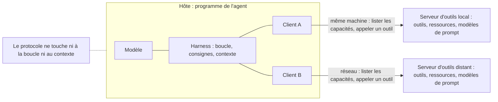

# Chapitre 6 — Des outils écrits pour un modèle : contrat, erreurs et protocole MCP

Dans ce chapitre, vous verrez pourquoi un outil destiné à un agent se conçoit autrement qu'une interface de programmation exposée telle quelle. Vous apprendrez à choisir sa granularité, à faire découvrir les données à la demande, à rédiger ses résultats et ses messages d'erreur, et à limiter le nombre d'outils. Vous verrez enfin ce que le Model Context Protocol (MCP) apporte lorsque les outils quittent le programme de l'agent.

Ce chapitre et le suivant achèvent la partie II en examinant ce que l'agent peut effectivement faire. Ses capacités réelles tiennent à trois choses : les opérations que le *harness* lui expose, le contrat de chacune, et l'autorisation de l'exécuter au nom d'une personne. Ce chapitre traite des opérations et de leur contrat, le chapitre 7 de l'autorisation.

## Des questions que trois outils ne couvrent plus

L'éditeur du fil rouge veut ouvrir le service aux acheteurs et aux comptables. Le même agent recevra alors leurs questions. Une comptable demande : « Quelles factures de ce fournisseur attendent une validation ? » Un acheteur veut le montant moyen des demandes d'achat de son service. Un autre cherche les demandes créées le mois dernier par un collègue dont il donne le prénom. Un contrôleur de gestion, rattaché à la comptabilité, voudrait la répartition des montants facturés par fournisseur et par mois.

Les trois outils hérités des chapitres 4 et 5 ne répondent à aucune de ces demandes. Vous pourriez écrire un outil par question, mais la liste des questions possibles n'a pas de fin prévisible. Il reste à voir comment concevoir un outil pour qu'un modèle s'en serve bien, et combien il en faut.

## Un lecteur particulier : le modèle

Une interface de programmation s'adresse à un développeur. Il lit la documentation, essaie, corrige, puis fige son appel. Le modèle, lui, relit la définition de l'outil à chaque cycle. Il ne connaît de l'outil que ce texte, et il rédige son appel en une passe, au milieu d'une conversation.

Les travaux sur l'usage des outils montrent le poids de ce texte. Sur les tâches étudiées, la seule documentation d'un outil permet à un modèle de l'utiliser correctement, sans exemples d'appels (Hsieh et al., 2023). Des descriptions hétérogènes, redondantes ou incomplètes nuisent à l'usage ; les réécrire en instructions concises et uniformes réduit les *tokens* consommés et améliore les résultats dans les expériences rapportées (Yuan et al., 2024). Les erreurs ont des formes reconnaissables, comme des arguments inexacts ; un modèle entraîné à écrire des appels d'interfaces les atténue nettement (Patil et al., 2023).

Exposer telle quelle une interface existante suffit donc rarement. Elle attend des identifiants techniques que l'utilisateur ignore, renvoie des codes internes et livre l'enregistrement entier là où deux champs suffisaient. Reprenez chacun de ces points du point de vue du modèle : ce qu'il sait au moment d'appeler, ce qu'il doit comprendre du résultat, ce qu'il fera ensuite.

> **Point clé**
>
> La définition d'un outil se rédige et se maintient comme un texte de consignes. Vous jugez sa qualité aux appels que le modèle rédige à partir d'elle.

## Granularité : outils spécialisés ou outils génériques

Un **outil spécialisé** répond à une question métier. Il a peu de paramètres, et sa logique est écrite par le concepteur. Le modèle a peu d'occasions de se tromper, mais chaque nouvelle question demande un nouvel outil.

Un **outil générique** interroge une source de données quelconque. Le modèle indique la source, les filtres, les champs, le tri, un éventuel agrégat. Un seul outil couvre des questions imprévues, mais la composition de la requête repose sur le modèle, et cette tâche est difficile. Les bancs d'essai de traduction d'une question en requête de base de données le montrent : les premiers modèles évalués généralisaient mal à des bases inconnues (Yu et al., 2018), et la connaissance des valeurs réellement présentes dans les données conditionne l'exactitude de la requête (Li et al., 2023).

Ces travaux portent sur des requêtes complètes en texte libre. Vous pouvez réduire la difficulté de deux façons : remplacer le texte libre par des paramètres structurés que le programme valide un à un, et placer dans la description quelques exemples tirés des questions fréquentes, comme la manière d'exprimer « en retard » ou « en attente de validation ». Le tableau 6-1 compare les deux approches.

*Tableau 6-1 — Outil spécialisé et outil générique*

| | Outil spécialisé | Outil générique avec exemples |
|---|---|---|
| Questions couvertes | Celles qui ont été prévues | Aussi des questions imprévues |
| Logique métier | Écrite dans l'outil | Composée par le modèle, guidée par la description |
| Risque principal | Catalogue qui grossit | Requêtes mal formées ou mal ciblées |
| Maintenance | Du code par question | Une description à tenir à jour |

Un outil spécialisé peut souvent céder la place à quelques exemples bien choisis.

> **Sur le terrain**
>
> Quand un outil spécialisé ne sert qu'à un calcul précis, essayez d'abord de le remplacer par deux ou trois exemples de filtres dans la description de l'outil générique. Le catalogue reste court, et le modèle apprend la formulation métier au lieu de choisir entre deux outils voisins.

Reste à doser ces exemples, ce que les travaux disponibles ne permettent pas de faire avec précision.

> **Attention — Zone d'incertitude**
>
> Le dosage des exemples reste empirique. Des démonstrations mal choisies peuvent orienter l'usage d'un outil dans une direction indésirable, et le même travail plaide pour la documentation de préférence aux démonstrations (Hsieh et al., 2023). Vérifiez qu'un exemple n'est pas imité hors de son cas.

## Faire découvrir la structure des données

Un outil générique suppose que le modèle connaisse la structure des données. L'inscrire dans le *system prompt* la ferait relire à chaque appel, alors qu'une demande n'en utilise qu'une fraction. Faites-la plutôt découvrir à la demande : un outil liste les sources accessibles, avec une ligne de description pour chacune, et un autre décrit une source donnée. Ces deux outils de découverte appliquent un principe que le chapitre 9 généralise à tout le contexte : la **divulgation progressive**.

Cette description porte ce dont le modèle a besoin pour écrire un filtre juste :

- **Les champs** : leur nom exact et une explication en termes métier.
- **Les relations** : les sources voisines qui se rattachent à celle-ci, et par quel champ.
- **Les valeurs des champs codés** : les valeurs possibles d'un statut ou d'un type de document, avec leur signification. Sans elles, le modèle écrit « en attente » là où la donnée contient un code, et la requête ne renvoie rien (Li et al., 2023).

La même attention vaut au retour. Un résultat qui affiche des codes internes oblige le modèle à les traduire, parfois de travers. Renvoyez chaque valeur avec son libellé métier, dans la langue de l'utilisateur quand l'application en dispose, en gardant la valeur interrogeable pour les filtres suivants.

## Résoudre les noms approximatifs

L'utilisateur désigne un fournisseur ou un collègue par son nom ; les données le désignent par un identifiant, et le nom enregistré diffère souvent de celui que l'on tape. Sans aide, le modèle filtre sur le nom reçu et ne trouve rien, ou propose un identifiant plausible.

Un outil de **résolution de noms** prend en charge cette étape. Il reçoit un nom et un type d'objet, effectue la comparaison approchée dans le programme, où elle est reproductible, et renvoie les candidats avec leur identifiant et de quoi les distinguer. Le modèle poursuit avec l'identifiant s'il n'y a qu'un candidat, demande une précision s'il y en a plusieurs (chapitre 5), et annonce l'absence de résultat sinon. L'outil généralise le rapprochement du chapitre 4 : recherche exacte d'abord, recherche par proximité ensuite, et un résultat qui dit laquelle a abouti.

## Rédiger le résultat d'un outil

Le résultat d'un outil est lu par le modèle, puis reste dans le contexte. Réglez sa pertinence à la source : renvoyez les champs demandés, ou un petit jeu de champs utiles, plutôt que l'enregistrement complet. Sa taille compte aussi ; le chapitre 9 montre comment la borner sans fausser ce que le modèle en comprend. Les agrégats simples, comme un décompte, un total ou une moyenne, sont calculés par le système interrogé sur l'ensemble filtré. Le montant moyen des demandes d'achat d'un service relève de ce cas.

La lisibilité tient à des détails. Un montant sans devise, une date sans format ou une colonne au nom abrégé laissent le modèle supposer. Une structure stable d'un appel à l'autre lui évite de réapprendre à lire. Un identifiant renvoyé avec chaque ligne lui permet de demander le détail au cycle suivant.

## Les messages d'erreur comme guide

Avec un outil générique, les erreurs deviennent ordinaires : une source mal nommée, un champ inexistant, un filtre mal construit. Le chapitre 5 a montré qu'un message muet fait répéter le même appel. Le message d'erreur est le principal élément dont le modèle dispose pour décider de la suite.

Un message utile dit ce qui a été refusé, pourquoi, et ce qui serait accepté. Pour une source inconnue, il cite les noms les plus proches ; pour un champ inconnu, il rappelle les champs de la source ; pour un filtre mal formé, il indique la forme attendue. Le programme peut absorber lui-même un écart sans conséquence, comme une différence de casse, sans jamais accepter un champ inventé.

Distinguez aussi les erreurs selon ce que le modèle peut en faire. Des paramètres invalides appellent une reformulation. Un service indisponible appelle un message à l'utilisateur plutôt qu'une série de nouvelles tentatives. Dans tous les cas, l'échec porte un statut explicite, pour ne pas être lu comme un résultat vide.

> **Sur le terrain**
>
> Quand le programme corrige lui-même un écart, comme la casse d'un nom de champ, faites figurer le nom corrigé dans le résultat. Sinon, le modèle répète l'erreur au cycle suivant, et chaque appel passe par la même correction silencieuse.

## Limiter le nombre d'outils et les nommer

Chaque outil ajouté pèse sur la fenêtre, puisque sa définition est transmise à chaque appel. Il pèse aussi sur la décision : des outils aux descriptions voisines sont difficiles à départager, et le modèle peut choisir le mauvais sans qu'aucune erreur ne le signale. Un travail propose de ne présenter que les descriptions pertinentes pour la demande, sélectionnées par une recherche préalable ; ses auteurs rapportent un *prompt* réduit et une sélection plus exacte (Gan et Sun, 2025). La technique de recherche est celle que le chapitre 12 présente pour les documents.

Avant d'en arriver là, trois mesures simples limitent le problème :

- Retirez les outils que personne n'appelle.
- Fusionnez ceux qui ne diffèrent que par un paramètre.
- Vérifiez que chaque description dit aussi dans quels cas l'outil ne convient pas.

Lorsque des outils d'origines différentes sont réunis, deux d'entre eux peuvent porter le même nom. Une **convention de nommage** qui préfixe chaque outil par son domaine évite la collision et aide le modèle à situer l'outil. Le nom devient alors un élément de contrat.

> **Sur le terrain**
>
> Avant de changer une convention de nommage, recherchez chaque ancien nom dans les consignes, les exemples d'usage, les libellés d'étapes affichés à l'utilisateur et les scénarios de test. Ce sont ces citations dispersées, plus que les outils eux-mêmes, qui cassent au moment du changement.

La généralité d'un outil appelle enfin une précaution avant son ouverture à tous.

> **Attention**
>
> Un outil très général peut faire davantage que ce que vous aviez en tête. Avant de l'exposer à tous les utilisateurs, examinez ce qu'il permet dans le pire des cas ; le chapitre 7 reprend cette question sous l'angle des droits et de l'environnement d'exécution.

Reste une question que le fil rouge pose déjà : une autre application de l'éditeur voudrait proposer les mêmes consultations, sans la boucle ni les consignes de l'agent. Le contrat d'outil que vous venez de concevoir doit alors servir deux programmes. Où ces outils doivent-ils vivre ?

## Sortir les outils du programme : le Model Context Protocol

Jusqu'ici, les outils du fil rouge s'exécutent dans le programme de l'agent. Cette organisation devient coûteuse dès que plusieurs applications veulent accéder aux mêmes systèmes : chacune doit écrire, pour chaque système, la description de l'outil, l'authentification et la mise en forme du résultat, et les copies finissent par diverger. Une synthèse sur les protocoles d'interopérabilité relève que ces intégrations au cas par cas sont difficiles à étendre et à sécuriser (Ehtesham et al., 2025).

Le **Model Context Protocol** (MCP) est un protocole ouvert qui normalise la manière dont une application construite autour d'un modèle découvre et utilise des capacités fournies par d'autres programmes. Une étude le présente comme un standard émergent de découverte dynamique entre modèles et outils externes (Hou et al., 2025). Le système qui détient les données les expose une fois ; toute application qui parle le protocole peut en lister les capacités, lire leurs descriptions et demander leur exécution. Le protocole ne prescrit ni la boucle, ni les consignes, ni la composition du contexte : ces décisions restent au *harness*.

Le protocole distingue trois rôles, que représente la figure 6-1 :

- **L'hôte (*host*)** : l'application construite autour du modèle ; dans le fil rouge, le programme de l'agent.
- **Le client** : le composant de l'hôte qui entretient la liaison avec un serveur donné ; l'hôte en crée un par serveur.
- **Le serveur** : le programme qui annonce des capacités et exécute ce qu'on lui demande. Il peut tourner sur la même machine que l'hôte ou être joint par le réseau ; seul change le transport, c'est-à-dire le canal qui achemine les messages.

*Figure 6-1 — Les rôles du protocole MCP*

*Description du schéma :* à gauche, un grand cadre « hôte : programme de l'agent », qui contient le bloc « modèle », le bloc « *harness* : boucle, consignes, contexte » et deux petits blocs « client A » et « client B ». Chaque client est relié à un serveur situé à droite : « serveur d'outils local », par une liaison étiquetée « même machine », et « serveur d'outils distant », par une liaison étiquetée « réseau ». Chaque serveur annonce trois natures de capacités : « outils », « ressources », « modèles de *prompt* ». Sur chaque liaison transitent deux échanges : « lister les capacités » et « appeler un outil, recevoir le résultat ». Une note rattachée à l'hôte rappelle que le protocole ne touche ni à la boucle ni au contexte.

Avec un serveur, le *harness* reçoit toujours la demande d'appel du modèle, vérifie qu'elle désigne un outil annoncé, puis la transmet par le client ; le serveur valide les paramètres, exécute et renvoie le résultat. Les outils se découvrent par une demande de liste, puis s'utilisent par une demande ciblée. La définition qu'un serveur annonce est le texte que le modèle lira : tout ce que ce chapitre dit de sa rédaction s'y applique.

Un serveur peut aussi proposer deux autres natures de capacités, dont l'emploi n'est pas décidé par le modèle : des **ressources**, données à lire que l'hôte choisit de placer dans le contexte, et des **modèles de *prompt***, trames d'instructions que l'utilisateur déclenche le plus souvent depuis l'interface. Le fil rouge n'emploie que les outils.

## Séparer l'agent et ses outils : gains et coûts

Sortir les outils du programme se justifie surtout lorsque plusieurs applications les partagent. Les outils existent en un seul exemplaire, et le serveur peut s'exécuter avec ses propres droits, ce que le chapitre 7 mettra à profit.

En contrepartie, chaque appel d'outil traverse le réseau, ce qui ajoute un délai et une cause de panne. Le *harness* doit signaler au modèle qu'un outil n'a pas répondu, et éviter qu'une liste d'outils à moitié chargée passe pour complète. Une modification de la définition d'un outil doit aussi rester compatible avec les agents qui l'utilisent déjà.

Un serveur distant doit enfin décider de ce qu'il retient entre deux requêtes. Dans un échange **avec état**, il ouvre une session et y conserve des informations, comme le contexte d'authentification ; les requêtes suivantes s'y rapportent par un identifiant. Dans un échange **sans état**, chaque requête porte tout ce qu'il faut pour la traiter. Le second simplifie le fonctionnement lorsque le serveur tourne en plusieurs exemplaires, puisque n'importe lequel peut répondre ; en échange, chaque requête transporte de nouveau son contexte, dont l'authentification, que le serveur vérifie à chaque fois.

Une question surgit dès que l'outil quitte le programme : au nom de qui le serveur interroge-t-il l'application ? Un serveur partagé doit y répondre à chaque appel, et la réponse décide de ce qu'un utilisateur peut obtenir par la conversation. Le chapitre 7 la tranche en premier.

## Ce que le protocole ne garantit pas

Un protocole commun facilite le branchement d'un serveur, pas la qualité de ses outils. Un serveur peut annoncer des descriptions vagues, des résultats volumineux ou des erreurs muettes, et le coût d'un grand nombre de descriptions (Gan et Sun, 2025) augmente quand vous connectez des serveurs entiers.

La confiance à accorder à un serveur reste aussi à établir. Ses descriptions et ses résultats entrent dans le contexte, comme les contenus évoqués au chapitre 4 à propos de l'injection de *prompt* indirecte (Greshake et al., 2023). Une étude de serveurs publiés en source ouverte relève des vulnérabilités propres au protocole, dont l'empoisonnement d'outils (*tool poisoning*) (Hasan et al., 2025). Un audit montre que des modèles peuvent être amenés à employer de tels outils pour compromettre le système de leur utilisateur, par exemple en dérobant des identifiants (Radosevich et Halloran, 2025). Traitez les descriptions et les résultats d'un serveur tiers comme des contenus non fiables ; le chapitre 14 y revient.

> **Attention — Zone d'incertitude**
>
> Le protocole évolue vite, et une fonction sur laquelle vous vous appuyez peut être dépréciée, puis retirée. La révision de la spécification consultée pour ce chapitre, datée du 28 juillet 2026, classe ainsi parmi les fonctions dépréciées, à la suite de la proposition d'évolution SEP-2577, celle par laquelle un serveur demande une génération de texte au modèle du client. Dépendez surtout de l'annonce et de l'appel des outils, et revérifiez le reste à chaque nouvelle version.

## Ateliers 6a et 6b — Le serveur d'outils MCP et les regroupements

Le chapitre réunit deux décisions, que vous réaliserez en deux ateliers successifs, chacun avec son critère de réussite : le contrat des outils du fil rouge et leur emplacement (6a), puis les regroupements demandés par le contrôleur de gestion (6b). Le tableau 6-2 fait le bilan des deux.

### Atelier 6a — Le serveur d'outils MCP

#### La décision à prendre

L'agent reçoit des questions d'acheteurs et de comptables que ses outils ne couvrent pas. Faut-il un outil par question métier, ou quelques outils génériques ? Une autre application de l'éditeur voudrait en outre proposer les mêmes consultations, sans la boucle ni les consignes de l'agent : où ces outils doivent-ils vivre ?

#### Les options

Deux questions se posent, chacune avec ses options. Pour le contrat :

- **Un outil par question métier.** Sa logique est écrite d'avance.
- **Des outils génériques seuls.** Le modèle compose toutes les requêtes.
- **Des outils génériques guidés par des exemples, et quelques outils spécialisés.** Les outils spécialisés couvrent les questions les plus fréquentes.

Pour l'emplacement :

- **Dans le programme de l'agent.** L'autre application écrit sa propre copie.
- **Une bibliothèque partagée.** Chaque application l'embarque.
- **Un serveur d'outils dédié.** Il est joint par un protocole standard, avec ou sans état.

#### Le choix retenu et son coût

Pour le contrat, l'équipe retient des outils génériques guidés par des exemples, et quelques outils spécialisés :

- La consultation d'une commande, question la plus fréquente, garde son outil spécialisé.
- L'outil qui listait les commandes d'un client devient un outil d'interrogation générique, qui calcule des agrégats simples (décompte, total, moyenne). Sa description donne des exemples de filtres pour chaque métier.
- La recherche d'un client devient une résolution de noms pour les clients, les fournisseurs et les utilisateurs.
- Deux outils de découverte listent les sources et décrivent chacune, avec ses champs, ses relations et ses valeurs codées.
- Les messages d'erreur indiquent quoi corriger, et les valeurs reviennent avec leur libellé métier.
- Une convention de nommage préfixe chaque outil par son domaine.
- Le *system prompt* est élargi aux achats et aux factures, sans recopier la structure des données.

Pour l'emplacement, les cinq outils passent dans un serveur d'outils dédié, exposé par MCP, en échanges sans état. La bibliothèque partagée est écartée : l'autre application devrait adopter la même technologie que l'agent. La boucle, les consignes, le contexte et la limite de cycles restent dans le *harness*. Le serveur reçoit la définition des outils, la validation des paramètres, la normalisation des résultats et les messages d'erreur. Il n'est ouvert aux utilisateurs qu'une fois réglée l'identité sous laquelle il interroge l'application.

L'agent consomme désormais des cycles pour s'orienter, et certaines requêtes sont mal formées au premier essai. La description de l'outil d'interrogation devient un texte à maintenir comme les consignes : un exemple ajouté pour un métier peut changer le comportement sur un autre. Chaque appel d'outil ajoute un appel réseau, et l'agent dépend d'un protocole qui évolue. Enfin, rien ne borne encore ce qu'une interrogation fait entrer dans le contexte : le chapitre 9 s'en charge.

#### Le critère de réussite

Vos outils de lecture sont servis par votre serveur MCP, construit à partir du serveur vide du dépôt compagnon, sans état ; l'agent n'appelle plus l'application directement. Deux clients distincts obtiennent le même catalogue d'outils, d'où les deux outils remplacés ont disparu. Un filtre mal formé reçoit une erreur qui dit quoi corriger, et les valeurs reviennent avec leur libellé métier. Une question simple d'acheteur ou de comptable aboutit par l'outil d'interrogation générique. Les tests de bout en bout de cet atelier se trouvent dans le dossier *workshops/09-mcp/tests/* du dépôt compagnon.

### Atelier 6b — Les regroupements

#### La décision à prendre

Le contrôleur de gestion demande la répartition des montants facturés par fournisseur et par mois, ce que l'outil d'interrogation ne sait pas produire : il calcule des agrégats sur un ensemble filtré, pas par groupe. Comment l'agent doit-il répondre à cette demande ?

#### Les options

Trois options se présentent.

- **Laisser le modèle calculer.** Il travaille à partir des lignes lues, sans garantie qu'elles soient toutes là ni qu'il les compte juste.
- **Offrir un outil d'exécution de code.** Le modèle rédige le calcul, exécuté dans une *sandbox* dédiée ; le chapitre 7 examine ce que cette voie suppose.
- **Étendre l'outil d'interrogation aux regroupements.** Le calcul reste confié au système interrogé, avec les mêmes droits.

#### Le choix retenu et son coût

Le fil rouge n'exécute pas de code produit par le modèle : les demandes connues portent sur des agrégats par groupe que le système interrogé sait calculer. L'équipe retient donc l'extension de l'outil d'interrogation aux regroupements, calculés par le système interrogé. Certaines analyses restent hors de portée, comme une médiane ; l'agent le dit et propose les agrégats disponibles.

#### Le critère de réussite

Une question de regroupement est calculée par l'outil d'interrogation. Aucun code produit par le modèle n'est exécuté. À une demande de médiane, l'agent répond qu'il ne peut pas la calculer et propose les agrégats disponibles. Les tests de bout en bout de cet atelier se trouvent dans le dossier *workshops/10c-groupings/tests/* du dépôt compagnon.

### L'état de l'agent

Le tableau 6-2 indique ce qui change par rapport au chapitre 5.

*Tableau 6-2 — Ce qui change dans l'agent au chapitre 6*

| Composant | Changement |
|---|---|
| Consignes | *System prompt* élargi aux achats et aux factures |
| Outils | Cinq outils de lecture, nommés par domaine : consulter une commande ; résoudre un nom ; lister les sources ; décrire une source ; interroger une source (filtres, agrégats simples, regroupements) |
| Outils remplacés | Lister les commandes d'un client, par l'outil d'interrogation ; rechercher un client, par la résolution de noms |
| Emplacement des outils | Un serveur d'outils dédié, joint par MCP, sans état |
| Contrôles | Messages d'erreur indiquant la correction ; valeurs renvoyées avec leur libellé métier ; aucune exécution de code produit par le modèle |
| Contexte | Structure des données découverte à la demande |

## Ce qu'il faut retenir

Six idées résument ce chapitre.

- Le modèle ne connaît d'un outil que sa définition : rédigez-la et vérifiez-la comme des consignes.
- Un outil spécialisé est prévisible et étroit ; un outil générique couvre l'imprévu et confie la requête au modèle, que des exemples peuvent guider.
- La structure des données se découvre à la demande, et la résolution des noms revient à un outil.
- Un message d'erreur dit ce qui a été refusé et ce qui serait accepté.
- Chaque outil ajouté coûte du contexte et complique le choix.
- MCP sépare l'hôte, ses clients et des serveurs qui annoncent leurs capacités ; il ne garantit ni la qualité des outils, ni la confiance à accorder à un serveur.

Le serveur d'outils attend de savoir au nom de qui il interroge l'application, et les acheteurs demandent déjà à créer des demandes d'achat depuis la conversation. Le chapitre 7 examine le droit d'agir : l'identité, les permissions, la validation humaine et le confinement.

## Références

Les travaux cités dans ce chapitre sont les suivants.

- Ehtesham, A., Singh, A., Gupta, G. K., et Kumar, S. (2025). *A survey of agent interoperability protocols: Model Context Protocol (MCP), Agent Communication Protocol (ACP), Agent-to-Agent Protocol (A2A), and Agent Network Protocol (ANP)*. arXiv:2505.02279.
- Gan, T., et Sun, Q. (2025). *RAG-MCP: Mitigating Prompt Bloat in LLM Tool Selection via Retrieval-Augmented Generation*. arXiv:2505.03275.
- Greshake, K., Abdelnabi, S., Mishra, S., et al. (2023). *Not what you've signed up for: Compromising Real-World LLM-Integrated Applications with Indirect Prompt Injection*. arXiv:2302.12173.
- Hasan, M. M., Li, H., Fallahzadeh, E., et al. (2025). *Model Context Protocol (MCP) at First Glance: Studying the Security and Maintainability of MCP Servers*. arXiv:2506.13538.
- Hou, X., Zhao, Y., Wang, S., et Wang, H. (2025). *Model Context Protocol (MCP): Landscape, Security Threats, and Future Research Directions*. arXiv:2503.23278.
- Hsieh, C.-Y., Chen, S.-A., Li, C.-L., et al. (2023). *Tool Documentation Enables Zero-Shot Tool-Usage with Large Language Models*. arXiv:2308.00675.
- Li, J., Hui, B., Qu, G., et al. (2023). *Can LLM Already Serve as A Database Interface? A BIg Bench for Large-Scale Database Grounded Text-to-SQLs*. arXiv:2305.03111.
- Model Context Protocol. *Spécification et documentation publiques*. modelcontextprotocol.io.
- Patil, S. G., Zhang, T., Wang, X., et Gonzalez, J. E. (2023). *Gorilla: Large Language Model Connected with Massive APIs*. arXiv:2305.15334.
- Radosevich, B., et Halloran, J. (2025). *MCP Safety Audit: LLMs with the Model Context Protocol Allow Major Security Exploits*. arXiv:2504.03767.
- Yu, T., Zhang, R., Yang, K., et al. (2018). *Spider: A Large-Scale Human-Labeled Dataset for Complex and Cross-Domain Semantic Parsing and Text-to-SQL Task*. arXiv:1809.08887.
- Yuan, S., Song, K., Chen, J., et al. (2024). *EASYTOOL: Enhancing LLM-based Agents with Concise Tool Instruction*. arXiv:2401.06201.
