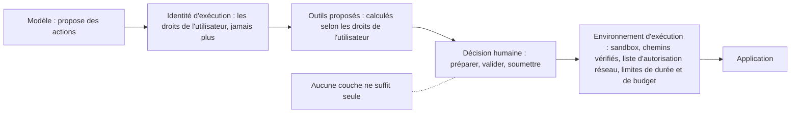

# Chapitre 7 — Le droit d'agir : identité, validation humaine et confinement

Dans ce chapitre, vous verrez comment décider de ce qu'un agent peut faire seul, de ce qu'il doit faire valider et de ce qui lui est interdit. Vous apprendrez à le faire agir avec les droits de la personne qu'il sert, sans qu'un utilisateur reçoive ce qui a été calculé pour un autre, à organiser une écriture pour que l'utilisateur en garde la décision, et à borner son environnement d'exécution.

## Quand une erreur de l'agent modifie l'application

À la fin du chapitre 6, le serveur d'outils attend de savoir au nom de qui il interroge l'application. Les demandes, elles, n'attendent pas. Les acheteurs veulent créer une demande d'achat depuis la conversation, les comptables approuver une facture qu'ils viennent d'examiner.

Jusqu'ici, une erreur de l'agent produisait une réponse fausse, que l'utilisateur pouvait écarter. Avec un outil d'écriture, la même erreur, comme un fournisseur retenu parmi deux homonymes, laisse un effet dans l'application. Des travaux qui testent des agents dotés d'outils sur des scénarios à enjeux relèvent de nombreux échecs aux conséquences potentiellement graves (Ruan et al., 2023). Une analyse des préjudices liés aux systèmes agentiques compte la sous-spécification des demandes et le caractère direct de l'impact parmi les facteurs de risque (Chan et al., 2023). Une demande en langage naturel est rarement complète ; un outil d'écriture donne à son interprétation un effet direct.

## Le moindre privilège appliqué à un agent

Le **principe du moindre privilège** (*least privilege*) veut que chaque programme et chaque utilisateur opère avec le plus petit ensemble de droits qui lui permette d'accomplir sa tâche (Saltzer et Schroeder, 1975). Un agent y ajoute une particularité : le composant qui choisit l'action est un modèle dont la sortie dépend de tout le texte de son contexte, y compris de textes écrits par des tiers (chapitres 4 et 14). Raisonnez donc sur ce que l'agent est en mesure de faire, quelle que soit l'intention que vous lui prêtez.

Le principe s'applique à quatre couches, que représente la figure 7-1 : l'identité sous laquelle chaque outil s'exécute, les outils proposés au modèle, le moment où une personne décide, et l'environnement d'exécution. Aucune ne suffit seule. Une liste d'outils restreinte ne protège pas un outil exécuté avec des droits étendus, et des droits bien réglés ne protègent pas un processus qui peut joindre n'importe quelle adresse.

*Figure 7-1 — Les quatre couches du moindre privilège*

*Description du schéma :* à gauche, un bloc « modèle : propose des actions » ; à droite, le bloc « application ». La flèche qui les relie traverse quatre couches, dans l'ordre : « identité d'exécution : les droits de l'utilisateur, jamais plus », « outils proposés, calculés selon les droits de l'utilisateur », « décision humaine : préparer, valider, soumettre », « environnement d'exécution : *sandbox*, chemins vérifiés, liste d'autorisation réseau, limites de durée et de budget ». Une note précise qu'aucune couche ne suffit seule.

## Au nom de qui l'outil agit-il ?

Une première réponse consiste à doter le serveur d'outils d'un compte de service aux droits étendus, chaque outil filtrant ce que l'utilisateur peut voir. Cette solution duplique dans le serveur des règles que l'application applique déjà, et les deux versions finissent par diverger. Un seul filtre oublié suffit : l'utilisateur obtient par la conversation ce que les écrans lui refusent.

La seconde réponse transmet l'identité de l'utilisateur jusqu'au serveur, qui interroge l'application avec les droits de cette personne. Les règles de droits restent à un seul endroit, et un outil appelé à tort ne renvoie que ce que l'utilisateur aurait pu consulter lui-même. Vérifiez cependant, outil par outil, que ces règles sont portées par l'interface que les outils appellent : une règle qui n'existe que dans un écran, comme un bouton désactivé, ne protège pas un appel qui ne passe pas par cet écran. Les choix proposés par l'agent, comme une catégorie d'achat ou un lieu de livraison, se lisent eux aussi dans l'application, avec les droits de l'utilisateur.

Pour les serveurs distants, la spécification de MCP décrit un cadre d'autorisation fondé sur OAuth 2.1, un standard de délégation d'accès : le client obtient un jeton d'accès et le présente avec chaque requête (Model Context Protocol, 2026). Un serveur qui interroge à son tour un autre système ne lui présente pas le jeton reçu : il en obtient un distinct, émis pour ce système, par exemple par un échange de jetons (*token exchange*). Chaque maillon vérifie ce qu'il reçoit.

Les droits de l'utilisateur sont un plafond, que rien n'oblige à atteindre. Des travaux proposent un cadre de délégation authentifiée et auditable, dans lequel une personne délègue à un agent une autorité restreinte en permissions et en périmètre (South et al., 2025).

> **Attention**
>
> Les recommandations de sécurité publiées avec la spécification mettent en garde contre un serveur qui relaierait tel quel un jeton émis pour un autre destinataire. Aucun jeton ne doit entrer dans le contexte du modèle. Et l'agent ne doit jamais disposer de droits supérieurs à ceux de la personne qu'il sert.

Ces règles se vérifient outil par outil, avec des comptes aux droits différents.

> **Sur le terrain**
>
> Pour chaque nouvel outil, faites un essai avec le compte le plus restreint de l'application. C'est le moyen le plus rapide de découvrir une règle de droit qui n'existait que dans un écran, et que l'outil contourne sans le savoir.

## Attribuer l'action à l'agent

Si l'agent agit avec l'identité de l'utilisateur, l'application enregistre l'action comme faite par l'utilisateur. Le journal ne distingue plus une demande saisie à la main d'une demande préparée par l'agent. L'action porte donc une double indication : la personne dont les droits ont été utilisés, et l'agent qui a agi pour son compte. Les mesures de gouvernance étudiées pour savoir par qui et comment un agent est utilisé comprennent des identifiants d'agent et des journaux d'activité, avec des conséquences pour la vie privée (Chan et al., 2024).

> **Sur le terrain**
>
> Faites transmettre le nom de l'agent jusqu'au journal de l'application, et pas seulement jusqu'au serveur d'outils. C'est dans ce journal que les équipes de l'application cherchent qui a agi ; elles ne consultent pas les traces de l'agent.

## Ne proposer que les outils permis

Tous les outils que l'application accepterait n'ont pas à figurer dans chaque conversation. Le *harness* peut calculer, au début de la conversation, la liste des outils éligibles d'après les droits de l'utilisateur. Cette restriction allège le contexte et évite au modèle de proposer ce qui échouerait. Elle ne constitue pas une permission : le serveur d'outils doit lui aussi refuser l'appel d'un outil hors du périmètre de l'utilisateur.

## Cloisonner les données entre utilisateurs et entre organisations

Agir avec les droits de l'utilisateur ne suffit pas si un résultat calculé pour lui est servi à un autre. Le serveur d'outils conserve des résultats intermédiaires, comme la structure des données accessibles ou l'identité résolue. Un **cache** conserve un résultat pour éviter de le recalculer ; si sa clé ne mentionne pas l'identité alors que le contenu dépend des droits, il peut servir à un utilisateur ce qui a été calculé pour un autre. Tout ce qui survit à un appel se cloisonne donc par organisation et par utilisateur, et les opérations sur le cache sont authentifiées. Les informations techniques jointes aux réponses, comme des chemins internes, n'ont à parvenir ni au client ni au contexte.

> **Sur le terrain**
>
> Pour chaque outil qui passe par un cache, écrivez un test qui l'appelle successivement avec deux utilisateurs aux droits différents et vérifie que le second ne reçoit pas le résultat du premier. C'est le moyen le plus sûr de repérer une clé incomplète avant qu'un utilisateur ne la découvre.

## Préparer, valider, soumettre

Si le modèle dispose d'un outil qui crée directement la demande d'achat, la création a lieu dès que l'appel est émis ; l'utilisateur découvre le document après coup. Séparer l'action en trois temps lui rend la décision :

1. **Préparer.** L'agent appelle un outil qui construit un brouillon. Ce brouillon n'a aucun effet dans l'application.
2. **Valider.** L'interface présente un récapitulatif du brouillon. L'utilisateur confirme, corrige ou abandonne.
3. **Soumettre.** Après confirmation, le *harness* soumet le brouillon à l'application.

Si le modèle rédigeait le récapitulatif, celui-ci pourrait différer de ce qui sera soumis. Le *harness* le construit donc à partir du brouillon et soumet exactement ce qui a été montré ; toute modification demande une nouvelle confirmation. Un « oui » écrit dans la conversation entre dans le contexte comme n'importe quel texte : le modèle peut le rattacher à la mauvaise question, et un texte venu d'ailleurs pourrait l'imiter. Un geste dans l'interface, lui, parvient au *harness* sans passer par le modèle, et la soumission ne figure pas parmi les outils que le modèle peut demander.

> **Sur le terrain**
>
> Réservez la soumission au *harness* même quand l'application sait distinguer un brouillon d'un document prêt. Sinon, l'outil de préparation finit tôt ou tard par recevoir une option « soumettre directement », ajoutée pour gagner un clic, et la frontière disparaît.

## Dire à l'utilisateur ce que l'agent sait faire

Le récapitulatif n'est pas la seule chose que l'utilisateur doit pouvoir lire. Il doit savoir qu'il s'adresse à un programme ; dans le fil rouge, l'agent est présenté comme tel. Il doit aussi savoir ce que le système sait faire. Un modèle formule parfois une offre de service, comme « vous serez prévenu dès que la facture sera débloquée ». L'agent du fil rouge ne peut ni surveiller un enregistrement ni écrire à quiconque, et l'utilisateur attend un effet qui n'aura pas lieu. Des recommandations de conception demandent de rendre clair ce que le système peut faire et avec quelle fiabilité (Amershi et al., 2019). Pour un agent, cela se traduit dans les consignes par ses limites réelles et la voie vers laquelle orienter l'utilisateur.

## Quand exiger une validation humaine

La **validation humaine** (*human-in-the-loop*) suspend une action jusqu'à la décision d'une personne. Exiger une validation pour tout rendrait l'agent pénible ; n'en exiger aucune laisserait au modèle la décision d'écrire. Comme au chapitre 5, la position retenue sur le continuum d'autonomie peut varier selon la famille de demandes (Feng et al., 2025). La pratique courante classe les actions selon leur effet, comme le montre le tableau 7-1.

*Tableau 7-1 — La validation selon l'effet de l'action*

| Action | Exemple | Validation |
|---|---|---|
| Lecture | Consulter une facture | Aucune, dans les droits de l'utilisateur |
| Préparation sans effet | Construire un brouillon | Aucune ; le brouillon est montré |
| Écriture réversible | Créer une demande d'achat | Confirmation sur récapitulatif |
| Écriture difficile à défaire | Approuver une facture | Confirmation systématique, sans dispense |
| Action hors du périmètre | Modifier des coordonnées bancaires | Aucun outil ; l'agent le dit |

La réversibilité se vérifie auprès du système cible : une facture approuvée peut déclencher un paiement, et une action annulable à l'écran peut avoir déjà déclenché un traitement en aval. Quand vous avez le choix, donnez à l'agent la forme la plus réversible de l'action ; pour une action irréversible, le récapitulatif le dit.

Une validation n'a de valeur que si la personne dispose de quoi juger et lit ce qu'on lui montre. La **fatigue d'approbation** apparaît quand les demandes de confirmation sont fréquentes : l'utilisateur finit par accepter sans lire. Réservez la confirmation aux actions qui modifient un système, et regroupez en un seul récapitulatif ce qui forme une même action. Une dispense du type « ne plus me demander » peut se concevoir pour une écriture réversible et de faible portée, jamais pour une action difficile à défaire. Ces règles relèvent de la pratique courante : la fréquence à partir de laquelle l'attention baisse n'est pas établie pour les agents conversationnels.

Une confirmation ne vaut que par ce que la personne a pu examiner. Imaginez qu'une comptable approuve, sur proposition de l'agent, une facture qui faisait double emploi avec une autre, déjà réglée. Aucun composant n'a failli : le récapitulatif était exact, la confirmation a eu lieu, l'action est attribuée. La comptable a confirmé parce que l'agent annonçait une concordance entre facture, commande et réception ; elle supposait que la recherche de doublons faisait partie de la vérification, ce que ni les consignes ni les outils ne prévoyaient. Une réponse qui énumérait les vérifications faites et celles qui ne l'avaient pas été lui aurait donné de quoi décider.

> **Attention**
>
> Une confirmation donnée sur un récapitulatif incomplet, ou au milieu d'une longue file de dossiers, renseigne peu sur l'examen réellement fait. S'en remettre à elle seule pour des actions que l'utilisateur ne peut pas examiner reporte sur lui un défaut de conception.

L'inverse de la fatigue d'approbation existe aussi : après une erreur visible, un utilisateur peut tout revérifier ou abandonner l'agent. La pratique courante donne à l'utilisateur de quoi juger : résultats partiels annoncés, limites dites, étapes visibles, récapitulatif construit par le *harness*. L'effet de ces dispositifs sur la confiance reste incertain.

Le droit retient lui aussi la validation humaine. Le règlement européen sur l'intelligence artificielle exige, dans son article 14 intitulé « Contrôle humain », que les systèmes qu'il classe à haut risque, selon leur usage, puissent être effectivement contrôlés par des personnes physiques pendant leur utilisation (Règlement (UE) 2024/1689, art. 14). La conformité s'établit au cas par cas, avec des juristes.

> **Point clé**
>
> Une validation humaine suppose une personne qui dispose des informations, du temps et de la pratique nécessaires pour juger. La conception de l'agent agit sur les informations et le temps ; l'organisation du travail agit sur la pratique.

## L'environnement d'exécution : isoler et borner

Les permissions décrivent ce que l'agent peut demander à l'application. Le processus qui exécute un outil leur échappe en partie : il tourne sous un compte du système d'exploitation, avec un accès à des fichiers, à un réseau et à une configuration. Un outil peut mal se comporter à cause d'un paramètre imprévu, d'un défaut dans une bibliothèque ou d'un contenu qui a orienté la demande. L'étendue des dégâts dépend alors de ce que le processus pouvait atteindre. Des travaux proposent ainsi une architecture qui isole l'exécution des applications tierces appelées par un modèle, et en mesurent le surcoût (Wu et al., 2024).

Une ***sandbox*** est un environnement d'exécution dont les accès sont déclarés à l'avance : dossiers lisibles et inscriptibles, destinations réseau, configuration visible, mémoire et temps de calcul. Le ***sandboxing*** consiste à exécuter les outils dans un tel environnement ; ce livre parle de **confinement**. Ce qui n'a pas été accordé est refusé, quoi que l'outil tente. Préférez un environnement fermé par défaut : chaque besoin y apparaît comme un refus à traiter, au lieu de laisser passer ce à quoi personne n'a pensé. Ce refus doit revenir à la boucle sans attente, sous la forme d'une erreur normalisée.

Un agent conversationnel a peu de raisons de toucher aux fichiers de sa machine. Chaque besoin réel se traduit par un dossier racine hors duquel rien n'est accordé. Lorsqu'un chemin est construit à partir d'une valeur que le serveur ne maîtrise pas, comme un nom de fichier fourni par le modèle, il peut remonter dans l'arborescence : on parle de **traversée de répertoires** (*path traversal*). La parade consiste à résoudre le chemin complet, puis à vérifier qu'il reste sous la racine autorisée.

Un outil qui peut joindre n'importe quelle adresse peut y envoyer ce qu'il a lu. La **liste d'autorisation** (*allowlist*) énumère les destinations permises et refuse toutes les autres. La vérification porte sur la destination réellement jointe : adresse normalisée avant tout envoi d'authentification, redirections refusées ou vérifiées à leur tour. Une liste stricte peut interrompre des usages non recensés ; un inventaire des destinations réellement utilisées, établi avant son activation, réduit ces interruptions.

> **Sur le terrain**
>
> Après chaque modification de la liste d'autorisation, rejouez un appel de chaque outil approuvé. Un accès oublié ne produit pas d'erreur claire : l'outil semble simplement en panne, et le modèle l'annonce comme tel à l'utilisateur.

## Exécuter du code écrit par le modèle

Pour répondre au contrôleur de gestion, l'atelier 6b a étendu l'outil d'interrogation aux regroupements. Une autre voie consiste à offrir au modèle un outil de calcul : il rédige quelques lignes qui regroupent et additionnent, le *harness* les exécute. Sur les bancs d'essai étudiés, un agent dont les actions prennent la forme de code exécutable réussit mieux qu'avec les formats d'appel habituels, qui se prêtent mal à la composition d'outils (Wang et al., 2024). Le résultat n'est juste que si le programme l'est, et s'il porte sur des données complètes : un calcul sur des lignes tronquées donne un chiffre faux que rien ne signale.

Le risque tient à la nature de ce qui est exécuté. Avec un outil ordinaire, le programme est écrit et testé par l'équipe, et le modèle n'en choisit que les paramètres. Avec un outil d'exécution de code, le programme lui-même est une sortie du modèle : la validation des paramètres n'a plus de prise, et un contenu lu par l'agent peut avoir orienté ce qui s'exécute. Les précautions courantes se combinent : une *sandbox* dédiée, sans réseau ni fichiers autres que les données remises, des bibliothèques restreintes, une durée et une mémoire bornées. Une relecture du code par un second modèle peut écarter des programmes hors sujet ; elle ne dispense pas de l'isolation.

## Limites de durée et de budget

La limite de cycles et les limites de durée et de budget évoquées au chapitre 5 prennent ici leur sens précis : la limite de cycles borne le nombre de décisions, pas leur coût. Une **limite de durée** s'applique au tour et à chaque appel d'outil, pour qu'un outil bloqué n'immobilise pas la boucle. Une **limite de budget** plafonne la consommation d'un tour. Le *harness* compte et interrompt ; à la limite, l'agent expose ce qu'il a obtenu et ce qui manque.

## Tenir les secrets hors du contexte

Un **secret** est une information dont la possession donne un accès : mot de passe, clé de service, jeton d'authentification. Tout ce qui entre dans le contexte peut ressortir dans une réponse, un paramètre ou une trace. L'identité de l'utilisateur voyage donc entre le *harness* et le serveur, hors de la séquence soumise au modèle ; aucun outil ne reçoit de jeton parmi ses paramètres, puisque le modèle les écrit ; les messages d'erreur techniques sont remplacés avant de rejoindre le contexte.

> **Attention**
>
> Un secret placé dans le contexte doit être considéré comme exposé, et renouvelé. Une consigne demandant au modèle de le taire n'apporte pas de protection fiable.

## Ateliers 7a à 7c — L'identité, les écritures et le confinement

Le chapitre donne à l'agent ses premières écritures et borne son exécution. Il réunit trois décisions de nature différente, que vous réaliserez en trois ateliers successifs, chacun avec son critère de réussite : l'identité (7a), les écritures (7b) et le confinement (7c). Le tableau 7-2 fait le bilan des trois.

### Atelier 7a — L'identité

#### La décision à prendre

Sous quelle identité le serveur d'outils interroge-t-il l'application ?

#### Les options

Deux options se présentent.

- **Un compte de service aux droits étendus.** Chaque outil filtre ce que l'utilisateur peut voir.
- **L'identité de l'utilisateur transmise à chaque appel.** L'application applique ses propres règles de droits.

#### Le choix retenu et son coût

L'équipe retient l'identité de l'utilisateur, transmise à chaque appel. Le serveur ne relaie pas le jeton reçu : il le vérifie, puis obtient pour l'application un jeton distinct, émis au nom de cette personne. Il ne dispose d'aucun compte de service, et une requête sans identité valide est refusée. Ses caches sont cloisonnés par utilisateur et par organisation. Le serveur est alors ouvert aux utilisateurs.

Chaque appel demande désormais une vérification et un échange de jeton. Les essais se font avec des comptes aux droits différents, et une règle qui n'existait que dans un écran doit être reportée dans l'interface que les outils appellent.

#### Le critère de réussite

Le serveur d'outils refuse une requête sans identité valide. Pour une requête valide, il vérifie le jeton reçu et l'échange contre un jeton distinct, émis pour l'application au nom de l'utilisateur ; l'application voit l'utilisateur, jamais un compte de service. Les caches ne se partagent ni entre utilisateurs ni entre organisations. Les tests de bout en bout de cet atelier se trouvent dans le dossier *workshops/10a-identity/tests/* du dépôt compagnon.

### Atelier 7b — Les écritures

#### La décision à prendre

Quelles écritures exigent une confirmation, et sous quelle forme ?

#### Les options

Quatre options se présentent.

- **Écrire directement.** L'outil crée le document dès que le modèle l'appelle.
- **Confirmer dans la conversation.** L'utilisateur donne son accord par écrit.
- **Renvoyer au formulaire.** L'agent ouvre le formulaire prérempli de l'application.
- **Préparer, puis confirmer dans l'interface.** L'agent construit un brouillon, que l'utilisateur confirme par un geste.

#### Le choix retenu et son coût

L'équipe retient la préparation suivie d'une confirmation dans l'interface. L'écriture directe ferait reposer un effet sur une simple consigne ; la confirmation dans la conversation laisserait au modèle l'interprétation de l'accord ; le formulaire retirerait à la conversation son intérêt.

- Deux outils préparent un brouillon sans effet : une demande d'achat, l'approbation d'une facture. Ils ne sont proposés qu'aux utilisateurs dont les droits le permettent, et le serveur refuse leur appel pour les autres.
- Le *harness* construit le récapitulatif ; l'utilisateur confirme par un geste dans l'interface.
- Le *harness* soumet le brouillon avec les droits de l'utilisateur, et l'action est attribuée à l'agent pour le compte de cette personne. L'interface n'indique une action comme effectuée qu'après cette soumission.
- Aucune dispense de confirmation n'est proposée.
- Les consignes décrivent les limites de l'agent et la voie vers laquelle orienter l'utilisateur.

Chaque écriture demande un geste de plus à l'utilisateur. Le récapitulatif, l'attribution et le calcul des outils proposés sont du code à écrire et à vérifier.

#### Le critère de réussite

Les deux outils de préparation ne sont proposés qu'aux utilisateurs qui en ont le droit, et le serveur refuse leur appel pour les autres. Un brouillon reste sans effet dans l'application simulée tant que l'utilisateur n'a pas confirmé par un geste dans l'interface. La soumission vient du *harness*, avec les droits de l'utilisateur, et l'application l'attribue à l'agent pour le compte de cette personne. Aucune réponse n'annonce une action effectuée avant la soumission. Les tests de bout en bout de cet atelier se trouvent dans le dossier *workshops/10b-writes/tests/* du dépôt compagnon.

### Atelier 7c — Le confinement

#### La décision à prendre

Le serveur d'outils agit désormais pour le compte des utilisateurs. Dans quel environnement s'exécute-t-il, qu'est-ce qui borne un tour, et que deviennent les secrets ?

#### Les options

Trois questions se posent, chacune avec deux options. Pour l'environnement :

- **Laisser le serveur hériter des accès de sa machine.** Il atteint tout ce que sa machine atteint.
- **Un environnement fermé par défaut.** Ses accès sont déclarés.

Pour les bornes :

- **S'en tenir à la limite de cycles du chapitre 5.** Elle borne le nombre de décisions.
- **Ajouter des limites de durée et de budget à chaque tour.** Elles bornent aussi leur coût.

Pour les secrets :

- **Demander au modèle de les taire.** Une consigne le lui demande.
- **Les tenir hors du contexte.** Le modèle ne les voit jamais.

#### Le choix retenu et son coût

L'environnement hérité laisserait un outil défaillant atteindre tout ce que sa machine atteint, et une consigne n'apporte pas de protection fiable à un secret. L'équipe retient le confinement.

- Le serveur d'outils s'exécute avec des droits explicites, sans accès aux fichiers, et une liste d'autorisation énumère ses destinations réseau.
- Chaque tour reçoit une limite de durée et une limite de budget.
- Aucun secret n'entre dans le contexte.

Les droits explicites demandent une déclaration à chaque nouvel outil.

#### Le critère de réussite

Le serveur d'outils n'accède à aucun fichier, et une destination absente de la liste d'autorisation est refusée. Un tour qui atteint sa limite de durée ou de budget s'arrête en exposant ce qu'il a obtenu et ce qui manque. Aucun secret n'apparaît dans l'entrée du modèle ni dans la trace. Les tests de bout en bout de cet atelier se trouvent dans le dossier *workshops/10d-sandboxing/tests/* du dépôt compagnon.

### L'état de l'agent

Le tableau 7-2 indique ce qui change par rapport au chapitre 6.

*Tableau 7-2 — Ce qui change dans l'agent au chapitre 7*

| Composant | Changement |
|---|---|
| Consignes | Limites de l'agent explicitées |
| Outils | Deux outils d'écriture proposés selon les droits : préparer une demande d'achat, préparer l'approbation d'une facture |
| Contrôles d'identité | Identité de l'utilisateur transmise jusqu'au serveur, jeton distinct pour l'application ; caches cloisonnés par utilisateur et par organisation ; action attribuée à l'agent |
| Contrôles des écritures | Confirmation par l'interface et soumission par le *harness* |
| Contrôles d'exécution | Limites de durée et de budget ; droits explicites et liste d'autorisation réseau ; secrets hors du contexte |
| Autonomie | Position 3 en lecture ; en écriture, l'agent prépare et l'utilisateur décide |
| Actions d'écriture | Créer une demande d'achat ; approuver une facture ; toujours en trois temps |
| Interface | Récapitulatif construit par le *harness* et confirmation par un geste ; action indiquée comme effectuée seulement après la soumission |

## Ce qu'il faut retenir

Sept idées résument ce chapitre.

- Le moindre privilège porte sur l'identité d'exécution, les outils proposés, la décision humaine et l'environnement ; aucune couche ne suffit seule.
- L'agent agit avec les droits de la personne qu'il sert, jamais plus, et ses actions lui sont attribuées.
- Tout ce qui survit à un appel se cloisonne par utilisateur et par organisation.
- Une écriture se déroule en trois temps ; le récapitulatif et la soumission relèvent du *harness*, la confirmation d'un geste dans l'interface.
- Plus une action est difficile à défaire, plus la confirmation doit être explicite.
- Le confinement borne l'exécution par une *sandbox* fermée par défaut, une liste d'autorisation et des limites de durée et de budget ; un secret entré dans le contexte est exposé.
- Une validation humaine suppose des informations, du temps et une pratique entretenue.

Depuis l'atelier 7a, le service est ouvert : le même agent sert désormais trois métiers, chargés de clientèle, acheteurs et comptables, contrôleur de gestion compris, avec des outils de lecture communs et des écritures selon les droits de chacun. Il sait ce qu'il peut faire, au nom de qui et sous quelle validation. Cette deuxième partie a fait du fil rouge un agent au sens du chapitre 5 : il décide de ses étapes, dans des limites imposées par le *harness*. Mais chaque cycle ajoute des résultats à l'historique, et ce que la boucle établit en chemin, comme le fournisseur retenu parmi deux homonymes, n'y figure qu'en passant. La partie III examine ce que l'agent garde sous les yeux pendant une conversation : le chapitre 8 tient à part ce que la tâche a établi, le chapitre 9 ne fait entrer dans le contexte que ce qui sert la décision suivante, et le chapitre 10 compacte ce qui s'est accumulé.

## Exercices de la partie II

**Exercice 1 — Autonomie et prévisibilité.** Choisissez un service en ligne que vous utilisez régulièrement. Pour trois demandes que vous pourriez lui adresser, indiquez si vous préféreriez qu'elles soient traitées par un enchaînement prédéfini ou par un agent, et pourquoi. Votre réponse change-t-elle selon que la demande lit des informations ou en modifie ?

**Exercice 2 — L'erreur silencieuse.** Un agent répond avec assurance en s'appuyant sur le mauvais client, choisi au deuxième cycle parmi deux homonymes. À quels endroits de la boucle cette erreur aurait-elle pu être évitée ou détectée ? Lesquels relèvent du modèle, lesquels du *harness*, lesquels de l'outil ?

**Exercice 3 — Concevoir les outils.** Une bibliothèque universitaire veut un agent qui renseigne les étudiants sur leurs emprunts, la disponibilité des ouvrages et les réservations de salles. Proposez sur papier un jeu d'outils de lecture : nom, description en quelques phrases, paramètres, forme du résultat. Indiquez lesquels sont spécialisés et lesquels génériques, ce que renvoie chacun lorsqu'il ne trouve aucun résultat, quel message d'erreur il rend lorsqu'un paramètre est invalide, et avec les droits de qui il s'exécute.

**Exercice 4 — Accorder le droit d'agir.** La bibliothèque souhaite que l'agent puisse aussi prolonger un emprunt, réserver une salle, annuler une réservation et régler une pénalité de retard. Classez ces actions selon leur effet et leur réversibilité, et indiquez pour chacune la validation requise : aucune, confirmation sur récapitulatif, confirmation sans dispense, ou aucun outil. Décrivez le récapitulatif présenté avant la réservation d'une salle, la manière dont l'étudiant confirme, l'identité sous laquelle l'action s'exécute et la façon dont elle est enregistrée. Rédigez enfin ce que l'agent répond à un étudiant qui lui demande de le prévenir dès qu'un ouvrage redeviendra disponible.

**Exercice 5 — Ouvrir l'agent à un serveur d'outils tiers.** Le fournisseur du logiciel de catalogue propose un serveur MCP qui expose une dizaine d'outils, dont l'un exécute des requêtes libres sur le catalogue et un autre envoie des courriels aux lecteurs. Dressez la liste des questions à poser avant de le connecter : ce que le serveur expose, sous quelle identité il interroge le catalogue, quelles destinations réseau il doit pouvoir joindre, quels outils proposer et à qui. Un bibliothécaire demande en outre des statistiques d'emprunt par discipline et par mois : comparez l'exécution de code écrit par le modèle et l'extension d'un outil d'interrogation, et justifiez votre choix.

**Exercice 6 — Critiquer une conception.** Une équipe propose le montage suivant pour un agent de ressources humaines : un serveur d'outils relié aux applications de congés, de paie et de notes de frais par un compte de service commun aux droits étendus ; des outils qui créent et valident des demandes sans confirmation, « puisque le modèle a déjà compris l'intention » ; un outil qui exécute le code écrit par le modèle pour tous les calculs ; et un *system prompt* de plusieurs pages qui contient le jeton d'accès à l'application de paie. Relevez les choix que les chapitres 6 et 7 conduisent à discuter, expliquez ce que chacun risque de produire, et proposez une conception plus simple.

**Exercice 7 — Les conditions d'arrêt.** L'agent de la bibliothèque enchaîne plusieurs cycles pour traiter une demande comme « Trouve-moi une salle pour quatre personnes demain après-midi, près des ouvrages de chimie ». Énumérez les conditions qui peuvent mettre fin au tour : l'arrêt décidé par le modèle, l'arrêt imposé par le *harness* (nombre de cycles, durée, budget), l'arrêt demandé par l'étudiant, la demande de précision. Pour chacune, décrivez ce que reçoit l'étudiant et ce que la trace doit permettre de reconstituer. Proposez une limite de cycles de départ et la manière de l'ajuster. Indiquez enfin ce que doit faire l'agent si la limite est atteinte alors qu'un brouillon de réservation est déjà prêt.

## Références

Les travaux et textes cités dans ce chapitre sont les suivants.

- Amershi, S., Weld, D., Vorvoreanu, M., et al. (2019). *Guidelines for Human-AI Interaction*. Proceedings of the 2019 CHI Conference on Human Factors in Computing Systems. https://doi.org/10.1145/3290605.3300233.
- Chan, A., Salganik, R., Markelius, A., et al. (2023). *Harms from Increasingly Agentic Algorithmic Systems*. arXiv:2302.10329. https://doi.org/10.48550/arXiv.2302.10329.
- Chan, A., Ezell, C., Kaufmann, M., et al. (2024). *Visibility into AI Agents*. arXiv:2401.13138. https://doi.org/10.48550/arXiv.2401.13138.
- Feng, K. J. K., McDonald, D. W., et Zhang, A. X. (2025). *Levels of Autonomy for AI Agents*. arXiv:2506.12469. https://doi.org/10.48550/arXiv.2506.12469.
- Model Context Protocol (2026). *Spécification et documentation publiques*, version 2026-07-28. https://modelcontextprotocol.io/specification/2026-07-28.
- Règlement (UE) 2024/1689 du Parlement européen et du Conseil (2024). *Règlement (UE) 2024/1689 du Parlement européen et du Conseil du 13 juin 2024 établissant des règles harmonisées concernant l'intelligence artificielle […] (règlement sur l'intelligence artificielle)*, article 14 « Contrôle humain ». Journal officiel de l'Union européenne, série L, 12 juillet 2024. https://eur-lex.europa.eu/eli/reg/2024/1689/oj.
- Ruan, Y., Dong, H., Wang, A., et al. (2023). *Identifying the Risks of LM Agents with an LM-Emulated Sandbox*. arXiv:2309.15817. https://doi.org/10.48550/arXiv.2309.15817.
- Saltzer, J. H., et Schroeder, M. D. (1975). *The Protection of Information in Computer Systems*. Proceedings of the IEEE, 63(9), 1278-1308. https://doi.org/10.1109/PROC.1975.9939.
- South, T., Marro, S., Hardjono, T., et al. (2025). *Authenticated Delegation and Authorized AI Agents*. arXiv:2501.09674. https://doi.org/10.48550/arXiv.2501.09674.
- Wang, X., Chen, Y., Yuan, L., et al. (2024). *Executable Code Actions Elicit Better LLM Agents*. arXiv:2402.01030. https://doi.org/10.48550/arXiv.2402.01030.
- Wu, Y., Roesner, F., Kohno, T., et al. (2024). *IsolateGPT: An Execution Isolation Architecture for LLM-Based Agentic Systems*. arXiv:2403.04960. https://doi.org/10.48550/arXiv.2403.04960.
