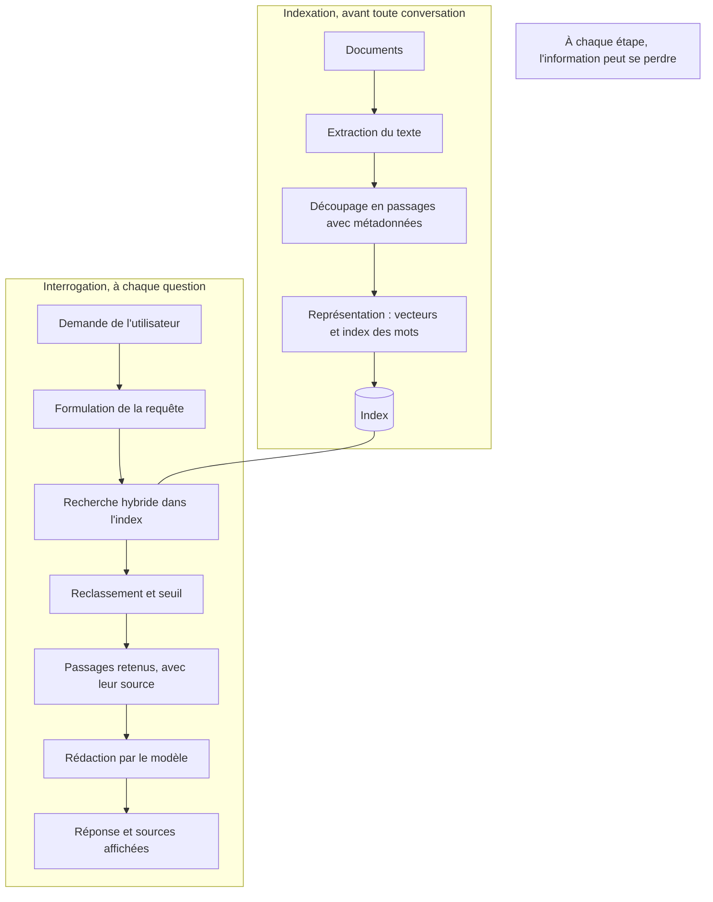

# Chapitre 12 — Savoir : répondre à partir de documents

Dans ce chapitre, vous verrez comment un agent peut appuyer ses réponses sur des documents qu'il recherche au moment de répondre. Vous suivrez le trajet d'une information, du document d'origine jusqu'au passage placé dans le contexte, puis vous apprendrez à afficher les sources, à reconnaître les échecs de la recherche et à l'évaluer séparément de la rédaction.

## Une question dont la réponse est dans un document

Un chargé de clientèle écrit à l'agent : « Que prévoit la procédure lorsqu'une livraison arrive incomplète ? » Les outils de l'agent renvoient des enregistrements, alors que la réponse tient en quelques paragraphes d'un guide. Une commande se retrouve par sa référence ; dans un guide, aucun identifiant ne désigne le paragraphe utile, qu'il faut retrouver par son sens.

Le modèle ne peut pas compter sur ses paramètres : les documents internes n'ont pas figuré dans son corpus d'entraînement, et ils ont pu être révisés depuis. Les placer en entier dans le *system prompt* occuperait la fenêtre à chaque appel, pour une faible part utile. Il faut donc sélectionner, pour chaque question, les passages qui s'y rapportent.

Selon les critères du chapitre 11, un tel passage a une provenance particulière : il a été rédigé par une personne, à une date donnée, et il décrit ce qui devrait se passer plutôt que ce qui s'est passé. Sa durée de vie est celle de la version du document. La confiance qu'il mérite dépend de qui a pu écrire dans la base, question que le chapitre 14 reprend.

## La génération augmentée par récupération

La **génération augmentée par récupération** (*retrieval-augmented generation*, RAG) combine ce que le modèle a appris dans ses paramètres avec une mémoire externe interrogée au moment de répondre : on y recherche les passages les plus proches de la question, et on les fournit au modèle avec celle-ci (Lewis et al., 2020). Dans ce travail d'origine, recherche et générateur étaient entraînés ensemble ; l'usage courant place aujourd'hui les passages retrouvés dans le contexte d'un modèle utilisé tel quel. Une synthèse retrace l'évolution de cette idée vers des organisations plus modulaires (Gao et al., 2023b).

Une base documentaire se met à jour sans réentraîner le modèle, et les passages récupérés permettent d'indiquer d'où vient une affirmation. Ajuster le modèle sur les documents est une autre voie, qui impose un nouvel entraînement à chaque révision ; ce livre ne la développe pas. Des passages pertinents peuvent réduire les hallucinations, sans les supprimer : s'ils ne contiennent pas la réponse, le modèle risque d'en produire une quand même.

> **Point clé**
>
> Le modèle rédige à partir des passages qu'on lui remet. La qualité d'une réponse documentaire dépend donc d'abord de la recherche, que vous pouvez examiner et corriger sans toucher au modèle.

## Indexer, puis interroger

Le travail se répartit en deux moments. L'**indexation** a lieu avant toute conversation : elle transforme les documents en une structure que l'on peut interroger rapidement. L'**interrogation** a lieu à chaque question : elle recherche dans cette structure les passages à remettre au modèle. L'indexation calcule notamment une **représentation vectorielle** (*embedding*) de chaque passage : un modèle dédié transforme le texte en un vecteur, c'est-à-dire une liste de nombres, de sorte que deux textes de sens voisin reçoivent des vecteurs voisins. La figure 12-1 représente ces deux moments, et le tableau 12-1 détaille leurs étapes.

*Figure 12-1 — Le trajet d'une information dans une génération augmentée par récupération*

*Description du schéma :* deux bandes horizontales superposées. La bande du haut, intitulée « indexation, avant toute conversation », enchaîne de gauche à droite : « documents », « extraction du texte », « découpage en passages avec métadonnées », « représentation : vecteurs et index des mots », qui aboutit à un cylindre « index ». La bande du bas, intitulée « interrogation, à chaque question », enchaîne : « demande de l'utilisateur », « formulation de la requête », « recherche hybride dans l'index » (un trait relie cette étape au cylindre), « reclassement et seuil », « passages retenus, avec leur source », « rédaction par le modèle », « réponse et sources affichées ». Une note rappelle qu'à chaque étape l'information peut se perdre.

Chacune de ces étapes produit un résultat que vous pouvez examiner séparément, comme le montre le tableau 12-1.

*Tableau 12-1 — Les étapes d'indexation et d'interrogation*

| Moment | Étape | Ce qu'elle produit |
|---|---|---|
| Indexation | Extraction | Le texte de chaque document, séparé de sa mise en forme |
| Indexation | Découpage | Des passages de taille limitée, accompagnés de métadonnées |
| Indexation | Représentation | Un vecteur par passage et, le cas échéant, un index des mots |
| Interrogation | Formulation | Une requête tirée de la demande de l'utilisateur |
| Interrogation | Recherche | Une liste de passages candidats |
| Interrogation | Reclassement | Les quelques passages retenus, ordonnés |
| Interrogation | Rédaction | Une réponse appuyée sur ces passages, avec ses sources |

## Préparer et découper les documents

L'indexation commence par l'extraction du texte. Un tableau dont les colonnes se mélangent ou un titre confondu avec le paragraphe voisin produisent des passages que la meilleure recherche ne rattrapera pas.

Le texte est ensuite découpé (*chunking*) en **passages** (*chunks*). Le vecteur d'un document entier mêle tous ses sujets et représente mal chacun d'eux ; un passage court laisse plus de place dans la fenêtre et désigne plus précisément l'endroit à vérifier. Mais un passage trop court perd son sens : « Ce délai est alors doublé » ne dit pas de quel délai il s'agit. Un passage trop long noie l'information utile.

Des pratiques courantes atténuent ces défauts. Découpez en suivant la structure du document, titres et paragraphes, plutôt qu'à intervalles fixes. Faites se recouvrir légèrement deux passages consécutifs. Rappelez en tête de chaque passage le titre du document et celui de la section. Aucune taille de passage ne convient à tous les corpus : les valeurs recommandées ici ou là tiennent à des documents et à des questions particuliers, et le découpage se règle sur vos propres documents, avec les mesures de la section « Évaluer la récupération et la réponse ».

Chaque passage conserve des **métadonnées** : document et section d'origine, version, langue, base, public visé, adresse de la source. Elles servent à filtrer la recherche, à afficher les sources et à repérer les contenus périmés ; elles portent la provenance et la durée de vie du passage.

## Représentations vectorielles et recherche sémantique

Chercher les passages dont la représentation vectorielle est proche de celle de la question s'appelle la **recherche sémantique** ; elle retrouve un passage pertinent même s'il n'emploie aucun mot de la question. Une recherche fondée sur ces seules représentations, dites denses parce que chaque composante du vecteur porte une valeur, à la différence des représentations lexicales où presque toutes valent zéro, peut dépasser une recherche par mots-clés sur des jeux de questions ouvertes (Karpukhin et al., 2020).

> **Pour aller plus loin**
>
> Le modèle de représentation encode chaque texte séparément, selon une organisation dite à double encodeur (*bi-encoder*) : des vecteurs calculés indépendamment, puis comparés, rendent la recherche praticable sur une grande collection (Reimers et Gurevych, 2019). La comparaison utilise souvent la similarité cosinus (*cosine similarity*), le cosinus de l'angle entre deux vecteurs, qui vaut 1 pour deux vecteurs de même direction et ne dépend pas de leur norme. Sur une base volumineuse, les bases vectorielles s'appuient sur une recherche approchée des plus proches voisins, qui renonce à une part d'exactitude en échange de la vitesse (Malkov et Yashunin, 2016). Le reclassement, présenté dans la section « Reclasser les candidats », emploie l'organisation inverse, dite à encodeur croisé (*cross-encoder*) : un modèle lit ensemble la question et un passage, ce qui coûte plus cher mais juge la paire plus finement (Nogueira et Cho, 2019).

Quelle que soit l'organisation retenue, une contrainte s'impose.

> **Attention**
>
> Le vecteur de la question et ceux des passages doivent provenir du même modèle de représentation. Changer de modèle impose de recalculer l'index entier.

La proximité des vecteurs mesure une ressemblance de sens ; elle ne garantit pas que le passage contienne la réponse. Un paragraphe qui pose la même question que l'utilisateur lui ressemble davantage que celui qui y répond. Et la recherche renvoie les passages les plus proches même lorsqu'aucun n'est proche : une liste de résultats ne prouve pas que la base traite le sujet.

## Recherche lexicale et recherche hybride

La **recherche lexicale** compare les mots de la question à ceux des passages. La pondération la plus répandue, BM25, donne plus de poids aux termes rares, limite l'effet des répétitions et tient compte de la longueur du passage (Robertson et Zaragoza, 2009). Elle est précise sur les termes exacts : un code d'article, un sigle, un message d'erreur, qu'une représentation vectorielle distingue mal lorsqu'ils ne diffèrent que d'un caractère, comme le modèle lui-même compare mal des références presque identiques à travers ses *tokens* (chapitre 2). Elle échoue lorsque question et document désignent la même chose par des mots différents, « retard de livraison » d'un côté, « dépassement du délai convenu » de l'autre.

Un banc d'essai couvrant des domaines variés conclut que BM25 reste une base de comparaison robuste, et que les modèles denses sont souvent en retrait **hors domaine**, c'est-à-dire sur des corpus éloignés de ceux sur lesquels ils ont été entraînés (Thakur et al., 2021). Les documents d'une organisation, avec leur vocabulaire propre, peuvent relever de ce cas. La **recherche hybride** exécute les deux recherches et fusionne leurs classements : elle retrouve le passage qui cite la référence exacte comme celui qui reformule la question.

> **Sur le terrain**
>
> Pour fusionner deux recherches, une pratique courante consiste à garder l'ordre de pertinence rendu par chaque moteur et à fusionner ces deux classements, au lieu de recalculer un score commun. Prévoyez aussi un repli vers la recherche lexicale seule, pour le cas où la recherche sémantique ne répond pas : mieux vaut un résultat moins fin qu'aucun.

## Reclasser les candidats

Le **reclassement** (*reranking*) ajoute un second examen, plus coûteux, sur un petit nombre de candidats. Un modèle lit ensemble la question et chaque passage, puis attribue à la paire un score de pertinence ; cette organisation a été appliquée au reclassement de passages par Nogueira et Cho (2019). Sur le banc d'essai de Thakur et al. (2021), le reclassement obtient en moyenne les meilleurs résultats hors domaine, pour un coût de calcul élevé. La recherche initiale rapporte donc un ensemble large de candidats, que le reclassement ordonne ; seuls les premiers sont remis au modèle.

Le nombre de passages retenus touche la qualité de la réponse. Des passages bien classés qui ne contiennent pas la réponse dégradent les réponses du modèle (Cuconasu et al., 2024), et une information placée au milieu d'un long contexte est moins bien exploitée qu'en tête ou en fin (Liu et al., 2023b). Un seuil de pertinence peut écarter les passages trop éloignés : un résultat vide renseigne mieux le modèle qu'une liste de passages hors sujet. Ce seuil se règle par l'évaluation. Chaque étape ajoute enfin un délai à un tour qui compte déjà plusieurs cycles.

## Chargement systématique ou outil de recherche

Le programme peut rechercher systématiquement avant chaque appel au modèle et charger les passages trouvés, ou exposer la recherche comme un outil que le modèle appelle au besoin.

Le chargement systématique est prévisible et n'ajoute pas de cycle. Mais elle recherche pour chaque message, y compris une salutation, et à partir du message tel qu'il est écrit : « Et pour l'export ? » ne désigne rien sans l'échange qui précède. Exposée comme un outil, la recherche suit le cycle du chapitre 4 : le modèle, qui lit l'historique, peut transformer « Et pour l'export ? » en une question complète. Le tour compte un cycle de plus, et le modèle peut ne pas appeler l'outil ou mal formuler sa requête.

Des travaux insèrent une étape de réécriture de la requête avant la recherche (Ma et al., 2023) ; d'autres entraînent le modèle à décider lui-même s'il doit rechercher, puis à juger les passages obtenus (Asai et al., 2023). Avec un modèle employé tel quel, ces comportements s'obtiennent par la description de l'outil et les consignes. La boucle du chapitre 5 permet aussi de relancer une recherche restée vide sous une autre formulation. Lorsque plusieurs bases documentaires coexistent, la description de l'outil en porte la liste, et la base devient un paramètre de l'appel.

> **Sur le terrain**
>
> Quand il existe plusieurs bases, laissez le modèle choisir parmi celles que l'application déclare pour l'utilisateur, plutôt que d'en fixer une d'avance. Prévoyez aussi un cas explicite « aucune base disponible » : sans lui, le modèle risque d'inventer un nom de base ou de répondre de mémoire.

## Montrer ses sources

L'affichage des sources aide l'utilisateur à contrôler une affirmation, qu'elle s'appuie sur un document ou sur une donnée : une réponse qui cite le retard d'une commande gagne à être accompagnée d'un lien vers cette commande.

Une adresse rédigée par le modèle est un texte généré, donc susceptible d'être inventé. Les sources affichées viennent des résultats d'outils : l'outil de recherche renvoie, pour chaque passage, le titre, la section, la version et l'adresse ; les outils de lecture renvoient l'identifiant des enregistrements consultés. Le programme en établit la liste et l'interface l'affiche sous la réponse ; le modèle peut tout au plus signaler, par un repère fourni avec chaque passage, celui sur lequel il appuie une phrase.

Ce dernier point appelle la prudence. Un audit de moteurs de recherche génératifs constate des affirmations non étayées et des citations inexactes fréquentes (Liu et al., 2023a), et un banc d'essai sur la génération avec citations conclut à une marge de progression importante (Gao et al., 2023a). Une source affichée indique où vérifier ; l'exactitude de la phrase reste à contrôler.

> **Sur le terrain**
>
> Ne retenez comme sources que les résultats des outils exécutés depuis le dernier message de l'utilisateur, dédoublonnés. Sinon, la liste traîne les sources des questions précédentes, et l'utilisateur ne sait plus lesquelles appuient la réponse qu'il lit.

## Quand la récupération échoue

Une réponse documentaire erronée a la même fluidité qu'une réponse juste. Pour en trouver la cause, il faut savoir à quelle étape l'information s'est perdue. Un retour d'expérience sur trois études de cas recense plusieurs points de défaillance, et conclut que la robustesse d'un tel système se construit au fil de son exploitation plutôt qu'à sa conception (Barnett et al., 2024). Le tableau 12-2 adopte la même démarche, sans reproduire la liste de ces auteurs.

*Tableau 12-2 — Où l'information se perd*

| Où l'information se perd | Ce que l'on observe | Ce qu'il faut examiner |
|---|---|---|
| La base ne contient pas la réponse | Une réponse inventée, ou tirée de passages voisins | La couverture de la base ; le résultat renvoyé en cas d'absence |
| Le passage existe, mais n'est pas retrouvé | Des sources proches du sujet, qui ne répondent pas | Le découpage, la requête, le type de recherche |
| Le passage est retrouvé, puis écarté | Le bon document n'apparaît pas dans les sources | Le nombre de passages retenus, le reclassement, le seuil |
| Le passage est dans le contexte, mais mal exploité | Une réponse incomplète, ou contraire à sa source | Le nombre et l'ordre des passages, les consignes |
| Le passage est périmé | Une réponse fidèle à une source dépassée | La mise à jour de l'index |

Le premier cas demande une précaution de conception. Les modèles évalués peinent à s'abstenir lorsque aucun document fourni ne contient la réponse, et à écarter une information fausse présente dans ces documents (Chen et al., 2023). Or la recherche documentaire trouve presque toujours quelque chose. L'outil doit donc décider lui-même qu'aucun passage n'est assez proche et l'énoncer dans son résultat, comme le chapitre 4 le demandait pour la réussite sans donnée.

## Qui peut lire la base, qui peut y écrire

Un index rassemble des documents dont les lecteurs autorisés diffèrent, et un passage placé dans le contexte peut être restitué à l'utilisateur. Le contrôle s'exerce donc avant que le passage n'atteigne le modèle : la recherche filtre les passages selon leurs métadonnées, avec les droits de la personne servie, comme les autres outils depuis le chapitre 7. Une consigne demandant d'ignorer certains documents ne suffit pas (chapitre 3). Dans l'application du fil rouge, utilisée par plusieurs organisations, les procédures de l'une ne doivent jamais apparaître dans une réponse faite à l'autre. Les droits évoluent aussi : le filtre consulte les droits au moment de la recherche.

Un passage récupéré est aussi un contenu écrit par un tiers, lu dans la même séquence que les consignes : il peut porter une injection de *prompt* indirecte (chapitre 4 ; Greshake et al., 2023). Un petit nombre de textes malveillants insérés dans une base peut suffire à faire produire une réponse choisie à une question ciblée (Zou et al., 2024). Vous devez donc savoir qui peut écrire dans la base autant que qui peut la lire ; le chapitre 14 examine ces risques.

## Évaluer la récupération et la réponse

Une réponse fausse peut venir de la recherche ou de la rédaction ; les évaluer séparément indique où intervenir.

Pour la recherche, constituez un jeu de questions dont vous connaissez les passages attendus. Le **rappel** (*recall*) parmi les *k* premiers résultats mesure la part des questions pour lesquelles un passage attendu y figure. Des questions auxquelles la base ne répond pas vérifient que le résultat est alors vide. Pour la réponse, examinez sa **fidélité** aux passages, au sens du chapitre 2, et l'abstention lorsque les passages ne permettent pas de répondre. Des métriques automatiques confient ce jugement à un modèle de langage (Es et al., 2023). Le chapitre 15 montre comment constituer ce jeu à partir des questions réelles, répéter les essais et confronter un juge automatique à des relecteurs humains ; chaque modification du découpage, du modèle de représentation ou du nombre de passages y est rejouée.

L'index, enfin, doit suivre les documents. Un document modifié est redécoupé et ses passages recalculés ; un document supprimé quitte l'index, faute de quoi l'agent continue de le citer. Un passage périmé donne une réponse fidèle à sa source et contraire à la réalité, défaut que l'évaluation de la fidélité ne détecte pas ; la version affichée avec la source donne à l'utilisateur un moyen de s'en apercevoir.

## Ce qui est établi et ce qui reste discuté

Pour situer les recommandations de ce chapitre, voici ce que l'on peut affirmer et ce qui reste discuté.

- **Établi** : fournir au modèle des passages pertinents améliore l'**ancrage** des réponses, c'est-à-dire leur appui sur les passages fournis plutôt que sur les seuls paramètres du modèle, sans supprimer les hallucinations ; et les citations produites par les systèmes génératifs ne sont pas toujours étayées par leurs sources.
- **Pratique courante** : on découpe selon la structure des documents, on combine recherche lexicale et recherche sémantique, on reclasse les candidats, on filtre selon les droits de l'utilisateur et l'on affiche les sources fournies par l'outil.
- **Zone d'incertitude** : la taille des passages, leur nombre, le seuil de pertinence et le choix du modèle de représentation n'ont pas de valeur générale. Les fenêtres de contexte s'allongent, et la part de la sélection qui restera nécessaire pour un corpus de taille modeste est discutée.

## Atelier 12 — La recherche documentaire

L'atelier remet la documentation à l'agent.

### La décision à prendre

Les utilisateurs posent des questions dont la réponse se trouve dans la documentation fonctionnelle et les procédures internes : le délai de traitement d'une réclamation, le circuit de validation d'une demande d'achat, la définition d'un statut de facture. Comment remettre cette documentation à l'agent, et que voit l'utilisateur ?

### Les options

Quatre options se présentent.

- **Placer la documentation dans le *system prompt*.** Elle occuperait la fenêtre à chaque cycle, et toute révision imposerait de republier les consignes.
- **Chargement systématique.** Prévisible, il exécuterait aussi la recherche pour les questions sur les données, que le fil rouge suppose les plus fréquentes, à partir d'un message qui se comprend rarement seul.
- **Exposer un outil de recherche dans la documentation.** Le modèle décide de rechercher et formule la requête à partir de l'historique.
- **Ne rien faire.** L'agent continue de répondre de mémoire, ou de dire qu'il ne sait pas.

### Le choix retenu et son coût

L'équipe retient un sixième outil de lecture, « rechercher dans la documentation », appelé à la demande. Dans le dépôt compagnon, une application de recherche tient l'index et exécute la recherche ; vous écrivez l'outil qui l'interroge. Le critère de réussite porte donc sur ce que fait cet outil, et non sur le découpage, la recherche hybride ou le reclassement, que la liste suivante décrit pour l'application de l'équipe.

- Les documents sont découpés selon leur structure, avec leurs métadonnées : document, section, version, public visé, adresse.
- La recherche est hybride, puis reclassée : la documentation emploie un vocabulaire propre et cite des codes de statut. Un seuil écarte les passages trop éloignés, et l'outil déclare explicitement un résultat vide.
- Les passages sont filtrés selon les droits de l'utilisateur au moment de la recherche.
- L'index est reconstruit à chaque publication de la documentation, et les versions retirées le quittent.
- Le programme établit la liste des sources du tour, que l'interface affiche sous la réponse ; le modèle ne rédige aucune adresse.
- Les consignes demandent de distinguer ce qui vient de la documentation (ce qui devrait se passer) de ce qui vient des données (ce qui s'est passé), et de dire quand la documentation ne répond pas.

Au chargé de clientèle, l'agent cite désormais la section de la procédure sur les livraisons incomplètes et sa version, puis consulte la commande concernée pour dire où elle en est. La base devient un second produit à maintenir, avec son modèle de représentation distinct, et ses droits de lecture doivent refléter ceux de l'application. Un tour qui fait appel à la documentation compte un cycle de plus.

### L'état de l'agent

Le tableau 12-3 indique ce qui change par rapport au chapitre 11.

*Tableau 12-3 — Ce qui change dans l'agent au chapitre 12*

| Composant | Changement |
|---|---|
| Consignes | Distinguer documentation et données ; dire quand la documentation ne répond pas |
| Outils | Sixième outil de lecture : « rechercher dans la documentation », passages renvoyés avec leur source |
| Contrôles | Passages filtrés selon les droits de l'utilisateur ; sources établies par le programme |
| Connaissances | Documentation récupérée à la demande, avec sa source et sa version ; index reconstruit à chaque publication |
| Interface | Sources du tour affichées sous la réponse |

### Le critère de réussite

Votre outil de recherche documentaire interroge l'application de recherche du dépôt compagnon, à la demande. Il renvoie des passages filtrés selon les droits et l'organisation de l'utilisateur, et déclare explicitement un résultat vide. Les sources affichées sont établies par le programme, et une version retirée de la documentation n'apparaît plus après la reconstruction de l'index. La réponse distingue ce qui vient de la documentation de ce qui vient des données. Les tests de bout en bout de cet atelier se trouvent dans le dossier *workshops/13-document-search/tests/* du dépôt compagnon.

## Ce qu'il faut retenir

Six points résument ce chapitre.

- La génération augmentée par récupération fournit au modèle des passages recherchés dans une base que l'on met à jour sans réentraînement.
- La qualité de la réponse dépend de chaque étape : extraction, découpage, représentation, recherche, reclassement.
- Recherche sémantique et recherche lexicale couvrent des besoins différents ; les combiner couvre les deux.
- L'outil doit pouvoir déclarer qu'il n'a rien trouvé ; les sources affichées viennent des résultats d'outils.
- Le filtrage selon les droits s'applique avant que les passages n'atteignent le modèle.
- Recherche et rédaction s'évaluent séparément, et l'index doit suivre les documents.

La documentation dit ce qui devrait se passer ; certaines tâches demandent en plus de savoir comment procéder, étape par étape, pour analyser des retards ou contrôler une facture. Le chapitre 13 examine comment remettre ces procédures dans le contexte sans alourdir les consignes permanentes.

## Références

Les travaux cités dans ce chapitre sont les suivants.

- Asai, A., Wu, Z., Wang, Y., Sil, A., et Hajishirzi, H. (2023). *Self-RAG: Learning to Retrieve, Generate, and Critique through Self-Reflection*. arXiv:2310.11511. https://doi.org/10.48550/arXiv.2310.11511.
- Barnett, S., Kurniawan, S., Thudumu, S., et al. (2024). *Seven Failure Points When Engineering a Retrieval Augmented Generation System*. arXiv:2401.05856. https://doi.org/10.48550/arXiv.2401.05856.
- Chen, J., Lin, H., Han, X., et Sun, L. (2023). *Benchmarking Large Language Models in Retrieval-Augmented Generation*. arXiv:2309.01431. https://doi.org/10.48550/arXiv.2309.01431.
- Cuconasu, F., Trappolini, G., Siciliano, F., et al. (2024). *The Power of Noise: Redefining Retrieval for RAG Systems*. arXiv:2401.14887. https://doi.org/10.48550/arXiv.2401.14887.
- Es, S., James, J., Espinosa-Anke, L., et Schockaert, S. (2023). *Ragas: Automated Evaluation of Retrieval Augmented Generation*. arXiv:2309.15217. https://doi.org/10.48550/arXiv.2309.15217.
- Gao, T., Yen, H., Yu, J., et Chen, D. (2023a). *Enabling Large Language Models to Generate Text with Citations*. arXiv:2305.14627. https://doi.org/10.48550/arXiv.2305.14627.
- Gao, Y., Xiong, Y., Gao, X., et al. (2023b). *Retrieval-Augmented Generation for Large Language Models: A Survey*. arXiv:2312.10997. https://doi.org/10.48550/arXiv.2312.10997.
- Greshake, K., Abdelnabi, S., Mishra, S., et al. (2023). *Not what you've signed up for: Compromising Real-World LLM-Integrated Applications with Indirect Prompt Injection*. arXiv:2302.12173. https://doi.org/10.48550/arXiv.2302.12173.
- Karpukhin, V., Oğuz, B., Min, S., et al. (2020). *Dense Passage Retrieval for Open-Domain Question Answering*. arXiv:2004.04906. https://doi.org/10.48550/arXiv.2004.04906.
- Lewis, P., Perez, E., Piktus, A., et al. (2020). *Retrieval-Augmented Generation for Knowledge-Intensive NLP Tasks*. arXiv:2005.11401. https://doi.org/10.48550/arXiv.2005.11401.
- Liu, N. F., Zhang, T., et Liang, P. (2023a). *Evaluating Verifiability in Generative Search Engines*. arXiv:2304.09848. https://doi.org/10.48550/arXiv.2304.09848.
- Liu, N. F., Lin, K., Hewitt, J., et al. (2023b). *Lost in the Middle: How Language Models Use Long Contexts*. arXiv:2307.03172. https://doi.org/10.48550/arXiv.2307.03172.
- Ma, X., Gong, Y., He, P., Zhao, H., et Duan, N. (2023). *Query Rewriting for Retrieval-Augmented Large Language Models*. arXiv:2305.14283. https://doi.org/10.48550/arXiv.2305.14283.
- Malkov, Y. A., et Yashunin, D. A. (2016). *Efficient and robust approximate nearest neighbor search using Hierarchical Navigable Small World graphs*. arXiv:1603.09320. https://doi.org/10.48550/arXiv.1603.09320.
- Nogueira, R., et Cho, K. (2019). *Passage Re-ranking with BERT*. arXiv:1901.04085. https://doi.org/10.48550/arXiv.1901.04085.
- Reimers, N., et Gurevych, I. (2019). *Sentence-BERT: Sentence Embeddings using Siamese BERT-Networks*. arXiv:1908.10084. https://doi.org/10.48550/arXiv.1908.10084.
- Robertson, S., et Zaragoza, H. (2009). *The Probabilistic Relevance Framework: BM25 and Beyond*. Foundations and Trends in Information Retrieval, 3(4), 333-389. https://doi.org/10.1561/1500000019.
- Thakur, N., Reimers, N., Rücklé, A., et al. (2021). *BEIR: A Heterogenous Benchmark for Zero-shot Evaluation of Information Retrieval Models*. arXiv:2104.08663. https://doi.org/10.48550/arXiv.2104.08663.
- Zou, W., Geng, R., Wang, B., et Jia, J. (2024). *PoisonedRAG: Knowledge Corruption Attacks to Retrieval-Augmented Generation of Large Language Models*. arXiv:2402.07867. https://doi.org/10.48550/arXiv.2402.07867.
