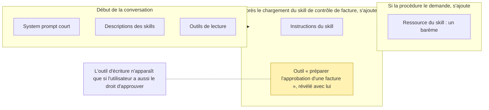

# Chapitre 13 — Savoir faire : des procédures chargées à la demande

Dans ce chapitre, vous verrez comment donner à un agent des procédures métier sans alourdir en permanence son contexte. Vous apprendrez à décrire un *skill* pour qu'il soit chargé au bon moment, à le distinguer d'un outil, d'une consigne et d'un document, à lier la présentation des outils d'écriture au chargement de leur procédure, et à maintenir un catalogue de *skills*.

## Des consignes qui grossissent

Depuis le chapitre 6, un même agent sert trois métiers, et leurs procédures posent maintenant une question de volume. Chaque métier veut que l'agent suive sa manière de travailler : analyser les retards d'un client, contrôler une facture en la rapprochant de la commande et de la réception, préparer une demande d'achat conforme aux règles internes.

Inscrites dans le *system prompt*, ces procédures seraient soumises au modèle à chaque appel, y compris pour l'état d'une commande. L'allongement de l'entrée peut dégrader le raisonnement à tâche égale (Levy et al., 2024), et un contenu sans rapport avec la question peut détourner le modèle (Shi et al., 2023). Un texte retouché par trois métiers accumule aussi des règles contradictoires : si acheteurs et comptables décrivent chacun le rapprochement d'une facture, deux règles finissent par traiter différemment une réception partielle.

Les outils d'écriture posent une question voisine. Depuis le chapitre 7, ils sont proposés dès que l'utilisateur en a le droit, pendant toute la conversation. Le modèle peut donc préparer une approbation sans avoir sous les yeux la procédure de contrôle qui devrait la précéder.

## Qu'est-ce qu'un skill ?

Un ***skill*** est un savoir-faire nommé que l'agent peut charger au cours d'une conversation. Il réunit trois éléments :

- **Une description courte** : elle dit à quoi sert le *skill* et dans quelles situations l'employer.
- **Des instructions** : rédigées en langage naturel, elles donnent les étapes d'une procédure, les règles, les cas particuliers, la forme attendue de la réponse.
- **Des ressources éventuelles** : un barème ou un modèle de réponse, par exemple, que les instructions désignent et que l'agent ne consulte qu'au besoin.

Une synthèse récente décrit les *skills* comme des ensembles composables d'instructions, de code et de ressources, chargés à la demande, qui étendent les capacités de l'agent sans réentraînement (Xu et Yan, 2026). Une autre insiste sur le fait qu'un *skill* emballe une connaissance procédurale avec ses conditions d'application, et se réutilise d'une tâche à l'autre (Jiang et al., 2026). Les bibliothèques de savoir-faire précèdent ce vocabulaire : un agent de jeu vidéo enrichissait lui-même une bibliothèque de comportements, conservés sous forme de code exécutable (Wang et al., 2023d). Dans le fil rouge, les *skills* ne contiennent que du texte, rédigé et relu par des personnes qui connaissent le métier : le chapitre 7 a exclu l'exécution de code produit par le modèle.

> **Point clé**
>
> La description du *skill* décide de son déclenchement ; son contenu, de son utilité. Le modèle choisit de charger un *skill* en ne lisant que sa description : une excellente procédure mal décrite peut ne jamais être chargée.

Rédigez donc la description comme celle d'un outil au chapitre 6, en nommant les demandes qui doivent conduire au chargement, dans les termes des utilisateurs.

Selon les critères du chapitre 11, la provenance d'un *skill* est un catalogue tenu par l'éditeur, où chaque *skill* a un auteur, un périmètre et une version. Sa durée de vie, une fois chargé, est celle de la conversation. Sa confiance est celle d'une consigne : le modèle suit la procédure, alors qu'il cite un passage documentaire et devra se méfier d'un contenu de tiers (chapitre 14). Cette confiance porte sur la manière de travailler, jamais sur ce que l'agent a le droit de faire.

## Charger au moment où c'est utile

Les *skills* appliquent aux consignes la divulgation progressive des chapitres 6 et 9, que représente la figure 13-1. Les descriptions de tous les *skills* accessibles figurent en permanence dans le contexte, à la suite du *system prompt*. Le corps d'un *skill* n'y entre que lorsqu'il est chargé, et ses ressources ne sont lues que si la procédure y conduit.

*Figure 13-1 — La divulgation progressive d'un skill*

*Description du schéma :* trois colonnes représentent le contexte à trois moments successifs. Dans la première, « début de la conversation », figurent le *system prompt* court, la liste des descriptions de *skills* et les outils de lecture. Dans la deuxième, « après le chargement du *skill* de contrôle de facture », s'ajoutent les instructions de ce *skill* et, en surbrillance, l'outil « préparer l'approbation d'une facture », révélé avec lui. Dans la troisième, « si la procédure le demande », s'ajoute une ressource du *skill*, un barème. Sous la deuxième colonne, une note précise que l'outil d'écriture n'apparaît que si l'utilisateur a aussi le droit d'approuver.

Dans ce livre, le chargement passe par un outil. Le modèle reconnaît que la demande correspond à une description et demande le chargement du *skill* par son nom ; le *harness* vérifie que ce *skill* appartient au catalogue, récupère son contenu et l'ajoute au contexte. Le coût est un cycle de plus avant la première action utile. Un rapport sur des agents déployés par un éditeur indique que le chargement différé améliore la qualité de la sélection des *skills*, avec une légère dégradation de la latence (Zhang et al., 2026).

Le déclenchement peut échouer : le modèle répond avec ce qu'il sait en général, charge un *skill* voisin, ou en charge plusieurs par précaution. Ces écarts s'observent dans les trajectoires, à condition que le chargement soit tracé. Une fois chargé, le contenu doit survivre à la compaction (chapitre 10) : un résumé approximatif pourrait faire perdre des règles de la procédure.

## Ce qui distingue un skill d'une consigne, d'un outil et d'un document

Un *skill* et un outil étendent tous deux ce que l'agent sait traiter. L'outil lui donne la possibilité d'obtenir une donnée ou d'effectuer une opération ; le *skill* lui indique comment enchaîner des opérations, et selon quelles règles. Le tableau 13-1 compare ces trois formes.

*Tableau 13-1 — Consigne permanente, skill et outil*

| | Consigne permanente | *Skill* | Outil |
|---|---|---|---|
| Ce qu'il apporte | Une règle valable pour toute demande | Une procédure pour un type de tâche | Une donnée ou une opération |
| Présence dans le contexte | À chaque appel | Description à chaque appel ; contenu après chargement | Définition à chaque appel ; résultat après exécution |
| Qui l'applique | Le modèle | Le modèle | Le programme |
| Exemple dans le fil rouge | Annoncer un résultat partiel | Contrôler une facture par rapprochement | Interroger une source de données |

La ligne « Qui l'applique » du tableau 13-1 guide le partage. Une procédure rédigée dans un *skill* est suivie par le modèle, avec la variabilité que cela suppose. Une règle qui doit s'appliquer à coup sûr, comme une exclusion, un plafond ou un contrôle de droits, a sa place dans un outil ou dans le programme, comme l'atelier du chapitre 4 l'avait montré. Le *skill* convient à ce qui relève du jugement et de l'ordre des étapes.

Un *skill* se distingue aussi d'un document retrouvé par recherche (chapitre 12). Le document apporte une information que l'agent cite, et peut venir de n'importe quel contributeur de la base. Le *skill* prescrit une manière de travailler, avec l'autorité d'une consigne, et provient du seul catalogue de l'éditeur. Une procédure interne peut exister sous les deux formes : le texte de référence, que l'agent cite, et un *skill* qui en tire la méthode à suivre pour agir.

## Révéler un outil avec son skill

Puisqu'une procédure s'appuie sur certains outils, vous pouvez ne présenter un outil au modèle que lorsque le *skill* qui en décrit l'usage est chargé. Le *skill* déclare ses outils, et le programme les ajoute à la liste visible au chargement. Cette divulgation progressive des outils réduit le nombre de définitions dans le contexte, comme le recommandait le chapitre 6 ; une sélection préalable des outils présentés au modèle allège le *prompt* et améliore le choix sur les tâches étudiées (Gan et Sun, 2025). Surtout, la procédure est dans le contexte avant que l'outil ne devienne disponible : l'outil qui prépare une approbation n'apparaît qu'une fois chargée la procédure de contrôle.

La mise au point est délicate. La liste d'outils change en cours de conversation, ce qui modifie le début de la séquence et peut annuler le bénéfice du cache. Certains outils restent visibles en toutes circonstances, à commencer par l'outil de chargement et les outils de lecture. Un *skill* peut déclarer un outil renommé ou retiré, et tous les chemins de chargement doivent produire le même effet.

## Révéler n'est pas autoriser

La divulgation liée au *skill* s'ajoute à la restriction du chapitre 7 ; elle ne la remplace pas. Un outil d'écriture n'est présenté au modèle que si l'utilisateur a le droit d'effectuer l'action et si le *skill* qui l'encadre est chargé.

> **Attention**
>
> Un *skill* ajoute une condition, il n'en retire aucune. Le serveur d'outils vérifie les droits à chaque exécution, que l'outil ait été révélé ou non, et la confirmation par l'interface reste exigée pour toute écriture. Un *skill* qui déclare un outil hors du périmètre de l'utilisateur ne le lui ouvre pas.

Les *skills* ajoutent aussi des chemins à couvrir : un *skill* inaccessible que l'outil de chargement accepterait, un préchargement qui contournerait le filtre.

> **Sur le terrain**
>
> Lorsque vous filtrez ce qui est découvert automatiquement, n'oubliez pas les *prompts* et les ressources qu'un serveur MCP sert à côté de ses outils. C'est la partie que l'on filtre le moins souvent, alors qu'elle entre dans le contexte au même titre.

## Précharger un skill

Une application peut indiquer au programme un *skill* à charger avant le premier appel au modèle, ce qui épargne le cycle de choix. Ce préchargement passe par les mêmes contrôles qu'un chargement demandé par le modèle : le *skill* doit appartenir au catalogue, et il est raisonnable de n'en accepter qu'un, pour ne pas reconstituer un long texte permanent. Il ne vaut que si le signal est fiable : un *skill* préchargé à tort occupe le contexte, oriente le modèle vers une procédure inadaptée et peut rendre visibles des outils d'écriture sans raison.

## Versionner et maintenir un catalogue

Tenus hors du *system prompt*, les *skills* forment un catalogue où le rapprochement de facture, utile aux acheteurs comme aux comptables, n'existe qu'en un exemplaire. Chaque *skill* porte une version : elle permet de savoir quelle procédure a été suivie dans une conversation, de revenir à la précédente si une modification dégrade les réponses, et de garder le contenu en cache sans servir un texte périmé.

> **Sur le terrain**
>
> Ne mettez jamais en cache un échec de récupération d'un *skill*. Sinon, une indisponibilité de quelques secondes devient une absence durable : l'agent travaille sans la procédure jusqu'à l'expiration du cache, sans que personne ne s'en aperçoive.

Pour chaque *skill*, vérifiez que les demandes prévues provoquent son chargement, que des demandes voisines ne le provoquent pas, et que la procédure conduit aux bons appels ; le chapitre 15 décrit ces vérifications.

Sachez aussi qui peut écrire dans le catalogue. Des instructions malveillantes dissimulées dans un long *skill*, ou dans un script auquel il renvoie, peuvent conduire un agent à divulguer des données sensibles (Schmotz et al., 2025). Des analyses trouvent des vulnérabilités dans une part notable des *skills* publiés par des communautés (Xu et Yan, 2026), et des risques de chaîne d'approvisionnement sont décrits (Jiang et al., 2026). Un catalogue interne, relu et versionné, est moins exposé ; ses textes méritent néanmoins une relecture comparable à celle du code.

> **Zone d'incertitude**
>
> La mesure de ce qu'apportent les *skills* débute. Un banc d'essai récent, qui compare les mêmes tâches avec et sans *skills* rédigés avec soin, observe un gain moyen dont l'ampleur varie selon les configurations, et de meilleurs résultats pour des *skills* ciblés que pour des ensembles exhaustifs (Li et al., 2026). Des *skills* produits par l'agent lui-même peuvent au contraire dégrader les résultats (Jiang et al., 2026). Ces travaux ne dispensent pas de mesurer l'effet de chaque *skill* sur vos propres parcours.

## Atelier 13 — Les skills

L'atelier range les procédures métier dans un catalogue plutôt que dans le *system prompt*.

### La décision à prendre

Où logent les procédures des trois métiers, qu'est-ce qui déclenche leur chargement, et quand les outils d'écriture deviennent-ils visibles ?

### Les options

Trois choix se combinent.

- **Le contenu.** Il reste dans le *system prompt*, en est entièrement retiré, ou est partagé : procédures longues et occasionnelles en *skills*, règles courtes et permanentes dans le *system prompt*.
- **Le chargement.** Il est décidé par le programme, qui classe la demande ; par le modèle, au moyen d'un outil ; ou par l'application, qui précharge un *skill*.
- **Les outils d'écriture.** Ils restent proposés selon les seuls droits, ou ne sont révélés qu'avec le *skill* correspondant, en plus de ces droits.

### Le choix retenu et son coût

L'équipe retient un catalogue de trois *skills* versionnés : « analyser les retards d'un client », « contrôler une facture par rapprochement », « préparer une demande d'achat conforme ». Les règles courtes et permanentes restent dans le *system prompt*, car un chargement oublié les rendrait inopérantes.

Elle confie le chargement au modèle, au moyen d'un outil tenu par le *harness*, qui refuse tout *skill* étranger au catalogue. Un classement préalable ajouterait un classifieur à maintenir ; le préchargement n'est pas retenu, faute de signal fiable de la tâche en cours.

Les deux outils d'écriture ne sont proposés qu'après le chargement de leur *skill*. Un utilisateur sans droit d'approbation qui demande le contrôle d'une facture reçoit la procédure, et l'outil d'approbation reste absent. Les *skills* chargés sont préservés lors de la compaction de l'historique : le *harness* les replace dans une section fixe du contexte, que ni l'effacement des anciens résultats d'outils ni le résumé n'atteignent.

Chaque chargement ajoute un cycle : « approuve cette facture » commence par le chargement de la procédure de contrôle. Le déclenchement dépend de la qualité des descriptions, la liste d'outils changeante réduit le bénéfice de la mise en cache du début de la séquence (chapitre 3), et le catalogue devient un objet à versionner, à relire et à tester. Enfin, l'agent cumule désormais la recherche documentaire du chapitre 12 et des outils d'écriture, sans protection contre l'injection de *prompt* : un passage piégé dans la documentation peut orienter un brouillon que l'utilisateur confirmera. Le chapitre 14 traite ce risque.

### L'état de l'agent

Le tableau 13-2 indique ce qui change par rapport au chapitre 12.

*Tableau 13-2 — Ce qui change dans l'agent au chapitre 13*

| Composant | Changement |
|---|---|
| Consignes | Procédures métier rangées dans un catalogue de trois *skills* versionnés plutôt que dans le *system prompt* |
| Outils | Outil de chargement de *skill* tenu par le *harness* ; outils d'écriture révélés avec leur *skill*, en plus des droits |
| Contrôles | Chargement limité aux *skills* du catalogue |
| Connaissances | Procédures chargées à la demande depuis le catalogue versionné |
| Contexte | Descriptions des *skills* toujours présentes, contenu chargé à la demande et préservé lors de la compaction |
| Autonomie | Le modèle choisit aussi les *skills* qu'il charge |

### Le critère de réussite

Seuls les trois *skills* du catalogue versionné se chargent ; une demande de *skill* étranger au catalogue est refusée. Un outil d'écriture n'est proposé qu'après le chargement de son *skill*, et toujours selon les droits de l'utilisateur. Un *skill* chargé est encore présent dans l'entrée du modèle après une compaction. Le déclenchement lui-même, la bonne demande chargeant le bon *skill*, varie d'une exécution à l'autre : ce critère ne le vérifie pas, et le chapitre 15 le mesure par des parcours répétés. Les tests de bout en bout de cet atelier se trouvent dans le dossier *workshops/14-skills/tests/* du dépôt compagnon.

## Ce qu'il faut retenir

Cinq idées se dégagent de ce chapitre.

- Un *system prompt* qui accumule les procédures pèse à chaque appel et devient difficile à maintenir.
- Un *skill* réunit une description, des instructions et d'éventuelles ressources ; la description déclenche le chargement.
- Un *skill* reçoit la confiance d'une consigne ; les règles qui doivent s'appliquer à coup sûr relèvent de l'outil ou du programme.
- Révéler un outil d'écriture avec son *skill* place la procédure dans le contexte avant l'action, sans jamais étendre les droits.
- Un catalogue de *skills* se versionne, se teste et se relit comme du code.

Tout ce que l'agent lit jusqu'ici vient de l'application, de la documentation publiée ou du catalogue de l'éditeur. Les utilisateurs veulent maintenant lui confier des documents reçus de l'extérieur, comme un devis ou une facture de fournisseur, dont personne n'a relu le contenu. Le chapitre 14 examine ce que l'agent peut en faire sans obéir à ce qu'ils contiennent.

## Références

Ce chapitre cite les travaux suivants.

- Gan, T., et Sun, Q. (2025). *RAG-MCP: Mitigating Prompt Bloat in LLM Tool Selection via Retrieval-Augmented Generation*. arXiv:2505.03275.
- Jiang, Y., Li, D., Deng, H., et al. (2026). *SoK: Agentic Skills — Beyond Tool Use in LLM Agents*. arXiv:2602.20867.
- Levy, M., Jacoby, A., et Goldberg, Y. (2024). *Same Task, More Tokens: the Impact of Input Length on the Reasoning Performance of Large Language Models*. arXiv:2402.14848.
- Li, X., Liu, Y., Chen, W., et al. (2026). *SkillsBench: Benchmarking How Well Agent Skills Work Across Diverse Tasks*. arXiv:2602.12670.
- Schmotz, D., Abdelnabi, S., et Andriushchenko, M. (2025). *Agent Skills Enable a New Class of Realistic and Trivially Simple Prompt Injections*. arXiv:2510.26328.
- Shi, F., Chen, X., Misra, K., et al. (2023). *Large Language Models Can Be Easily Distracted by Irrelevant Context*. arXiv:2302.00093.
- Wang, G., Xie, Y., Jiang, Y., et al. (2023d). *Voyager: An Open-Ended Embodied Agent with Large Language Models*. arXiv:2305.16291.
- Xu, R., et Yan, Y. (2026). *Agent Skills for Large Language Models: Architecture, Acquisition, Security, and the Path Forward*. arXiv:2602.12430.
- Zhang, G., Zhao, K., Mudgal, P., et al. (2026). *Report: Progressive Disclosure of Agent Skills*. arXiv:2609.35692.
