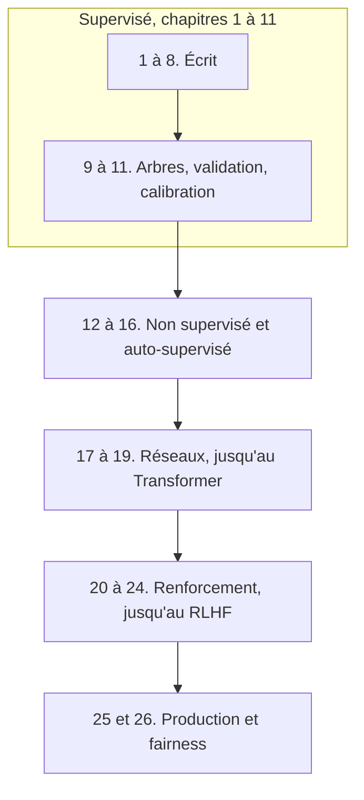

# Plan v5 — Fondamentaux du Machine Learning

Document de travail. Les parties I et II sont rédigées (chapitres 1 à 8) et cette version ne les remanie pas. Elle décrit les parties III à VII, à valider avant toute rédaction.

## 1. Titre, public, promesse

**Titre.** Fondamentaux du Machine Learning. Le libellé « Priorité 1 » ne figure ni dans le titre, ni sur la couverture, ni dans les fichiers du livre.

**Public.** Ingénieur logiciel senior, à l'aise en Python, en systèmes et en API, sans cursus de mathématiques avancées ni de *machine learning*. Il veut **construire** des modèles : choisir une cible, préparer une table, entraîner, mesurer, régler, et mettre en service. Les LLM et les agents qu'il utilise déjà sont un cas de cette construction, pas le sujet du livre. Quand un lien avec eux est juste, le chapitre le dit ; il ne réécrit pas chaque notion comme un problème de prompt.

**Promesse.** À la fin du livre, le lecteur sait construire un modèle dans les trois paradigmes. En supervisé : cadrer, préparer, ajuster une régression et une logistique, lire une descente, reconnaître un surapprentissage, mesurer sans fuite, régulariser, entraîner un arbre et un boosting, chercher des hyperparamètres, calibrer une probabilité. Sans étiquette : grouper, compresser, détecter une anomalie, apprendre ou réutiliser un embedding, poser une tâche auto-supervisée. En profond : empiler un réseau, un autoencodeur, un Transformer. En renforcement : poser un agent, un bandit, un Q-learning, un gradient de politique, puis un RLHF ou un DPO. En transverse : servir le système et mesurer un écart entre groupes, quel que soit le paradigme.

**Autonomie.** Le livre se lit seul. Les lecteurs qui arrivent de *De l'assistant à l'agent* y trouvent le développement de ce que le chapitre 1 de ce livre-là esquisse. Aucun chapitre de celui-ci ne suppose l'autre.

**Langue et ton.** Français clair et professionnel. Le « vous » s'adresse à l'ingénieur. Chaque notion est définie à sa première occurrence. L'intuition précède la formule. Les limites et les pièges sont énoncés au moment où le mécanisme les rend visibles.

## 2. Ce que le dépôt impose, et ce qu'il ne contient pas

Le dépôt, sur `main`, ne contenait pas de guide de style. Ce livre suit le [guide officiel O'Reilly](https://oreillymedia.github.io/production-resources/styleguide/). Les règles retenues, et les écarts assumés pour le français, sont dans [STYLE.md](STYLE.md). Ce fichier vaut pour ce livre ; il ne réécrit pas les conventions de l'autre livre du dépôt.

Ce qui existe, et que ce livre reprend :

- Un dossier par livre, en kebab-case, avec un `README.md` qui tient lieu de table et de fiche. Pas de fichier de métadonnées (`book.json`, YAML, front matter). Le `README.md` racine enregistre la liste des livres.
- Un fichier Markdown par pièce, préfixé par deux chiffres dans l'ordre de lecture (`00-preface.md`, `01-partie1.md`, `02-ch01.md`, …). Les ouvertures de partie sont des fichiers distincts, courts.
- Des titres de niveau 1 de la forme `Chapitre N — Titre`, avec un tiret cadratin entouré d'espaces. La chaîne PDF, sur la branche non fusionnée `ML/pdf-du-livre`, découpe le libellé et le titre sur ce tiret, et n'assemble que les liens du README de la forme `- [Titre](NN-fichier.md)`.
- La typographie déjà en usage : **gras** pour le terme au moment de sa définition ; *italique* pour le terme anglais, les chemins et les URL ; « guillemets » pour un nom cité ; `chasse fixe` pour le code, les identifiants et les messages. Les sigles restent en romain.
- Les légendes en italique, seules sur leur ligne, immédiatement au-dessus de l'élément : `*Figure 1-1 — Titre*`, `*Tableau 1-1 — Titre*`, `*Exemple 3-1 — Titre*`. Une figure Mermaid est suivie d'une ligne `*Description du schéma :*` qui rend le dessin accessible.
- La fin de chapitre `## Ce qu'il faut retenir`, puis `## Références` (auteur, année, titre en italique, DOI ou URL).
- L'ouverture `Dans ce chapitre, vous…`.
- Trois degrés de certitude, utiles ici pour la production et la fairness : **établi**, **pratique courante**, **zone d'incertitude**.

La seule trace O'Reilly du dépôt est matérielle, pas rédactionnelle : `tools/pdf/style.css` sur `ML/pdf-du-livre` (absente de `main`) vise le format 7 × 9,19 in, le texte en 9,5 pt, le code en 8 pt, et des encadrés rendus par des citations Markdown dont le premier gras est le libellé. Les listings y sont conçus pour environ 81 caractères par ligne. Ce livre est écrit pour ce format, afin qu'une future génération PDF n'ait pas à réinventer la maquette.

## 3. Conventions

Le manuscrit suit [STYLE.md](STYLE.md). En bref, pour la rédaction :

- Titre de chapitre : `Chapitre N. Titre en casse de phrase`. Un titre est suivi d'un paragraphe, pas d'un encadré.
- Terme technique en italique à la première occurrence, pas en gras. Emphase en italique.
- Renvoi numéroté avant l'élément : « la Figure 2-1 », « le Tableau 7-1 », « l'Exemple 3-1 », « le Chapitre 4 ». Légende `Figure 2-1. Légende sans point final`.
- Encadrés **Note**, **Tip** et **Warning** seulement. Un développement facultatif est un aparté (`Encadré. Titre`), pas un quatrième type.
- Code en chasse fixe, 81 caractères visés, bloc non numéroté introduit par un deux-points.

**Formules.** Une phrase d'intuition, puis la formule, puis ce que chaque symbole désigne sur les nombres de l'exemple. Pas de démonstration au fil du texte. La forme matricielle de la régression reste un aparté : le lecteur construit le modèle sans elle, et l'algèbre linéaire n'est pas un prérequis. Ce n'est pas un raccourci de longueur. Une dérivée est une pente : ce qui arrive au coût si l'on bouge un seul paramètre.

**Code.** Un extrait écrit à la main n'apparaît que lorsqu'il montre un mécanisme que la bibliothèque cache : la forme close sur un exemple minuscule (chapitre 2), un pas de descente (chapitre 3), une frontière sur deux variables (chapitre 6), les résidus d'un boosting sur quelques points (chapitre 9), une passe avant d'un petit réseau (chapitre 17). Partout ailleurs, scikit-learn, avec le paramètre qui compte nommé et justifié.

Les listings portent sur un jeu synthétique (`make_regression`, `make_classification`, `make_blobs`, quelques points à la main) ou, quand la géométrie est le sujet, sur un jeu classique livré avec scikit-learn (`iris` pour un arbre, `digits` pour une PCA). Pas de téléchargement. Aucune application métier fictive ne revient de chapitre en chapitre.

Pile prévue, versions épinglées dans la préface au moment de la rédaction, après vérification : Python 3.11 ou plus, NumPy, scikit-learn, Matplotlib. Le chapitre 9 ajoute un listing XGBoost ; LightGBM est comparé dans le texte, sans second tutoriel d'API, parce qu'une deuxième interface n'ajoute pas de mécanisme. Pas de dépôt compagnon.

**Références.** Auteur-date, notice complète en fin de chapitre, DOI ou URL vérifiés. Aucune référence inventée. Un retour d'expérience non publié est qualifié de pratique courante ou de zone d'incertitude, jamais d'établi.

## 4. Exemples, et le lien avec votre travail

Le livre ne suit pas de produit fictif. Le mécanisme s'apprend sur un exemple numérique petit, que l'on peut refaire. La finalité de chaque partie et de chaque chapitre apparaît de façon implicite dans son introduction, sans rubrique dédiée : ni titre, ni encadré, ni liste d'usages. L'ouverture de partie relie le mécanisme aux chapitres qui suivent. Les paragraphes d'ouverture du chapitre, avant « Objectifs », font sentir à quoi les notions serviront quand on construit un modèle. La section `## Ce que ça change en pratique`, en fin de chapitre, donne ensuite le levier (quelle transformation, quel réglage, quel jeu de validation, quel signal) et le cas où ce levier ne s'applique pas.

Un lien avec un LLM ou un agent n'apparaît que lorsqu'il éclaire le même mécanisme (un logit, un learning rate, une fuite de benchmark, un embedding). Il ne remplace pas l'exemple numérique, et il n'est pas l'unique angle du chapitre.

Un exercice peut demander de reporter la notion sur un modèle que le lecteur entraîne ou met en service. Cet exercice parle de son travail ; il n'installe pas un scénario récurrent.

## 5. Ordre retenu

Vingt-six chapitres, sept parties. Les parties I et II (chapitres 1 à 8) sont déjà écrites : leur ordre ne bouge pas. Chaque chapitre consomme une notion déjà vue. L'annexe ne contient que les solutions.

Le supervisé occupe onze chapitres, le non supervisé et l'auto-supervisé cinq, les réseaux trois, le renforcement cinq, la mise en service deux. Le supervisé reste le plus long, et c'est voulu. C'est le terrain où s'apprennent, une seule fois, les notions que les autres paradigmes réutilisent : la cible et la fuite, le coût, la descente, le biais et la variance, le découpage train / validation / test, la régularisation, la calibration. Les ajouter une seconde fois dans chaque paradigme allongerait le livre sans rien apprendre. Le non supervisé et le renforcement deviennent des parties, parce qu'un chapitre unique ne peut pas porter un paradigme.

**Pourquoi la production et la fairness quittent la partie III.** Elles valent pour un classifieur, un regroupement servi, un index d'embeddings, un Transformer et une politique apprise par renforcement. Les laisser après le boosting les aurait figées dans le seul cas supervisé. Le chapitre 26 peut alors parler d'un écart de rappel, d'un embedding qui reconcentre un stéréotype, et d'un jugement de préférence qui désavantage un groupe. La calibration, elle, reste au chapitre 11 : c'est une propriété des scores de classifieur, et Platt est une régression logistique. Le chapitre 25 dira d'utiliser ce score calibré quand le modèle en émet un. Un cluster ou une politique n'en a pas.

1. **Cadrer avant d'ajuster.** La cible et les informations présentes au moment de la prédiction décident de tout le reste, y compris de savoir si le problème est supervisé.
2. **La somme pondérée avant la descente.** La forme close rend le modèle visible. La descente vient aussitôt après : c'est l'outil que réutiliseront la logistique, le boosting, les embeddings et les réseaux.
3. **La préparation des données après le premier modèle, pas avant.** Les chapitres 2 et 3 sont ajustés sur une table numérique propre, pour que le mécanisme ne se mélange pas aux recettes. Ils montrent déjà qu'une variable à grande échelle domine les coefficients et fait exploser un pas. Le chapitre 4 répare cela, et ajoute le nettoyage, les valeurs manquantes et l'encodage, dont tous les chapitres suivants ont besoin. Placer ces recettes avant le premier modèle les aurait privées de motif.
4. **La capacité tout de suite après la construction de variables.** Ajouter des colonnes polynomiales est du feature engineering qui change ce que le modèle peut mémoriser. Biais, variance, sous-apprentissage et surapprentissage sont nommés ici, une seule fois. Les arbres, le boosting et les réseaux y renvoient au lieu de recommencer le cours.
5. **La classification après ce vocabulaire.** La logistique est encore une somme pondérée, bornée. Les métriques de classe ont alors un objet. Le softmax et la température y sont le cas à plusieurs classes, pas un chapitre à part.
6. **Mesurer avant de contraindre, de chercher ou de mettre en service.** Le découpage train / validation / test et les métriques précèdent la régularisation, les arbres et la recherche d'hyperparamètres. Sans cela, chaque « amélioration » est un chiffre sans protocole.
7. **Régulariser avant les modèles à nombreux boutons.** L2, L1 et l'*early stopping* donnent le geste. La profondeur d'un arbre, le nombre d'arbres et le learning rate du boosting en sont des reprises.
8. **L'arbre, la forêt et le boosting dans le même chapitre.** Le boosting n'a pas de sens sans l'arbre qui sert de base. Le gradient du chapitre 3 dit ce que chaque arbre ajouté apprend. Le bagging (forêt) est une section à part entière du même chapitre : moyenner des arbres tirés au hasard baisse la variance, et ce n'est pas ajuster un résidu. Un chapitre séparé répéterait le critère de coupe. La section n'est plus un contraste d'une phrase : le lecteur doit pouvoir choisir entre les deux.
9. **La validation croisée et les hyperparamètres seulement une fois que les boutons existent** (force de L2, profondeur, nombre d'arbres, learning rate). Plus tôt, la recherche n'aurait qu'un modèle à régler et cacherait le propos. Le test du chapitre 7 reste scellé. La validation emboîtée et la recherche bayésienne sont des sections de ce chapitre, pas des apartés : la première dit comment publier un chiffre après une recherche, la seconde dit quoi faire quand chaque entraînement coûte cher. Aucune des deux n'est un nouveau protocole assez distinct pour un chapitre.
10. **Calibrer après avoir choisi le modèle.** La mise à l'échelle de Platt est une régression logistique sur les scores, donc le chapitre 6. Les scores d'un boosting en ont plus besoin que ceux d'une logistique. Calibrer chaque candidat puis garder le meilleur sur les mêmes données fuirait : on sélectionne par validation croisée, on calibre sur des données non utilisées pour ce choix, on touche le test une fois.
11. **Grouper, compresser, puis représenter, une fois le supervisé en place.** Le clustering a besoin de l'échelle du chapitre 4 et d'une distance. La PCA a besoin de la variance du chapitre 5. L'*isolation forest* a besoin des arbres du chapitre 9. Les embeddings réutilisent la descente du chapitre 3 et le one-hot du chapitre 4. Les placer avant les arbres obligerait à enseigner l'isolation forest sans arbre.
12. **L'auto-supervisé ferme la partie sans étiquette et ouvre la suivante.** Il nomme la tâche prétexte, la reconstruction et le pré-entraînement, sans encore construire le réseau. L'autoencodeur concret attend le chapitre 18, quand la couche et la rétropropagation existent.
13. **Les réseaux après les embeddings, le Transformer en dernier de cette partie.** Un neurone est la somme du chapitre 2 et la sigmoïde du chapitre 6. La rétropropagation est la descente du chapitre 3. L'autoencodeur réalise l'objectif du chapitre 16. Le Transformer empile l'embedding du chapitre 15 et l'attention, enseignée ici juste assez pour lire un bloc, parce que le chapitre suivant s'en sert.
14. **Tout le renforcement après le Transformer.** Le cadre, les bandits, le Q-learning et le gradient de politique n'exigent pas un Transformer. Les grouper avant les réseaux couperait la partie en deux, et le gradient de politique est plus clair une fois qu'une politique peut être un réseau. Le RLHF et le DPO ferment la partie : ils ajustent un modèle de langage, donc un Transformer déjà construit. Les introduire avant serait utiliser un objet qui n'existe pas encore.
15. **Produire et mesurer l'écart tout à la fin.** Le pipeline fige la préparation du chapitre 4. Le seuil, quand il y a une probabilité, s'appuie sur le chapitre 11. L'écart entre groupes reprend les métriques du chapitre 7 et peut citer un embedding ou un jugement de préférence, parce que ces chapitres sont derrière. La fairness reste un chapitre : un encadré de production l'aurait réduite à une checklist.

La lecture est linéaire. Le supervisé vient en premier parce qu'il enseigne les outils transverses. Le non supervisé s'en sert sans cible. Les réseaux réalisent l'auto-supervisé et construisent le Transformer. Le renforcement s'achève par le RLHF, qui a besoin de ce Transformer. La production et la fairness ferment le livre, sur tous les paradigmes.

Les thèmes 5 et 7 du brief initial restent répartis comme avant : le phénomène biais-variance est au chapitre 5, les métriques et les découpages au chapitre 7. La régularisation (chapitre 8) vient après la mesure.

## 6. Hors périmètre

Couvert par le plan v5 : le supervisé des chapitres 1 à 11, le clustering, la PCA, t-SNE et UMAP, l'*isolation forest*, les embeddings, l'auto-supervisé, les réseaux jusqu'au Transformer, le renforcement jusqu'au RLHF et au DPO, la production et la fairness.

Encore hors manuscrit, avec un renvoi en conclusion et pas de chapitre :

- machines à vecteurs de support ;
- encodage par la cible (*target encoding*) comme technique à appliquer : le chapitre 4 le montre comme fuite, le chapitre 7 mesure le chiffre gonflé ;
- réseaux convolutionnels ;
- l'ingénierie du pré-entraînement à l'échelle (le principe est au chapitre 16, le bloc au chapitre 19, pas le calcul distribué) ;
- le détail des variantes de Q-learning profond au-delà d'un pont depuis le tabulaire ;
- théorie de la généralisation.

La forme matricielle reste un aparté du chapitre 2. La forêt reste une section du chapitre 9. La validation emboîtée et la recherche bayésienne restent des sections du chapitre 10. L'attention n'est plus hors manuscrit : le chapitre 19 l'enseigne assez pour lire un bloc Transformer, pas comme un survey.

## 7. Étendue indicative

Il n'y a pas de cible ni de plafond de pages. Les nombres ci-dessous sont un ordre de grandeur pour voir où le texte pèse, pas un budget à tenir. Une « page » désigne ici une page au format Animal du guide (7 × 9 in, corps autour de 9,5 pt), soit environ 400 mots, ou l'équivalent avec un listing court.

| Pièce | Ordre de grandeur |
|---|---|
| Préface | 3 |
| Partie I, ouverture | 1 |
| Chapitre 1. Cadrer | 8 |
| Chapitre 2. Régression linéaire | 8 |
| Chapitre 3. Coût et descente de gradient | 8 |
| Partie II, ouverture | 1 |
| Chapitre 4. Préparation des données | 9 |
| Chapitre 5. Polynômes, biais, variance | 8 |
| Chapitre 6. Régression logistique | 8 |
| Chapitre 7. Évaluation | 9 |
| Chapitre 8. Régularisation | 6 |
| Partie III, ouverture | 1 |
| Chapitres 9 à 11. Arbres, validation, calibration | 10 à 14 chacun |
| Partie IV, ouverture | 1 |
| Chapitres 12 à 16. Non supervisé et auto-supervisé | 8 à 12 chacun |
| Partie V, ouverture | 1 |
| Chapitres 17 à 19. Réseaux jusqu'au Transformer | 10 à 14 chacun |
| Partie VI, ouverture | 1 |
| Chapitres 20 à 24. Renforcement jusqu'au RLHF | 8 à 12 chacun |
| Partie VII, ouverture | 1 |
| Chapitres 25 et 26. Production et fairness | 8 à 12 chacun |
| Conclusion | 3 |
| Annexe A et glossaire | s'allongent avec les chapitres |

## 8. Gabarit de chaque chapitre

L'ordre est fixe.

1. Titre de niveau 1 : `Chapitre N. Titre en casse de phrase`, suivi d'un paragraphe.
2. Ouverture, avant tout titre de section : un ou deux paragraphes. La finalité y apparaît de façon implicite, sans rubrique dédiée. Le lecteur comprend à quoi les notions serviront quand on construit un modèle, avant qu'elles ne soient définies. Pas de liste d'usages.
3. `## Objectifs`, précédé de cette ouverture. Quatre objectifs observables, à l'infinitif.
4. Corps : intuition, formule commentée, exemple numérique sur un jeu synthétique ou classique, code. Le terme nouveau est en italique à la première occurrence. Figure, tableau et exemple numérotés sont annoncés avant (`la Figure 2-1`, légende `Figure 2-1. …`). Pas de scénario métier suivi d'un chapitre à l'autre.
5. `## Ce que ça change en pratique` : le levier quand vous construisez ou servez un modèle (transformation, hyperparamètre, protocole de validation, seuil, signal de surveillance), la décision qu'il permet, et le cas où il ne s'applique pas. Un lien avec un LLM ou un agent n'y figure que s'il éclaire le même levier.
6. `## Exercices` : trois exercices. L'énoncé tient dans le chapitre ; la solution développée est à l'annexe A. Un exercice peut demander de reporter la notion sur un modèle que le lecteur entraîne déjà.
7. `## Questions de compréhension` : quatre questions courtes. La réponse est dans le chapitre.
8. `## Ce qu'il faut retenir` : cinq à huit puces. Ce n'est pas un encadré.
9. `## Références`, dès qu'un travail est cité. Les encadrés du corps sont Note, Tip ou Warning, chacun précédé d'une phrase. Un aparté porte le libellé `Encadré. Titre`.

## 9. Préface, parties, conclusion, annexe, glossaire

**Préface.** Déjà écrite. Elle annonce encore quatre parties. Ce plan en compte sept. Elle n'est pas réécrite ici : une mise à jour du paragraphe d'organisation suivra la validation du plan v5, sans toucher au reste.

**Ouvertures de partie.** La question de la partie, ce que chaque chapitre consomme du précédent, ce que le lecteur sait construire en sortant. La finalité de la partie y est implicite, reliée aux chapitres, sans rubrique dédiée.

- Partie I — Ajuster un modèle. Rédigée. Quelle décision, puis la somme pondérée et la descente, sur une table encore propre.
- Partie II — Préparer, diagnostiquer, contraindre. Rédigée. Rendre une table utilisable, voir le modèle échouer, passer à une classe, mesurer, limiter.
- Partie III — Choisir et régler. Un modèle qui découpe, la recherche des réglages, une probabilité qui veut dire ce qu'elle dit. La production et la fairness n'y sont plus.
- Partie IV — Sans étiquette. Grouper, compresser, isoler un point rare, associer un vecteur, apprendre sans cible explicite.
- Partie V — Réseaux, jusqu'au Transformer. Empiler les sommes déjà vues, réaliser l'autoencodeur, lire un bloc.
- Partie VI — Renforcement. Agent, bandit, valeur, politique, puis ajuster un Transformer par des préférences.
- Partie VII — Mettre en service. Le pipeline et l'écart entre groupes, pour tous les paradigmes.

**Conclusion.** Les leviers dans l'ordre d'un diagnostic, puis ce que le livre laisse ouvert. Pas de nouveau mécanisme. Fichier prévu : `36-conclusion.md`. Il n'existe pas encore. L'ancien nom `21-conclusion.md` n'a jamais été créé.

**Fichiers déjà écrits, non renommés.** `00-preface.md` à `10-ch08.md`, `22-annexe-a-solutions.md`, `23-glossaire.md`. Les préfixes 22 et 23 ne suivent plus l'ordre de lecture : l'annexe et le glossaire restent en fin d'ouvrage, leurs noms ne changent pas. Les fichiers prévus sautent donc de `21-partie5.md` à `24-ch17.md`.

**Annexe A. Solutions.** Les exercices des chapitres rédigés, avec le raisonnement. Les questions de compréhension n'y figurent pas. Les chapitres 9 à 26 s'y ajouteront. Pas de solutions répétées en fin de chapitre.

**Glossaire.** Tableau français / anglais / définition courte / chapitre. Entrées nées des termes mis en italique à leur définition.

## 10. Les chapitres

### Chapitre 1. Cadrer un problème avant d'entraîner quoi que ce soit

**Indicatif : environ 8 pages.** Vocabulaire minimum et décision d'avant l'algorithme : quelle cible, quelles informations existeront au moment de la prédiction, à quoi on verra que le modèle est utile. Le supervisé est situé par rapport au non supervisé et au renforcement, sans les développer. L'exemple est un tableau de quelques lignes.

**Dans l'ouverture, sans titre.** Construire un modèle commence par nommer la décision et ce qui sera connu à l'appel : prévoir une grandeur, classer un événement, grouper des objets, repérer un cas aberrant. La même discipline dit quand une colonne est une fuite, qu'il s'agisse d'un score métier ou d'un label d'évaluation écrit après coup.

**Objectifs.**

- Formuler un besoin comme une tâche, en nommant la cible et les variables connues au moment de la prédiction.
- Choisir la régression, la classification ou l'absence de cible.
- Reconnaître une information qui n'existera pas en production.
- Expliquer la différence entre mémoriser les exemples et généraliser.

**Sections.** Exemple, variable, cible, modèle, paramètre. Trois régimes, et ceux que le livre développe. Régression ou classification. Ce qui doit être connu à l'instant de la prédiction. Généraliser. Ce que ça change en pratique.

**Exercices.** Réécrire trois demandes de construction (prédire une grandeur, classer un événement, grouper des objets) en cible et variables. Marquer, sur six lignes, les colonnes indisponibles le jour de la prédiction. Dire ce qu'un modèle ajusté sur une table et un modèle de langage n'apprennent pas de la même façon.

### Chapitre 2. La régression linéaire : une somme pondérée

**Indicatif : environ 8 pages.** Prédiction égale à un décalage plus une somme pondérée. Forme close sur cinq points, puis scikit-learn sur `make_regression`. Une variable est à une échelle cent fois plus grande : les coefficients deviennent illisibles. La réparation attend le chapitre 4, pour que le lecteur voie le dégât avant la recette. La forme matricielle reste un aparté : elle n'est pas nécessaire pour construire le modèle.

**Dans l'ouverture, sans titre.** Une ligne de base, une tête linéaire sur des variables déjà prêtes, et la dernière couche d'un réseau calculent cette somme. Lire un coefficient, c'est voir quelle variable tire la prédiction, à condition que les échelles soient comparables. Un logit, avant un softmax, est la même somme : le chapitre 6 y revient.

**Objectifs.**

- Lire et écrire la prédiction comme décalage plus somme pondérée.
- Entraîner une régression linéaire avec scikit-learn et interpréter le signe d'un coefficient.
- Retrouver la forme close sur un jeu minuscule.
- Montrer qu'une variable d'échelle dominante rend les coefficients incomparables.

**Sections.** Une grandeur sur quelques points. La somme pondérée. Forme close, puis scikit-learn. L'échelle qui brouille la lecture. Ce que la droite ne représente pas. Ce que ça change en pratique.

**Exercices.** Interpréter les coefficients avant et après une mise à l'échelle faite à la main. Refaire la forme close sur les cinq points. Nommer deux endroits, dans un modèle que vous construisez, où la prédiction est une somme pondérée.

### Chapitre 3. La fonction de coût et la descente de gradient

**Indicatif : environ 8 pages.** L'erreur quadratique moyenne comme paysage, un pas dans le sens qui le diminue, batch, stochastique et mini-batch, sur le jeu du chapitre 2. Une variable mal échelonnée fait exploser le pas : le lien avec le chapitre 4 est explicite.

**Dans l'ouverture, sans titre.** Tout modèle que vous entraînez vraiment — régression, boosting, embedding, réseau — déplace ses paramètres en descendant un coût. Le learning rate est la longueur du pas. Le mini-batch explique le bruit d'une courbe d'entraînement, y compris celle d'un fine-tuning.

**Objectifs.**

- Relier un coût à ce que le modèle est puni d'avoir raté.
- Décrire un pas de descente et le rôle du pas d'apprentissage.
- Distinguer batch, stochastique et mini-batch.
- Relier une courbe qui explose, stagne ou oscille à un levier : pas, échelle, nombre d'itérations.

**Sections.** De l'erreur d'un point au coût du jeu. La pente et un pas. Trois régimes. Lire une courbe. Ce que ça change en pratique.

**Exercices.** Calculer trois coûts à la main. Choisir un régime selon la taille du jeu. Proposer un correctif pour trois courbes, et reconnaître les mêmes formes sur un journal d'entraînement.

### Chapitre 4. Préparer les données et construire les variables

**Indicatif : environ 9 pages.** Nettoyage, valeurs manquantes, encodage des catégories, normalisation. Le chapitre reprend le modèle du chapitre 2 après mise à l'échelle et montre les coefficients redevenus lisibles. L'encodage one-hot est la représentation creuse qu'un embedding (chapitre 15) densifiera. L'encodage par la cible est signalé comme une fuite, mesurée au chapitre 7, pas enseigné comme une technique.

**Dans l'ouverture, sans titre.** Le temps de construction d'un modèle passe d'abord dans la table : une valeur absente, une catégorie nouvelle le jour de l'appel, une colonne dont l'unité écrase les autres. Un pipeline qui réestime la moyenne à l'appel n'est plus le modèle que vous avez mesuré. Ce chapitre est celui que tous les suivants supposent.

**Objectifs.**

- Imputer une valeur manquante avec une statistique apprise sur l'entraînement seul.
- Encoder une catégorie sans utiliser la cible.
- Normaliser avec les statistiques de l'entraînement, et relire les coefficients du chapitre 2.
- Repérer une transformation qui fuirait si on l'ajustait sur toute la table.

**Sections.** Ce qu'une table brute empêche. Valeurs manquantes. Catégories. Échelle. Construire une colonne, et le risque d'y mettre la cible. Ce que ça change en pratique.

**Exercices.** Choisir une imputation et dire ce qui casse si on la calcule sur toute la table. Encoder une catégorie à trois niveaux et prédire la forme du tableau. Réentraîner la régression du chapitre 2 après normalisation et comparer les coefficients.

### Chapitre 5. Polynômes, sous-apprentissage, surapprentissage

**Indicatif : environ 8 pages.** Une régression polynomiale est une régression linéaire sur des colonnes construites, donc un cas du chapitre 4 qui change la capacité. Sous-apprentissage, surapprentissage, biais, variance, courbes d'apprentissage, sur une courbe synthétique bruitée. La contrainte elle-même attend le chapitre 8.

**Dans l'ouverture, sans titre.** Ajouter des variables, approfondir un arbre ou allonger un entraînement peut faire baisser l'erreur d'entraînement et dégrader les exemples tenus à l'écart. La courbe d'apprentissage dit si le levier est plus de données, une forme plus riche, ou une contrainte. Un fine-tuning qui dégrade un modèle sur des prompts nouveaux est ce phénomène ; un benchmark déjà vu est une fuite, traitée au chapitre 7.

**Objectifs.**

- Construire une régression polynomiale comme une régression linéaire sur des puissances.
- Qualifier un échec par l'erreur d'entraînement et l'erreur sur des exemples nouveaux.
- Expliquer biais et variance, et dire laquelle plus de données peut réduire.
- Lire une courbe d'apprentissage pour choisir entre données, forme et contrainte.

**Sections.** Des colonnes construites. Le modèle trop rigide. Le modèle qui épouse le bruit. Biais et variance. Courbes d'apprentissage. Ce que ça change en pratique.

**Exercices.** Classer quatre paires d'erreurs. Pour un modèle dont l'erreur d'entraînement baisse et l'erreur tenue à l'écart monte, choisir le levier. Esquisser la courbe d'un degré trop élevé.

### Chapitre 6. La régression logistique et la frontière de décision

**Indicatif : environ 8 pages.** La sigmoïde borne la somme du chapitre 2. La frontière est le lieu du seuil. La log loss est montrée sur deux scores avant la formule. Entraînement sur `make_classification` à deux variables. Un listing applique un softmax à quatre logits et une température : le cas à plusieurs classes, sans entraîner de modèle de langage.

**Dans l'ouverture, sans titre.** Dès que la cible est une classe, la sortie utile est un score borné, pas une grandeur. Vous vous en servez pour classer un événement, un ticket, un défaut. Le même softmax, appliqué à des logits, est la sortie d'un modèle à plusieurs classes, et aussi celle d'un LLM sur son vocabulaire : la température se règle au moment de tirer un token, elle ne change pas l'entraînement.

**Objectifs.**

- Choisir la régression logistique quand la cible est une classe.
- Lire un score entre 0 et 1 et la frontière au seuil.
- Expliquer ce que la log loss punit.
- Relier sigmoïde, softmax et température.

**Sections.** Une classe n'est pas une grandeur. La sigmoïde. La frontière. La log loss. Softmax et température. Ce que ça change en pratique.

**Exercices.** Dire pourquoi une régression du chapitre 2 entraînée sur 0/1 sort de \[0, 1\]. Placer une frontière sur un nuage. Comparer deux log loss, puis un softmax à deux températures.

### Chapitre 7. Évaluer sans se tromper soi-même

**Indicatif : environ 9 pages.** L'entraînement ajuste, la validation choisit, le test mesure une fois. Fuites sur un jeu synthétique : cible recopiée, prétraitement ajusté sur tout le jeu, doublons, ordre temporel cassé. Métriques de régression et de classification, matrice de confusion, précision, rappel, F1, ROC, précision-rappel sur une classe rare. Le biais-variance n'est pas réenseigné. La validation croisée est annoncée comme la réponse du chapitre 10 quand un seul découpage est trop bruité pour comparer des réglages ; elle n'est pas développée ici.

**Dans l'ouverture, sans titre.** Le chiffre que vous annoncez pour un modèle construit de vos mains n'a de sens que si le test n'a servi ni à l'ajuster ni à le choisir. Précision et rappel traduisent le coût d'une alerte à tort et celui d'un cas manqué, pour un classifieur comme pour un agent qui agit ou s'abstient. Un item d'évaluation déjà présent dans l'entraînement, ou dans les exemples d'un prompt, est une fuite.

**Objectifs.**

- Tenir les trois rôles des trois ensembles et garder le test jusqu'à la mesure finale.
- Choisir précision, rappel ou F1 selon le coût des deux erreurs.
- Dire ce que ROC et précision-rappel montrent, et laquelle lire si la classe positive est rare.
- Repérer une fuite et dire quel chiffre elle gonfle.

**Sections.** Trois ensembles. Les fuites. Erreurs de régression et diagnostic du chapitre 5. Matrice, précision, rappel, F1. ROC et précision-rappel. Ce que ça change en pratique.

**Exercices.** Dire ce qu'un découpage aléatoire mélange dans une série ordonnée. Comparer le score avec et sans la colonne qui recopie la cible. Choisir une métrique dans deux rapports de coûts. Repérer un item d'évaluation déjà vu dans les exemples d'apprentissage.

### Chapitre 8. Régulariser : L2, L1 et early stopping

**Indicatif : environ 6 pages.** L2 rapetisse les coefficients, L1 peut les annuler, l'*early stopping* arrête dès que l'erreur de validation cesse de baisser. La force se choisit sur la validation. Le chapitre dit ce que cela laisse intact : mauvaise cible, fuite, variable absente le jour de la prédiction.

**Dans l'ouverture, sans titre.** Avant d'empiler des arbres ou des couches, vous disposez de trois freins sur le modèle simple. Le weight decay d'un réseau joue le rôle de L2 ; avec AdamW il est découplé du gradient, ce que dit un aparté. L'*early stopping* est le même geste sur un fine-tuning ou sur un boosting. LoRA limite la capacité, comme un degré tenu bas : ce n'est pas une pénalité ajoutée au coût. Aucun de ces freins ne répare une fuite du chapitre 7.

**Objectifs.**

- Prédire l'effet de L2 et de L1 sur les coefficients.
- Décrire l'*early stopping* comme un arrêt guidé par la validation.
- Régler la force sur la validation et mesurer une fois sur le test.
- Distinguer une pénalité et une limite de capacité, et nommer un échec que ni l'une ni l'autre ne répare.

**Sections.** Une pénalité sur le coût. L2. L1. *Early stopping*. Ce que la régularisation laisse intact. Ce que ça change en pratique.

**Exercices.** Prédire quels coefficients synthétiques L1 annule et lesquels L2 rapetisse. Choisir un instant d'arrêt sur une courbe. Citer une fuite du chapitre 7 qu'aucune pénalité ne corrige.

### Chapitre 9. Arbres de décision et gradient boosting

**Indicatif : environ 14 pages.** Un arbre coupe l'espace en seuils, sans exiger l'échelle du chapitre 4. La profondeur rejoue le surapprentissage du chapitre 5. Une section enseigne la forêt : des arbres sur des échantillons, une moyenne, et pourquoi la variance baisse. Ce n'est pas un contraste d'une phrase, et ce n'est pas un chapitre : le critère de coupe est le même. Le gradient boosting ajoute des arbres le long du gradient du chapitre 3 ; le learning rate et le nombre d'arbres reprennent le pas et l'*early stopping* du chapitre 8. Le mécanisme est montré avec scikit-learn sur quelques résidus, puis un listing XGBoost reprend le même jeu. LightGBM est comparé par ce qui change le mécanisme (coupes par histogramme, croissance feuille à feuille, catégories natives), sans second tutoriel d'API.

**Dans l'ouverture, sans titre.** Sur une table que vous avez préparée, l'arbre puis le boosting sont souvent le modèle que vous entraînez, pas la régression. Vous y retrouvez des boutons déjà nommés : profondeur, pas, arrêt. XGBoost et LightGBM sont les bibliothèques de ce geste. Une forêt qui moyenne et un boosting qui corrige le résidu ne se règlent pas de la même façon.

**Objectifs.**

- Lire une coupe d'arbre comme un seuil sur une variable, et relier la profondeur au surapprentissage.
- Distinguer une forêt, qui moyenne, d'un boosting, qui ajoute des arbres sur le résidu.
- Relier le gradient boosting à la descente du chapitre 3 et à l'*early stopping* du chapitre 8.
- Lancer un gradient boosting avec XGBoost sur le jeu du chapitre, et dire ce que LightGBM change à la même idée.

**Sections.** Une coupe, un seuil. La profondeur. Forêt : échantillonner et moyenner. Ajouter des arbres le long du gradient. XGBoost et LightGBM. Ce que ça change en pratique.

**Exercices.** Dire si un arbre profond surapprend ou sous-apprend, à partir de deux erreurs. Expliquer, sur trois résidus, ce que le deuxième arbre cherche à corriger. Choisir entre une forêt et un boosting pour un jeu bruité et un jeu où l'ordre des corrections compte, et justifier.

### Chapitre 10. Validation croisée et hyperparamètres

**Indicatif : environ 10 pages.** Un seul découpage de validation, défini au chapitre 7, devient bruité dès qu'on compare des dizaines de réglages : force de L2, profondeur, nombre d'arbres, learning rate. La validation croisée estime l'erreur de choix sur plusieurs plis. Grille et recherche aléatoire. Une section sur la validation emboîtée montre comment le chiffre publié reste honnête après la recherche. Une section sur la recherche bayésienne montre un modèle de substitution qui propose l'essai suivant, quand chaque entraînement coûte cher. Le test reste hors de la boucle. Chercher le nombre d'arbres à la grille et, en plus, couper par *early stopping* sur les mêmes plis est un double usage des données.

**Dans l'ouverture, sans titre.** Construire un modèle, c'est comparer des réglages. Le chapitre vous donne une boucle qui choisit sans ouvrir le test : les plis servent au choix, un ensemble tenu à l'écart sert à la calibration du chapitre 11, le test ne sert qu'à la fin. La même boucle vaut pour la profondeur d'un arbre, le pas d'un boosting, ou le learning rate d'un réseau.

**Objectifs.**

- Dire pourquoi un seul jeu de validation ne suffit plus quand les réglages se multiplient.
- Mettre en place une validation croisée stratifiée pour une classification.
- Distinguer grille, recherche aléatoire et recherche bayésienne, et dire quand la troisième économise des entraînements.
- Garder le test hors de la recherche, et dire ce que la validation emboîtée change au chiffre publié.

**Sections.** Du découpage unique aux plis. Ce qu'on a le droit de chercher. Grille et tirage aléatoire. Validation emboîtée. Recherche bayésienne. Ce que ça change en pratique.

**Exercices.** Dire quel chiffre est optimiste si le test a servi à choisir la profondeur. Proposer les hyperparamètres à chercher pour le boosting du chapitre 9, et ceux qu'il faut laisser fixes. Repérer un protocole qui coupe par *early stopping* et choisit le nombre d'arbres sur les mêmes plis.

### Chapitre 11. Calibrer une probabilité

**Indicatif : environ 7 pages.** Un score qui classe bien peut mentir comme probabilité. Diagramme de fiabilité et score de Brier, sur les sorties de la logistique et du boosting. La mise à l'échelle de Platt est une régression logistique sur le score, donc une reprise du chapitre 6. L'isotonique a sa section : elle suit les fréquences observées sans forme imposée, et elle surapprend sur un petit échantillon. La température reprend celle du softmax, appliquée aux logits. On calibre après le choix du chapitre 10, sur des données qui n'ont pas servi à ce choix.

**Dans l'ouverture, sans titre.** Un seuil de production, un coût d'erreur, une abstention : tout cela suppose qu'un score de 0,8 arrive environ huit fois sur dix. Les scores d'un boosting sont souvent mal calibrés ; ceux d'une logistique le sont moins. Vous calibrez le modèle retenu, vous ne choisissez pas le modèle d'après la calibration calculée sur les mêmes lignes. La température d'échantillonnage d'un LLM est le même levier sur d'autres logits ; elle ne remplace pas une calibration de classifieur.

**Objectifs.**

- Distinguer un score qui ordonne et une probabilité fiable, sur un diagramme de fiabilité.
- Ajuster une mise à l'échelle de Platt et dire pourquoi c'est une logistique.
- Placer la calibration après la sélection du modèle, sur des données neuves pour ce choix.
- Dire dans quel usage un score non calibré reste suffisant : ordonner, pas décider.

**Sections.** Ordonner n'est pas prévoir une fréquence. Le diagramme et le score de Brier. Platt. Isotonique. La température sur des logits. Ce que ça change en pratique.

**Exercices.** Lire un diagramme où les scores à 0,9 n'arrivent que six fois sur dix. Dire pourquoi calibrer tous les candidats puis garder le meilleur sur les mêmes lignes fausse le choix. Appliquer deux températures à quatre logits et dire laquelle concentre la masse.

### Chapitre 12. Grouper sans cible : k-means, hiérarchie, DBSCAN

**Partie IV — Sans étiquette.** Fichier d'ouverture prévu : `15-partie4.md`. Chapitre : `16-ch12.md`.

Sans cible, le modèle ne prédit plus une case : il propose une structure. Le chapitre groupe des points après la standardisation du chapitre 4, parce qu'une distance est dominée par la colonne la plus dispersée. K-means fixe le nombre de groupes et un centre. La classification hiérarchique montre l'emboîtement sans choisir ce nombre tout de suite. DBSCAN groupe par densité et laisse des points sans groupe : ce ne sont pas des erreurs, ce sont des points que la densité ne réclame pas.

**Dans l'ouverture, sans titre.** Segmenter des objets, des sessions ou des vecteurs est déjà une décision de conception. Le nombre de groupes n'est pas un fait du monde. Il se justifie par l'usage qu'on fera du groupe.

**Objectifs.**

- Grouper avec k-means et dire ce que l'échelle des variables change aux distances.
- Lire un dendrogramme assez bien pour choisir où couper.
- Dire ce que DBSCAN laisse hors groupe, et pourquoi ce n'est pas un k-means raté.
- Choisir le non supervisé quand il n'y a pas de cible à prédire.

**Sections.** Pas de cible. K-means et l'échelle. Hiérarchie. Densité. Ce que ça change en pratique.

**Exercices.** Prédire le changement des groupes si une variable passe de \[0, 1\] à \[0, 10 000\] sans standardisation. Couper un petit dendrogramme à deux hauteurs et dire ce qui change. Citer un nuage où imposer k groupes force un rapprochement que la densité refuse.

### Chapitre 13. Réduire la dimension : PCA, t-SNE, UMAP

Fichier prévu : `17-ch13.md`.

La PCA cherche des directions de variance maximale, les mêmes variances que le chapitre 5 a appris à nommer. Elle est linéaire, et l'erreur de reconstruction dit ce qui a été jeté. t-SNE et UMAP ne servent pas à construire une variable pour un modèle servi : ils placent les points dans un plan pour qu'un humain voie des groupes. Deux réglages différents dessinent deux cartes. Le chapitre le dit avant que le dessin passe pour une preuve.

**Dans l'ouverture, sans titre.** Compresser des descripteurs avant un modèle, ou les regarder, ne sont pas le même geste. Le premier se mesure. Le second se regarde, et se méfie.

**Objectifs.**

- Décrire une composante principale comme une direction de variance, et l'erreur de reconstruction comme ce qu'on a perdu.
- Choisir un petit nombre de composantes pour une tâche aval, et dire comment le chapitre 7 en jugera l'effet.
- Expliquer pourquoi t-SNE et UMAP sont des outils de visualisation, pas des features à mettre en production sans autre contrôle.
- Relier la PCA à l'embedding du chapitre 15 : les deux donnent des coordonnées, l'une sans étiquette et linéaire.

**Sections.** Axes et variance. Ce que la reconstruction jette. Regarder n'est pas servir. Ce que ça change en pratique.

**Exercices.** Dire ce qu'une PCA à deux axes garde et jette sur un nuage allongé. Proposer une vérification, au sens du chapitre 7, avant d'utiliser des composantes comme variables d'une logistique. Expliquer pourquoi deux images t-SNE du même jeu peuvent raconter deux histoires.

### Chapitre 14. Détecter une anomalie

Fichier prévu : `18-ch14.md`.

Un point loin de son centre, un point mal reconstruit par la PCA, un point qu'une forêt d'isolation sépare en peu de coupes : trois lectures, pas trois produits. L'*isolation forest* reprend les coupes du chapitre 9. Un point rare est isolé plus vite qu'un point banal. La reconstruction par autoencodeur, qui généralise la PCA, est annoncée pour le chapitre 18 : ce chapitre-ci ne construit pas le réseau.

**Dans l'ouverture, sans titre.** Faire remonter un cas éloigné de la masse est souvent le modèle que l'on met en service quand on n'a pas d'étiquette fiable. Le critère choisi décide quels cas resteront invisibles.

**Objectifs.**

- Marquer une anomalie par la distance à un centre, par une erreur de reconstruction linéaire, ou par une forêt d'isolation.
- Dire ce que chaque critère ne voit pas.
- Relier l'isolation forest aux arbres du chapitre 9, sans en refaire le cours.
- Distinguer un point hors groupe au sens de DBSCAN et une anomalie que l'on veut signaler.

**Sections.** Loin du centre. Mal reconstruit. Isolé vite. Ce que ça change en pratique.

**Exercices.** Donner un nuage où la distance au centre ne signale rien et où une forêt d'isolation isole un point. Dire ce qu'une PCA qui garde presque toute la variance rate comme détecteur. Choisir un critère pour des événements rares déjà étiquetés, et dire pourquoi le chapitre 7 reprend alors la main.

### Chapitre 15. Embeddings et représentations

Fichier prévu : `19-ch15.md`.

Le one-hot du chapitre 4 est le vecteur creux. Un embedding est un vecteur dense associé à un objet, entraîné par la descente du chapitre 3, puis réutilisé comme variables du chapitre 2. La similarité cosinus compare deux vecteurs. La PCA du chapitre 13 est le cas linéaire obtenu sans étiquette. Utiliser un vecteur déjà calculé et en entraîner un sont deux gestes. La qualité se juge sur la tâche d'aval, avec les outils du chapitre 7, pas sur la norme du vecteur.

**Dans l'ouverture, sans titre.** Réutiliser un objet, un identifiant, un document ou un produit, dans un autre modèle évite de réencoder toute la table. Un embedding de texte est une source de vecteurs parmi d'autres. Le mécanisme est le même.

**Objectifs.**

- Distinguer un one-hot et un embedding dense.
- Entraîner un petit embedding par descente et l'utiliser comme variables d'une régression ou d'une logistique.
- Comparer deux vecteurs par similarité cosinus, et situer la PCA comme embedding linéaire non supervisé.
- Séparer le fait d'entraîner une représentation et celui de réutiliser une représentation déjà calculée.

**Sections.** Du vecteur creux au vecteur court. L'entraîner. Le comparer. S'en servir. Ce que ça change en pratique.

**Exercices.** Dire ce qu'un one-hot de mille modalités coûte face à un embedding de taille 8. Esquisser la perte qui rapproche deux vecteurs dont la tâche est « ces deux objets vont ensemble ». Nommer une mesure du chapitre 7 pour juger un embedding utilisé comme variables.

### Chapitre 16. Apprendre sans cible explicite

Fichier prévu : `20-ch16.md`.

L'auto-supervisé fabrique sa cible à partir de l'entrée. Reconstruire ce qu'on a masqué, rapprocher deux vues du même objet, prédire la suite : la perte est celle des chapitres 3 et 6, la réponse n'a pas été annotée. Le chapitre nomme l'autoencodeur comme la reconstruction du chapitre 14 faite par un réseau, et le pré-entraînement comme la même idée à l'échelle d'un texte. Il ne construit ni le réseau ni le Transformer. Il pose le signal d'apprentissage que les chapitres 18 et 19 réaliseront.

**Dans l'ouverture, sans titre.** Beaucoup de modèles que l'on met en service ont d'abord appris sur des données sans étiquette humaine. Comprendre ce signal évite de prendre un modèle pré-entraîné pour une mémoire neutre, ou pour un modèle supervisé déguisé.

**Objectifs.**

- Expliquer une tâche prétexte : la cible est fabriquée à partir de l'entrée.
- Relier la reconstruction auto-supervisée à l'erreur de reconstruction de la PCA.
- Situer le pré-entraînement d'un modèle de langage comme une prédiction de la suite, sans annotation.
- Dire ce que ce chapitre ne construit pas encore : le réseau, le bloc, l'ajustement par préférences.

**Sections.** Une cible fabriquée. Reconstruire. Contraster. Prédire la suite. Ce que ça change en pratique.

**Exercices.** Pour trois situations (image masquée, deux vues d'un même exemple, mot suivant), nommer l'entrée, la cible fabriquée, et la perte parmi celles des chapitres 3 et 6. Dire pourquoi un autoencodeur n'est pas encore entraînable avec les seuls outils de ce chapitre. Expliquer en quoi un modèle pré-entraîné peut porter les régularités du corpus, que le chapitre 26 mesurera comme un écart.

### Chapitre 17. Du neurone au réseau

**Partie V — Réseaux, jusqu'au Transformer.** Fichier d'ouverture prévu : `21-partie5.md`. Chapitre : `24-ch17.md`. Les préfixes 22 et 23 restent l'annexe et le glossaire, déjà écrits.

Un neurone est la somme du chapitre 2 passée dans la sigmoïde du chapitre 6. Une couche en empile. La rétropropagation est la descente du chapitre 3, couche par couche, sans dérivation complète dans le texte. La profondeur construit des représentations, là où le chapitre 5 les fabriquait à la main et où le chapitre 15 les stockait dans une table. Un petit réseau est comparé à la logistique sur le même jeu synthétique. L'arrêt anticipé du chapitre 8 surveille la validation. L'attention n'est pas encore là.

**Dans l'ouverture, sans titre.** Quand la table et les arbres ne portent plus la décision, on empile des couches au lieu d'ajouter des colonnes à la main. Le coût, le pas et l'arrêt sont déjà connus. Ce qui change, c'est que la représentation est calculée.

**Objectifs.**

- Relier un neurone aux chapitres 2 et 6, et une première couche à l'embedding du chapitre 15.
- Décrire la rétropropagation comme le gradient calculé couche par couche.
- Dire ce que la profondeur ajoute par rapport aux colonnes construites du chapitre 5.
- Indiquer quelle courbe l'arrêt anticipé du chapitre 8 surveille.

**Sections.** Un neurone, déjà vu. Empiler. La rétropropagation, sans dérivée complète. Représentations calculées. Le même jeu, en réseau et en logistique. Ce que ça change en pratique.

**Exercices.** Réécrire un neurone à deux entrées avec les symboles du chapitre 6. Sur un schéma de trois couches, dire où passe le gradient. Comparer, sur un jeu synthétique, l'erreur tenue à l'écart d'une logistique et d'un petit réseau, et dire quand le réseau ne gagne rien.

### Chapitre 18. Autoencodeurs

Fichier prévu : `25-ch18.md`.

L'autoencodeur réalise l'objectif du chapitre 16 : le réseau refait son entrée, et le goulet au milieu est une représentation apprise. L'erreur de reconstruction prolonge celle de la PCA, sans rester linéaire. Un point mal refait est une anomalie, au sens du chapitre 14, avec un détecteur plus souple. Le chapitre n'ouvre pas le calcul distribué des grands modèles. Il montre le mécanisme sur un jeu petit.

**Dans l'ouverture, sans titre.** Avoir nommé la reconstruction ne la rend pas entraînable. Ici le réseau du chapitre 17 a une tâche sans étiquette humaine, et un échec qui se mesure.

**Objectifs.**

- Décrire l'encodeur, le goulet et le décodeur comme un seul réseau entraîné par la descente.
- Relier l'erreur de reconstruction à la PCA du chapitre 13 et aux anomalies du chapitre 14.
- Dire ce qu'un goulet trop large apprend : l'identité, donc rien.
- Situer ce mécanisme comme la version petite du pré-entraînement nommé au chapitre 16.

**Sections.** Refaire l'entrée. Le goulet. Ce que la reconstruction rate. Ce que ça change en pratique.

**Exercices.** Prédire l'erreur d'un autoencodeur dont le goulet a la taille de l'entrée. Comparer, sur un nuage allongé, ce qu'une PCA et un autoencodeur peuvent rater. Proposer un signal d'anomalie fondé sur l'erreur de reconstruction, et dire comment le chapitre 25 le surveillerait.

### Chapitre 19. Le Transformer

Fichier prévu : `26-ch19.md`.

Un bloc commence par l'embedding du chapitre 15. L'attention mélange les positions : chaque élément interroge les autres, pondère leurs valeurs, et produit une nouvelle représentation. Le livre s'arrête à cette lecture : requêtes, clés, valeurs, plusieurs têtes comme plusieurs façons de pondérer, puis le bloc empilé. Pas de tour d'horizon des variantes, pas d'entraînement à l'échelle. Le pré-entraînement est celui du chapitre 16 : prédire la suite, ou une partie masquée, avec la perte du chapitre 6. Le chapitre 24 s'en servira tel quel.

**Dans l'ouverture, sans titre.** Un modèle de langage que l'on appelle est ce bloc, déjà entraîné. Le lire permet de savoir ce que l'on ajuste ensuite, et ce que l'on ne fait que solliciter.

**Objectifs.**

- Situer l'embedding de tokens comme le chapitre 15 appliqué à un vocabulaire.
- Décrire l'attention comme une somme pondérée des valeurs, les poids venant de la comparaison entre requêtes et clés.
- Relier le pré-entraînement du bloc à la tâche prétexte du chapitre 16.
- Nommer ce que le chapitre ne couvre pas : le calcul distribué, les variantes d'architecture, l'ajustement par préférences.

**Sections.** Des tokens aux vecteurs. L'attention, assez pour lire un bloc. Empiler. Pré-entraîner, au sens du chapitre 16. Ce que ça change en pratique.

**Exercices.** Sur un schéma de bloc, marquer l'embedding, l'attention et la couche linéaire déjà lue au chapitre 17. Expliquer pourquoi un token peut peser plus qu'un autre dans la somme. Dire quelle perte du chapitre 6 sert à prédire le token suivant.

### Chapitre 20. Un agent, une récompense, une politique

**Partie VI — Renforcement.** Fichier d'ouverture prévu : `27-partie6.md`. Chapitre : `28-ch20.md`.

Le chapitre 1 a nommé le renforcement sans l'enseigner. Ici l'agent agit dans un environnement, reçoit une récompense, et suit une politique : une façon de choisir l'action selon ce qu'il perçoit. Le processus de décision markovien range cela en états, actions, transitions et récompenses. L'état résume le passé utile. Si ce résumé est faux, la politique optimise autre chose que la décision que l'on croit poser. Le Transformer du chapitre 19 n'intervient qu'au chapitre 24.

**Dans l'ouverture, sans titre.** Construire un système qui agit, pas seulement qui prédit, demande de dire ce qui est récompensé. Une récompense mal posée est une cible mal posée, au sens du chapitre 1.

**Objectifs.**

- Distinguer agent, environnement, action, récompense et politique.
- Écrire un petit processus de décision markovien : états, actions, ce qui fait passer d'un état à l'autre.
- Dire ce que l'hypothèse de Markov oublie si l'état est incomplet.
- Relier la récompense à la cible du supervisé : les deux disent ce que l'on veut, pas comment l'obtenir.

**Sections.** Agir, pas seulement prédire. La politique. Les états et les transitions. Un état qui oublie. Ce que ça change en pratique.

**Exercices.** Pour une tâche d'appel d'outil, proposer une récompense et dire quel comportement elle encouragerait à tort. Donner deux états dont l'un oublie une information nécessaire. Écrire trois transitions d'un processus à deux états.

### Chapitre 21. Explorer et exploiter : les bandits

Fichier prévu : `29-ch21.md`.

Un bandit a plusieurs bras et une récompense incertaine. L'état ne change pas. Chaque essai choisit entre jouer le bras qui a le mieux payé et en essayer un autre. L'exploration coûte des récompenses immédiates. L'exploitation fige un jugement trop tôt. Le chapitre montre la règle epsilon-gloutonne et l'idée de regret, sans théorie lourde. Le même compromis reviendra dans le Q-learning et dans le réglage d'une politique.

**Dans l'ouverture, sans titre.** Tout système qui apprend en agissant dépense une partie de ses essais à ne pas savoir. Décider combien, c'est déjà un choix de conception.

**Objectifs.**

- Formuler un bandit à plusieurs bras et la récompense moyenne d'un bras.
- Expliquer le compromis entre exploration et exploitation sur une suite d'essais.
- Décrire la règle epsilon-gloutonne et dire ce que epsilon règle.
- Reconnaître le même compromis quand une politique cesse d'essayer des actions rares.

**Sections.** Plusieurs bras. Le regret. La règle epsilon-gloutonne. Ce que ça change en pratique.

**Exercices.** Sur trois bras de moyennes connues de vous seul, simuler dix essais gloutons et dire quel bras est ignoré. Proposer un epsilon pour un système qui ne peut pas se tromper souvent, et un autre pour un système encore en exploration. Relier un bras jamais tiré à une classe rare que le chapitre 7 n'a pas vue.

### Chapitre 22. Q-learning

Fichier prévu : `30-ch22.md`.

La valeur d'une action dans un état est la récompense que l'on en attend, suites comprises. Q-learning met à jour cette table : la cible de la mise à jour est la récompense immédiate, plus la valeur escomptée de la meilleure action suivante. C'est encore une erreur, au sens du chapitre 3, entre la valeur annoncée et cette cible. Le chapitre reste tabulaire. Remplacer la table par un réseau est le Q-learning profond : il réutilise le chapitre 17, et on ne l'entraîne pas ici.

**Dans l'ouverture, sans titre.** Quand les conséquences d'une action arrivent plus tard, la récompense du moment ne juge pas l'action. Il faut une valeur.

**Objectifs.**

- Lire la valeur d'un couple état-action comme une prédiction de récompense cumulée.
- Écrire la mise à jour tabulaire comme une correction vers une cible calculée.
- Dire le rôle du taux d'escompte : jusqu'où l'avenir compte.
- Situer le Q-learning profond comme la même mise à jour, la table devenant un réseau.

**Sections.** Une valeur, pas seulement une récompense. La cible de la mise à jour. L'escompte. De la table au réseau, sans l'entraîner. Ce que ça change en pratique.

**Exercices.** Sur un processus à deux états, calculer à la main une mise à jour à partir d'une table initiale nulle. Dire ce qu'un escompte nul optimise. Expliquer pourquoi une table devient impossible quand les états sont des phrases.

### Chapitre 23. Gradients de politique

Fichier prévu : `31-ch23.md`.

Au lieu d'apprendre une valeur puis d'en déduire l'action, on ajuste directement les paramètres d'une politique. Le gradient monte la probabilité des actions qui ont précédé une récompense haute, et la baisse pour les autres. C'est la descente du chapitre 3, dans le sens de la récompense. La politique peut être le réseau du chapitre 17. La variance des retours est le problème pratique : une récompense bruitée donne un gradient bruité, et une ligne de base le centre. Le chapitre le montre sur une politique petite, pas sur un modèle de langage.

**Dans l'ouverture, sans titre.** Certaines actions ne se laissent pas lire dans une table. On peut quand même pousser la politique vers ce qui a été récompensé, si l'on accepte un gradient bruité.

**Objectifs.**

- Distinguer apprendre une valeur et apprendre directement une politique.
- Relier le gradient de politique à la descente du chapitre 3.
- Expliquer pourquoi la variance des retours rend le pas instable, et ce qu'une ligne de base change.
- Dire qu'une politique neuronale réutilise le chapitre 17, sans en refaire l'architecture.

**Sections.** Ajuster la politique. Le sens du gradient. Une ligne de base. Ce que ça change en pratique.

**Exercices.** Sur trois actions dont une seule a été récompensée, dire lesquelles le gradient rend plus probables. Expliquer un cas où une récompense bruitée renforce une mauvaise action. Proposer ce qui, dans la politique, jouerait le rôle du pas d'apprentissage.

### Chapitre 24. RLHF et DPO

Fichier prévu : `32-ch24.md`.

On ajuste le Transformer du chapitre 19 avec des préférences humaines, pas avec une cible mot à mot. Un modèle de récompense est une régression, au sens du chapitre 2, entraînée à noter des réponses. La politique est ensuite poussée vers les réponses mieux notées, avec le gradient du chapitre 23, et freinée pour ne pas s'éloigner du modèle de départ : c'est le cousin de la régularisation du chapitre 8. DPO retire le modèle de récompense explicite et apprend la politique directement sur les paires préférées. Le chapitre dit ce que les deux partagent, et ce que DPO n'entraîne plus. Il ne tranche pas la variante à retenir.

**Dans l'ouverture, sans titre.** Rendre un modèle de langage utile passe souvent par des jugements humains sur des paires de réponses. Ce jugement est une cible, avec les fuites et les écarts qu'une cible a toujours eus.

**Objectifs.**

- Décrire une paire préférée comme une cible construite, pas comme une vérité.
- Situer le modèle de récompense comme une régression sur des réponses.
- Relier l'ajustement de la politique au gradient du chapitre 23 et à un frein du chapitre 8.
- Expliquer ce que DPO n'entraîne plus, et ce qu'il suppose encore.

**Sections.** Des paires, pas des notes absolues. Le modèle de récompense. Pousser la politique, sans la perdre. DPO. Ce que ça change en pratique.

**Exercices.** Donner une paire de réponses et une récompense qui encouragerait la plus longue plutôt que la plus juste. Dire quelle fuite du chapitre 7 apparaîtrait si les paires d'évaluation avaient servi à l'ajustement. Comparer ce que RLHF et DPO entraînent.

### Chapitre 25. Production : pipeline, dérive et pièges

**Partie VII — Mettre en service.** Fichier d'ouverture prévu : `33-partie7.md`. Chapitre : `34-ch25.md`.

Le prétraitement du chapitre 4, l'embedding du chapitre 15, les poids d'un Transformer ou les paramètres d'une politique font partie de ce qui est servi. Un contre-exemple recalcule une statistique à l'appel. Versions, graine, identifiant du modèle. L'écart entre entraînement et service, puis la dérive du mélange des requêtes, ont chacun un signal. Quand le modèle émet une probabilité, le seuil s'appuie sur le chapitre 11 et sur un coût, pas sur 0,5. Un cluster ou une politique n'ont pas ce seuil : on surveille la taille des groupes, le taux d'actions rares, le refus.

**Dans l'ouverture, sans titre.** Ce que l'on met derrière une API n'est pas le poids seul. Le pipeline, la version et le mélange des appels décident du comportement, que le modèle classe, groupe, complète un texte ou agisse.

**Objectifs.**

- Décrire un chemin où la transformation de l'appel est celle de l'entraînement, pour un classifieur et pour un embedding.
- Distinguer un écart entre entraînement et service, et une dérive, avec un signal pour chacun.
- Fixer un seuil à partir d'un coût et d'une probabilité calibrée, et dire ce que l'on surveille à la place quand il n'y a pas de probabilité.
- Rattacher fuite temporelle, entrée absente, métrique unique et modèle non versionné au contrôle qui les révèle.

**Sections.** Le pipeline est le modèle. Versions. Écart et dérive. Le seuil, quand il existe. Ce que ça change en pratique.

**Exercices.** Repérer une statistique recalculée à l'appel. Proposer un signal quand la part d'un type de requête double, et un autre quand l'identifiant servi change. Choisir un seuil pour un coût du chapitre 7, puis un signal de remplacement pour une politique qui n'émet pas de probabilité.

### Chapitre 26. Fairness : ce que les données transmettent

Fichier prévu : `35-ch26.md`.

Trois sources : les variables, la cible ou le jugement historique, l'écart de performance entre groupes. Le calcul d'un écart de faux négatifs reprend la matrice du chapitre 7. Retirer la colonne du groupe laisse les variables, ou les embeddings, qui la reconstruisent. Un jugement de préférence du chapitre 24 est une cible historique : il peut concentrer un désavantage sans qu'on l'ait écrit. Une contrainte d'équité est un choix, pas un réglage automatique. Le règlement européen, s'il est cité, reste un aparté de contexte.

**Dans l'ouverture, sans titre.** Un modèle que l'on entraîne, un vecteur que l'on réutilise, une préférence que l'on collecte peuvent désavantager un groupe parce que les données concentraient déjà une décision humaine. Le chiffre mesure. Il ne choisit pas la politique du produit.

**Objectifs.**

- Distinguer un biais dans les variables, un biais dans la cible ou le jugement, et un écart de performance.
- Calculer un écart de taux de faux négatifs entre deux groupes.
- Expliquer comment des variables ou un embedding reconstruisent une colonne retirée.
- Dire ce qu'un jeu de préférences peut transmettre, au sens du chapitre 24.

**Sections.** D'où vient l'écart. Le mesurer. La colonne retirée, et le vecteur qui la reconstruit. Le jugement de préférence. Ce que ça change en pratique.

**Exercices.** Classer quatre situations selon les trois sources, dont une paire de préférences et un embedding. Calculer l'écart de rappel entre deux groupes sur une matrice fournie. Proposer une information de contexte qui sert de proxy à une mention retirée.

## 11. Décisions arrêtées

1. **Titre.** Fondamentaux du Machine Learning.
2. **Pas de fil rouge fictif.** Exemples synthétiques ou jeux classiques. La finalité apparaît dans l'introduction de la partie et du chapitre, sans rubrique dédiée. Les LLM et les agents n'y figurent que lorsque le mécanisme est le même.
3. **Solutions.** Annexe A. Fichier inchangé : `22-annexe-a-solutions.md`.
4. **Arbres, forêt et boosting.** Un seul chapitre, le 9. La forêt y est une section complète.
5. **Code.** Extraits dans le livre. Pas de dépôt compagnon. XGBoost pour un listing du chapitre 9. LightGBM comparé sans second tutoriel d'API.
6. **Style.** [STYLE.md](STYLE.md), d'après le guide O'Reilly. Il ne s'applique pas à l'autre livre du dépôt.
7. **Longueur.** Aucun plafond. Les ordres de grandeur du § 7 ne sont pas des budgets.
8. **Paradigmes.** Le supervisé (chapitres 1 à 11) reste le terrain des notions transverses. Le non supervisé et l'auto-supervisé ont la partie IV (chapitres 12 à 16). Les réseaux ont la partie V (chapitres 17 à 19). Le renforcement a la partie VI (chapitres 20 à 24). RLHF et DPO ferment cette partie, après le Transformer. Production et fairness ont la partie VII (chapitres 25 et 26), parce qu'elles valent pour tous les paradigmes.
9. **Fichiers écrits.** `00-preface.md` à `10-ch08.md`, `22-annexe-a-solutions.md` et `23-glossaire.md` ne sont pas renommés. Les préfixes 22 et 23 ne suivent plus l'ordre de lecture. Les nouveaux fichiers sautent de 21 à 24.
10. **Textes déjà en écart avec ce plan, non corrigés ici.** La préface annonce quatre parties. Le chapitre 1 et le glossaire disent que le renforcement n'est pas enseigné. Une révision courte de ces passages suivra la validation, hors de cette PR.
