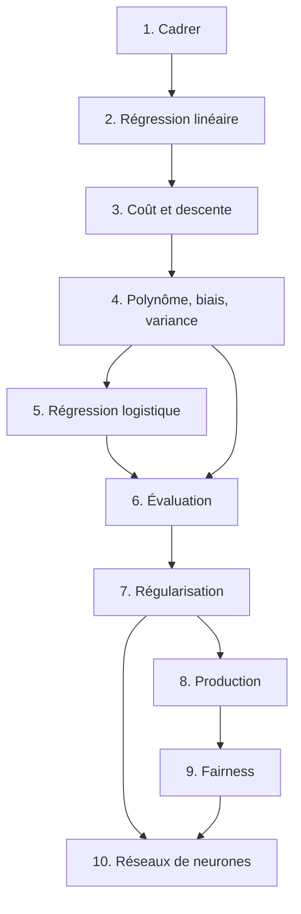

# Plan — Fondamentaux du Machine Learning

Document de travail, hors manuscrit. Il sert à valider le découpage avant la rédaction du chapitre 1. Les chapitres ne sont pas écrits.

## 1. Titre, public, promesse

**Titre.** Fondamentaux du Machine Learning. Le libellé « Priorité 1 » ne figure ni dans le titre, ni sur la couverture, ni dans les fichiers du livre.

**Public.** Ingénieur logiciel senior, à l'aise en Python, en systèmes et en API, sans cursus de mathématiques avancées ni de *machine learning*. Il conçoit et met en production des grands modèles de langage et des agents. Il veut comprendre pourquoi un modèle fonctionne ou échoue, pour diagnostiquer et choisir le bon levier.

**Promesse.** À la fin du livre, le lecteur sait cadrer une question prédictive, entraîner une régression linéaire et une régression logistique, lire une descente de gradient, reconnaître un surapprentissage, mesurer un modèle sans fuite, régulariser à bon escient, éviter les pièges de mise en service, voir un biais entre groupes, et situer un réseau de neurones — donc un Transformer et un modèle de langage — dans cette lignée. Chaque chapitre dit en quoi la notion change son travail sur les LLM et les agents.

**Autonomie.** Le livre se lit seul. Les lecteurs qui arrivent de *De l'assistant à l'agent* y trouvent le développement de ce que le chapitre 1 de ce livre-là esquisse en quelques pages. Aucun chapitre de celui-ci ne suppose l'autre.

**Langue et ton.** Français clair et professionnel. Le « vous » s'adresse à l'ingénieur. Chaque notion est définie à sa première occurrence. L'intuition précède la formule. Les limites et les pièges sont énoncés au moment où le mécanisme les rend visibles.

## 2. Ce que le dépôt impose, et ce qu'il ne contient pas

Le dépôt, sur `main`, contient un seul livre : `construire-agent-conversationnel/`. Il n'existe **aucun guide de style O'Reilly** (ni fichier, ni dossier, ni page de conventions partagées). Une recherche sur l'historique et sur les autres branches ne trouve pas non plus de tel guide.

Ce qui existe, et que ce livre reprend :

- Un dossier par livre, en kebab-case, avec un `README.md` qui tient lieu de table et de fiche. Pas de fichier de métadonnées (`book.json`, YAML, front matter). Le `README.md` racine enregistre la liste des livres.
- Un fichier Markdown par pièce, préfixé par deux chiffres dans l'ordre de lecture (`00-preface.md`, `01-partie1.md`, `02-ch01.md`, …). Les ouvertures de partie sont des fichiers distincts, courts.
- Des titres de niveau 1 de la forme `Chapitre N — Titre`, avec un tiret cadratin entouré d'espaces. La chaîne PDF, sur la branche non fusionnée `ML/pdf-du-livre`, découpe le libellé et le titre sur ce tiret, et n'assemble que les liens du README de la forme `- [Titre](NN-fichier.md)`.
- La typographie déjà en usage : **gras** pour le terme au moment de sa définition ; *italique* pour le terme anglais, les chemins et les URL ; « guillemets » pour un nom cité ; `chasse fixe` pour le code, les identifiants et les messages. Les sigles restent en romain.
- Les légendes en italique, seules sur leur ligne, immédiatement au-dessus de l'élément : `*Figure 1-1 — Titre*`, `*Tableau 1-1 — Titre*`, `*Exemple 3-1 — Titre*`. Une figure Mermaid est suivie d'une ligne `*Description du schéma :*` qui rend le dessin accessible.
- La fin de chapitre `## Ce qu'il faut retenir`, puis `## Références` (auteur, année, titre en italique, DOI ou URL).
- L'ouverture `Dans ce chapitre, vous…`.
- Trois degrés de certitude, utiles ici pour la production et la fairness : **établi**, **pratique courante**, **zone d'incertitude**.

La seule trace O'Reilly du dépôt est matérielle, pas rédactionnelle : `tools/pdf/style.css` sur `ML/pdf-du-livre` (absente de `main`) vise le format 7 × 9,19 in, le texte en 9,5 pt, le code en 8 pt, et des encadrés rendus par des citations Markdown dont le premier gras est le libellé. Les listings y sont conçus pour environ 81 caractères par ligne. Ce livre est écrit pour ce format, afin qu'une future génération PDF n'ait pas à réinventer la maquette.

## 3. Conventions O'Reilly appliquées

Faute de guide dans le dépôt, le manuscrit suivra les conventions O'Reilly standard, traduites en français et compatibles avec la maquette ci-dessus. Ces conventions restent celles de ce livre : pas de guide partagé ajouté au dépôt dans cette étape.

**Voix.** Deuxième personne, voix active, présent. Phrases tenues courtes. Un terme nouveau est défini à la première occurrence, mis en gras, avec l'anglais en italique entre parenthèses, puis repris au glossaire.

**Titres.** Casse de phrase. Le titre dit ce que la section fait ; pas de titre générique « Introduction » ou « Conclusion » à l'intérieur d'un chapitre. Les renvois dans le texte restent en français courant : « la figure 2-1 », « le chapitre 4 », « l'exemple 3-1 ». (L'usage O'Reilly anglophone met une capitale à *Figure* et *Chapter* ; ce livre suit la typographie française déjà en usage dans le dépôt.)

**Encadrés.** Cinq libellés, balisés comme dans l'autre livre pour que la même feuille de style les rende :

> **Note**
>
> Une précision utile qui n'est pas le fil du paragraphe.

> **Astuce**
>
> Le geste par défaut recommandé, l'équivalent du *Tip* O'Reilly.

> **Attention**
>
> Un piège coûteux : fuite de données, métrique trompeuse, coefficient illisible, seuil pris pour une vérité. L'équivalent du *Warning*.

> **Pour aller plus loin**
>
> Un développement facultatif (forme matricielle, référence). Le lecteur peut le passer sans perdre le fil.

> **Point clé**
>
> L'idée à retenir d'une section. Cet encadré est celui de l'autre livre du dépôt ; il complète les trois encadrés O'Reilly, il ne les remplace pas.

Les encadrés restent rares : un par section au plus, seulement quand le paragraphe seul ne porte pas l'avertissement.

**Formules.** Une phrase d'intuition, puis la formule, puis ce que chaque symbole désigne sur les nombres de l'exemple. Pas de démonstration. La forme matricielle de la régression, quand elle apparaît, est dans un encadré « Pour aller plus loin ». Une dérivée est présentée comme une pente : ce qui arrive au coût si l'on bouge un seul paramètre.

**Code.** Extraits courts, en Python, avec le langage indiqué sur la balise du bloc. Commentaires et textes en français, identifiants en anglais. La sortie réellement obtenue est reproduite sous le listing. Graine aléatoire fixée. Lignes visées à 81 caractères.

Un extrait écrit à la main n'apparaît que lorsqu'il montre un mécanisme que la bibliothèque cache : la forme close sur un exemple minuscule (chapitre 2), un pas de descente (chapitre 3), une frontière sur deux variables (chapitre 5), une passe avant d'un petit réseau (chapitre 10). Partout ailleurs, scikit-learn, avec le paramètre qui compte nommé et justifié.

Les listings portent sur un jeu synthétique (quelques points calculés à la main, ou `make_regression` / `make_classification`) ou sur un calcul numérique court (quelques logits, un softmax, une température). Aucune application métier fictive ne revient de chapitre en chapitre.

Pile prévue, versions épinglées dans la préface au moment de la rédaction, après vérification : Python 3.11 ou plus, NumPy, scikit-learn, Matplotlib. Pas de téléchargement : le script qui engendre un jeu, quand il y en a un, est reproduit dans le chapitre qui s'en sert. Pas de dépôt compagnon.

**Mots évités.** « Simplement », « évidemment », « trivialement », « il suffit de ». Ils contredisent le public visé.

**Références.** Comme dans l'autre livre : auteur et année dans le texte, notice complète en fin de chapitre, DOI ou URL vérifiés au moment de l'écriture. Aucune référence inventée. Un retour d'expérience non publié est qualifié de pratique courante ou de zone d'incertitude, jamais d'établi.

## 4. Exemples, et le lien avec votre travail

Le livre ne suit pas de produit fictif. Le mécanisme s'apprend sur un exemple numérique petit, que l'on peut refaire. Le lien avec les LLM et les agents est dit à part, dans chaque chapitre, sous deux formes qui ne racontent pas une histoire :

- l'ouverture et la ligne de plan **Pourquoi c'est utile pour vous**, qui nomment le geste professionnel correspondant ;
- la section `## Ce que ça change en pratique`, qui donne le levier (réglage, jeu d'éval, signal de surveillance) et le cas où ce levier ne s'applique pas.

Un exercice peut demander de reporter la notion sur un système que le lecteur fait déjà tourner (un prompt, un agent, un fine-tuning). Cet exercice parle de son travail ; il n'installe pas un scénario récurrent dans le livre.

## 5. Découpage, et pourquoi les thèmes du brief bougent

Le brief liste dix thèmes. Deux se recouvrent : l'évaluation (thème 5) et le biais, la variance, le surapprentissage (thème 7). Le plan les sépare par rôle, et ne les enseigne qu'une fois chacun.

Le **chapitre 4** réunit la régression polynomiale (seconde moitié du thème 2) et le compromis biais-variance (thème 7). Le polynôme est le premier modèle du livre qui rend le surapprentissage visible : la droite du chapitre 2 est trop rigide pour l'illustrer. Le vocabulaire biais / variance sert à le nommer au moment où le lecteur le voit. Les courbes d'apprentissage y sont introduites comme image, pas comme catalogue de graphiques.

Le **chapitre 6** traite le protocole et les métriques (le reste du thème 5) : découpages, fuites, erreur de régression, matrice de confusion, précision, rappel, F1, courbes ROC et précision-rappel. Il renvoie au chapitre 4 pour le phénomène, et montre comment un chiffre confirme le diagnostic. Il ne recommence pas le cours sur le biais et la variance. La contamination d'un benchmark, items déjà vus à l'entraînement ou dans les exemples du prompt, est traitée ici comme une fuite.

La **régularisation** (thème 6 du brief) vient après l'évaluation, au chapitre 7. Le lecteur a d'abord vu l'échec (chapitre 4), puis appris à le mesurer sans se tromper (chapitre 6). Les leviers L2, L1 et *early stopping* s'exercent alors sur un chiffre qui a un sens, et la force de régularisation se choisit sur la validation.

La **classification** (chapitre 5) précède l'évaluation complète, parce que la matrice de confusion et les courbes ROC n'ont pas d'objet tant qu'il n'y a pas de classes. Les métriques de régression sont rappelées au chapitre 6, là où elles se comparent aux métriques de classification, plutôt que dans un chapitre à part.

La **fairness** (chapitre 9) reste un chapitre, distinct des pièges de production (chapitre 8). Un encadré dans le chapitre de production l'aurait réduite à une checklist. Le calcul d'écart se fait sur un petit tableau synthétique à deux groupes ; la section pratique le transporte vers les écarts de comportement d'un LLM.

Les **réseaux de neurones** ferment le livre (chapitre 10). Un neurone est une régression déjà écrite ; la descente est celle du chapitre 3 ; la capacité et la régularisation sont celles des chapitres 4 et 7. Les placer plus tôt obligerait à réexpliquer chaque pièce. Le lien avec les Transformers est nommé dans ce chapitre, à partir des pièces déjà vues ; l'attention et le pré-entraînement à l'échelle n'y sont pas enseignés.

Quatre parties, dix chapitres. La partie I ne contient que le chapitre 1 : le cadrage est un préalable, pas un survey. Les trois autres parties ont trois chapitres.

La lecture reste linéaire. La flèche du chapitre 4 vers le chapitre 6 rappelle que le diagnostic y est posé avant d'être mesuré ; celle du chapitre 7 vers le chapitre 10, que le réseau réutilise la régularisation.

## 6. Hors périmètre

Le livre ne couvre pas : arbres de décision, forêts, *boosting*, machines à vecteurs de support, clustering, réduction de dimension, recherche bayésienne d'hyperparamètres, théorie de la généralisation, réseaux convolutionnels, le détail de l'attention, et l'entraînement des grands modèles de langage à l'échelle. Le *boosting* sur données tabulaires est le grand absent par rapport à la pratique classique ; l'ajouter dépasserait le brief et le budget de pages. La conclusion dira où continuer, en une page, sans ouvrir de chapitre.

Le chapitre 10 nomme la place d'un Transformer : des couches déjà comprises, empilées, plus des pièces que le livre ne développe pas. Ce nommage tient dans la section pratique du chapitre. Il ne devient pas un chapitre sur l'architecture.

Les thèmes non supervisés et par renforcement sont nommés au chapitre 1, le temps de situer le supervisé, puis laissés.

## 7. Volume

Une page est une page au format visé par la maquette du dépôt : 7 × 9,19 in, texte autour de 9,5 pt, soit environ 400 mots de prose, ou l'équivalent dès qu'un listing court et un encadré occupent la page. Les énoncés d'exercices sont dans le chapitre. Les solutions développées sont dans l'annexe A et comptent dans le total.

Le lien « pourquoi c'est utile pour vous » tient dans l'ouverture et dans « Ce que ça change en pratique ». Il ne rajoute pas de section, et les totaux ci-dessous le comptent déjà.

| Pièce | Pages |
|---|---|
| Préface | 3 |
| Partie I, ouverture | 1 |
| Chapitre 1 — Cadrer | 10 |
| Partie II, ouverture | 1 |
| Chapitre 2 — Régression linéaire | 11 |
| Chapitre 3 — Coût et descente de gradient | 11 |
| Chapitre 4 — Polynôme, biais, variance | 10 |
| Partie III, ouverture | 1 |
| Chapitre 5 — Régression logistique | 11 |
| Chapitre 6 — Évaluation | 12 |
| Chapitre 7 — Régularisation | 9 |
| Partie IV, ouverture | 1 |
| Chapitre 8 — Production | 10 |
| Chapitre 9 — Fairness | 8 |
| Chapitre 10 — Réseaux de neurones | 10 |
| Conclusion | 3 |
| Annexe A — Solutions | 8 |
| Glossaire | 3 |
| **Total** | **123** |

La cible est 123 pages, dans la bande 80-150. Si les listings des chapitres 3 et 10 s'allongent, le total peut approcher 140. Il reste une marge sous 150. Resserrer l'annexe et le glossaire ramènerait le livre vers 110, toujours au-dessus de 80.

## 8. Gabarit de chaque chapitre

L'ordre est fixe, pour que le lecteur retrouve ses repères.

1. Titre de niveau 1 : `Chapitre N — Titre`.
2. Ouverture : `Dans ce chapitre, vous…`, deux à quatre phrases. Elles disent le mécanisme, puis pourquoi il compte pour qui conçoit ou met en production un LLM ou un agent.
3. `## Objectifs` : quatre objectifs observables, à l'infinitif.
4. Corps : intuition, formule commentée, exemple numérique sur un jeu synthétique ou un calcul court, code. Les sections portent un titre qui dit leur propos. Pas de scénario métier suivi d'un chapitre à l'autre.
5. `## Ce que ça change en pratique` : le levier sur un LLM ou un agent (learning rate, jeu d'éval, seuil d'abstention, weight decay, signal de dérive, écart entre groupes), la décision que ce levier permet, et le cas où il ne s'applique pas. Cette section fait le pont avec le travail du lecteur. Elle ne raconte pas d'application fictive, et elle ne remplace pas l'exemple numérique du corps.
6. `## Exercices` : trois exercices. L'énoncé tient dans le chapitre ; la solution développée est à l'annexe A, annoncée en une ligne. Un exercice peut demander de reporter la notion sur un système que le lecteur exploite déjà.
7. `## Questions de compréhension` : quatre questions courtes. La réponse est dans le chapitre ; elle n'est pas réécrite.
8. `## Ce qu'il faut retenir` : cinq à huit puces.
9. `## Références`, dès qu'un travail est cité. Un chapitre sans source externe peut omettre la section ; il ne l'invente pas.

## 9. Préface, parties, conclusion, annexe, glossaire

**Préface (3 pages).** À qui s'adresse le livre, ce qu'il suppose (Python, un appel d'API déjà écrit, aucune analyse), l'organisation en quatre parties, la façon dont les exemples numériques et les sections pratiques se répondent, la pile et la graine, les conventions typographiques et les encadrés, la façon dont le livre a été écrit. Même franchise que l'autre livre du dépôt : l'aide d'outils d'IA générative est dite, et les choix de plan restent ceux de l'auteur.

**Ouvertures de partie (1 page chacune).** La question de la partie, ce que chaque chapitre y apporte, ce que le lecteur sait faire en la quittant, y compris sur un LLM ou un agent.

- Partie I — Ce que « apprendre » veut dire. La question est celle du cadrage : quelle décision, avec quelles informations disponibles à l'instant de la prédiction.
- Partie II — Prédire une grandeur. La question est mécanique : ajuster une somme pondérée, chercher les paramètres par la pente, et voir l'échec quand la forme est trop pauvre ou trop riche.
- Partie III — Décider une catégorie, puis croire le chiffre. La question est le passage d'un score à une décision oui/non, la mesure de cette décision, et la contrainte qui empêche le modèle de coller au bruit.
- Partie IV — Sortir le modèle du notebook. La question est ce qui casse entre une expérience et un service, ce que le modèle hérite des décisions passées, et en quoi un réseau, puis un Transformer, prolonge les mêmes idées.

**Conclusion (3 pages).** Les leviers revus dans l'ordre où un incident se diagnostique (cadrage, fuite, métrique, capacité, régularisation, données de service, écart entre groupes), sur un système à base de LLM comme sur un modèle classique. Une page sur ce que le livre laisse ouvert, dont les modèles à arbres et le détail des Transformers. Pas de nouveau mécanisme.

**Annexe A — Solutions (8 pages).** Les trente exercices, par chapitre, avec le raisonnement, pas seulement le résultat. Les questions de compréhension n'y figurent pas. Ce choix est arrêté : les solutions ne sont pas répétées en fin de chapitre.

**Glossaire (3 pages).** Tableau français / anglais / définition courte / chapitre, sur le modèle du glossaire de l'autre livre. Entrées nées des termes en gras. Index anglais-français court en fin de tableau si la place le permet ; sinon le tableau unique suffit, et la page économisée reste dans la marge.

## 10. Les chapitres

### Chapitre 1 — Cadrer un problème avant d'entraîner quoi que ce soit

**10 pages.** Chapitre 1 du brief (introduction et cadrage).

Ce chapitre fixe le vocabulaire minimum et la décision qui précède tout algorithme : quelle question prédire, à partir de quelles informations existeront vraiment au moment de la prédiction, et à quoi on verra que la réponse est utile. Il situe l'apprentissage supervisé par rapport au non supervisé et à l'apprentissage par renforcement, sans les développer. L'exemple numérique est un tableau de quelques lignes, engendré dans le chapitre.

**Pourquoi c'est utile pour vous.** Vous décidez déjà ce qu'un agent doit trancher : le prochain outil, la fin d'une tâche, la qualité d'une réponse. Le chapitre sépare la cible, les informations présentes dans le prompt au moment de l'appel, et celles qui n'existent qu'après — la correction humaine, le label d'évaluation. Refuser une colonne qui ne sera pas là en service est le même geste, que le modèle soit une régression ou un LLM.

**Objectifs.**

- Formuler un besoin comme une tâche supervisée, en nommant la cible et les variables connues au moment de la prédiction.
- Choisir la régression ou la classification d'après la forme de la cible.
- Reconnaître, dès le cadrage, une information qui n'existera pas en production.
- Expliquer la différence entre mémoriser les exemples et généraliser à un exemple nouveau.

**Sections.** Pourquoi ce chapitre pour qui met déjà des modèles de langage en production. Exemple, variable, cible, modèle, paramètre. Trois régimes d'apprentissage, et celui que le livre garde. Régression ou classification. Ce qui doit être connu à l'instant de la prédiction. Généraliser. Un petit tableau synthétique. Ce que ça change en pratique.

**Exercices.** Réécrire trois demandes issues de votre travail (classer un appel d'outil, noter une réponse, décider si l'agent s'arrête) en cible et variables connues à l'appel. Sur un tableau de six lignes, marquer les colonnes indisponibles le jour de la prédiction. Dire ce qu'un modèle de langage et une régression sur un tableau n'apprennent pas de la même façon.

### Chapitre 2 — La régression linéaire : une somme pondérée

**11 pages.** Thème 2 du brief, volet linéaire. Le volet polynomial est au chapitre 4.

Le chapitre construit le modèle le plus simple : une prédiction égale à une somme pondérée des variables, plus un décalage. Il traite la droite comme un choix de forme, pas comme une loi. La forme close est montrée sur un exemple à une variable, cinq points calculés à la main, puis énoncée ; la forme matricielle reste dans un encadré facultatif, sans démonstration. Le même ajustement est refait avec scikit-learn sur `make_regression`, pour que l'appel de bibliothèque ait un contenu visible. Une variable est volontairement à une échelle cent fois plus grande que l'autre, pour montrer ce que cette échelle fait aux coefficients.

**Pourquoi c'est utile pour vous.** Une couche linéaire, la tête posée sur des embeddings gelés, et le calcul d'un logit avant le softmax sont cette somme pondérée. Lire un coefficient, c'est voir dans quel sens une dimension tire la prédiction. Quand vous ajoutez une tête linéaire sur un encodeur figé, vous êtes dans ce chapitre : la mise à l'échelle des entrées décide si un poids est lisible.

**Objectifs.**

- Lire et écrire la prédiction comme décalage plus somme pondérée, et dire ce que le décalage et un coefficient changent à la cible.
- Entraîner une régression linéaire avec scikit-learn sur un jeu synthétique, et interpréter le signe et l'ordre de grandeur d'un coefficient.
- Recalculer la solution en forme close sur un jeu minuscule, et retrouver le résultat de la bibliothèque.
- Remettre les variables à une échelle comparable avant de comparer des coefficients entre eux.

**Sections.** Une grandeur à prédire, sur quelques points. La somme pondérée. Un exemple à la main, puis scikit-learn. L'échelle des variables et la lecture des coefficients. Ce que la droite ne peut pas représenter. Ce que ça change en pratique.

**Exercices.** Interpréter les coefficients avant et après mise à l'échelle, quand une variable vit dans \[0, 1\] et l'autre dans \[0, 10 000\]. Refaire la forme close sur les cinq points. Nommer, dans une passe avant de modèle de langage, l'étape qui est cette somme pondérée.

### Chapitre 3 — La fonction de coût et la descente de gradient

**11 pages.** Thème 3 du brief, entier : coût, descente batch, stochastique et mini-batch.

Ce chapitre répond à la question que la forme close laisse ouverte : comment les paramètres se trouvent quand une formule inverse n'est plus disponible. L'erreur d'un exemple est agrégée en un coût, l'erreur quadratique moyenne. Ce coût est un paysage ; la descente fait un pas dans le sens qui le diminue. Le pas d'apprentissage est la longueur du pas. Batch, stochastique et mini-batch diffèrent par ce qu'ils coûtent en calcul et par le bruit de la trajectoire. Les courbes sont tracées sur le même jeu synthétique que le chapitre 2.

**Pourquoi c'est utile pour vous.** L'entraînement et le fine-tuning d'un LLM descendent un coût par pas. Le learning rate est la longueur de ce pas : trop grand, la loss explose ; trop petit, elle stagne. Le mini-batch est le régime de ces entraînements, et le bruit de la courbe dans les logs vient de là. Lire un log de fine-tuning, c'est lire ce chapitre.

**Objectifs.**

- Relier une fonction de coût à ce que le modèle est puni d'avoir raté, sur un exemple puis sur le jeu.
- Décrire un pas de descente comme un déplacement qui suit la pente descendante, et le pas d'apprentissage comme sa longueur.
- Distinguer batch, stochastique et mini-batch par le sous-ensemble qui sert à estimer la pente.
- Diagnostiquer un coût qui explose, qui stagne ou qui oscille, et nommer le levier : pas, échelle des variables, nombre d'itérations.

**Sections.** De l'erreur d'un exemple au coût du jeu. L'erreur quadratique moyenne. La pente et un pas. Le pas d'apprentissage. Batch, stochastique, mini-batch. Lire une courbe de coût. Ce que ça change en pratique.

**Exercices.** Calculer le coût de trois prédictions à la main et dire laquelle une descente chercherait à corriger d'abord. Choisir, pour trois tailles de jeu, le régime de descente. Proposer un correctif pour trois courbes (explosion, plateau, oscillation) et reconnaître les mêmes formes sur un log de fine-tuning.

### Chapitre 4 — Polynômes, sous-apprentissage, surapprentissage

**10 pages.** Régression polynomiale (thème 2) et biais, variance, sous-apprentissage, surapprentissage (thème 7), enseignés ensemble, une seule fois.

Le chapitre enrichit la forme du modèle : une régression polynomiale est une régression linéaire sur des variables construites. Le jeu est une courbe synthétique bruitée. Le sous-apprentissage est un modèle trop rigide pour la relation ; le surapprentissage est un modèle qui épouse le bruit. Biais et variance nomment ces deux sources d'erreur. Les courbes d'apprentissage indiquent s'il faut plus de données, une forme plus riche, ou une contrainte — la contrainte elle-même attend le chapitre 7.

**Pourquoi c'est utile pour vous.** Un fine-tuning dont la loss d'entraînement baisse pendant que les prompts tenus à l'écart se dégradent est ce surapprentissage. La courbe d'apprentissage vous dit si le levier est plus d'exemples, moins d'époques, ou une adaptation de plus petite capacité. Quand le modèle a déjà vu les items d'un benchmark, le chiffre mesure en partie une mémorisation : le chapitre 6 traite cette situation comme une fuite, pas comme un meilleur modèle.

**Objectifs.**

- Construire une régression polynomiale comme une régression linéaire sur des puissances d'une variable.
- Qualifier un échec de sous-apprentissage ou de surapprentissage en comparant l'erreur d'entraînement et l'erreur sur des exemples nouveaux.
- Expliquer le biais et la variance comme deux sources d'erreur distinctes, et dire laquelle un jeu plus grand peut réduire.
- Lire une courbe d'apprentissage assez bien pour choisir entre plus de données, une forme plus riche, et une contrainte à venir.

**Sections.** Des variables construites. Le modèle trop rigide. Le modèle qui épouse le bruit. Biais et variance. Courbes d'apprentissage. Ce que ça change en pratique.

**Exercices.** Classer quatre paires d'erreurs (entraînement / données nouvelles) en sous-apprentissage ou surapprentissage. Pour un fine-tuning dont la loss d'entraînement baisse et dont l'éval sur prompts tenus à l'écart monte, choisir le levier parmi plus d'exemples, moins d'époques, et une adaptation plus petite. Esquisser la courbe d'un polynôme de degré trop élevé.

### Chapitre 5 — La régression logistique et la frontière de décision

**11 pages.** Thème 4 du brief, entier.

Une somme pondérée non bornée est une mauvaise réponse à une question oui/non : elle sort de l'intervalle d'une probabilité. La sigmoïde ramène la somme dans l'intervalle. La frontière est le lieu où l'estimation égale le seuil. La log loss est introduite par deux cas numériques — avoir tort en étant sûr, avoir tort en doutant — avant la formule. Le modèle est entraîné avec scikit-learn et une descente minimale sur `make_classification` à deux variables, pour voir la frontière. Un listing court applique un softmax à quatre logits, puis les divise par une température : c'est le même mécanisme, à plusieurs classes, sans entraîner de modèle de langage. Le score n'est pas encore traité comme une probabilité calibrée : le chapitre 6 y revient par les métriques, le chapitre 8 par le seuil de décision.

**Pourquoi c'est utile pour vous.** La sortie d'un LLM est cette construction à l'échelle du vocabulaire : des logits, c'est-à-dire des sommes pondérées, puis un softmax qui en fait une distribution. La température divise les logits avant ce softmax, au moment de l'échantillonnage. La cross-entropy qui entraîne le modèle est la log loss de ce chapitre. Un seuil sur un score est le même geste que de décider, à partir d'une probabilité, si l'agent agit ou s'abstient.

**Objectifs.**

- Choisir la classification quand la cible est une catégorie, et la régression logistique comme premier modèle.
- Interpréter la sortie comme un score entre 0 et 1, et la frontière comme le lieu où ce score égale un seuil.
- Expliquer ce que la log loss punit : une confiance élevée dans la mauvaise classe.
- Relier sigmoïde, softmax et température, et entraîner le modèle à deux classes pour voir la frontière bouger.

**Sections.** Une question oui/non, une grandeur. De la somme pondérée à un score : la sigmoïde. La frontière et le seuil. La log loss, vue sur deux cas avant la formule. scikit-learn et une descente minimale. Plusieurs classes : softmax et température. Du score à la décision. Ce que ça change en pratique.

**Exercices.** Dire pourquoi une régression linéaire du chapitre 2, entraînée sur 0/1, produit des prédictions hors de \[0, 1\], et ce que cela casse pour un seuil. Placer à la main une frontière sur un nuage de deux variables. Comparer la log loss de deux scores faux, l'un à 0,99 et l'autre à 0,6, puis calculer le softmax de quatre logits à deux températures et dire laquelle concentre la masse sur le token le plus fort.

### Chapitre 6 — Évaluer sans se tromper soi-même

**12 pages.** Thème 5 du brief : train, validation, test, métriques, ROC, précision-rappel, matrice de confusion. Le biais-variance n'est pas réenseigné ; il est diagnostiqué avec ces instruments.

Ce chapitre fixe le protocole qui rend un chiffre crédible. L'entraînement ajuste, la validation choisit, le test mesure une fois. Les fuites qui gonflent un score sont passées en revue sur un jeu synthétique : cible recopiée parmi les variables, prétraitement ajusté sur tout le jeu, doublons des deux côtés d'une coupe, ordre temporel cassé par un découpage aléatoire. Les métriques de régression et de classification sont posées côte à côte. Précision, rappel et F1 se choisissent d'après le coût d'un faux positif et d'un faux négatif. La courbe ROC et la courbe précision-rappel répondent à deux questions différentes, la seconde lorsque la classe positive est rare. L'exemple de classe rare est un `make_classification` déséquilibré, pas un cas métier.

**Pourquoi c'est utile pour vous.** Le jeu sur lequel vous itérez un prompt ou un agent est une validation ; celui que vous ne touchez qu'à la fin est un test. Annoncer le chiffre du jeu que vous avez regardé vingt fois, c'est publier la validation à la place du test. Précision et rappel traduisent deux coûts : l'agent agit à tort, ou il laisse passer un cas. Un benchmark dont les items sont dans le pré-entraînement ou dans les exemples du prompt est une fuite : le score mesure une reconnaissance, pas une généralisation.

**Objectifs.**

- Attribuer à l'entraînement, à la validation et au test des rôles distincts, et garder le test inconnu jusqu'à la mesure finale.
- Lire une matrice de confusion et choisir précision, rappel ou F1 selon le coût des deux erreurs.
- Expliquer ce qu'une courbe ROC et une courbe précision-rappel montrent, et laquelle lire quand la classe positive est rare.
- Repérer une fuite (cible, prétraitement, temps, doublons, item déjà vu) et dire quel chiffre elle améliore à tort.

**Sections.** Trois ensembles, trois rôles. Les fuites. Erreurs de régression : ce que le chiffre dit au chapitre 4. Matrice de confusion, précision, rappel, F1. ROC et précision-rappel. Ce que ça change en pratique.

**Exercices.** Découper un jeu synthétique ordonné dans le temps et dire ce qu'un découpage aléatoire mélange. Retrouver le score gonflé par une colonne qui recopie la cible, et le score sans elle. Choisir une métrique dans deux cas : une action à tort coûte dix fois plus cher qu'une abstention, puis l'inverse. Repérer, dans une mini-liste d'items d'éval, celui qui figurait déjà dans les exemples du prompt.

### Chapitre 7 — Régulariser : L2, L1 et early stopping

**9 pages.** Thème 6 du brief, entier.

Une fois le surapprentissage mesuré, trois leviers limitent la liberté du modèle, sur le jeu synthétique des chapitres précédents. L2 rapetisse les coefficients. L1 peut les annuler. L'*early stopping* arrête la descente dès que l'erreur de validation cesse de baisser : la contrainte est l'instant de l'arrêt, pas un terme ajouté au coût. La force se choisit sur la validation, jamais sur le test. Le chapitre dit aussi ce que la régularisation laisse intact : une mauvaise cible, une fuite, une variable absente le jour de la prédiction.

**Pourquoi c'est utile pour vous.** Le weight decay d'un entraînement de LLM joue le rôle de la pénalité L2 : il retient les poids. Avec AdamW, cette retenue est découplée du gradient ; l'encadré « Pour aller plus loin » le signale, le corps du chapitre reste sur L2. L'*early stopping* d'un fine-tuning, c'est arrêter quand la loss sur des prompts tenus à l'écart cesse de baisser. LoRA n'est pas une pénalité ajoutée au coût : en ne libérant qu'une mise à jour de petit rang, il limite la capacité, dans la même famille d'idées qu'un degré de polynôme tenu bas. Ni L2, ni le weight decay, ni LoRA ne réparent un jeu d'éval contaminé.

**Objectifs.**

- Relier L2 et L1 à une pénalité ajoutée au coût, et prédire leur effet sur les coefficients.
- Décrire l'*early stopping* comme un arrêt guidé par la validation.
- Régler la force de la pénalité sur l'ensemble de validation, et mesurer une fois sur le test.
- Reconnaître un échec que la régularisation laisse intact, et distinguer une pénalité L2 d'une limite de capacité comme LoRA.

**Sections.** Ajouter une pénalité au coût. L2. L1. *Early stopping*. Régler sur la validation. Ce que la régularisation laisse intact. Ce que ça change en pratique.

**Exercices.** Prédire, sur un jeu synthétique à coefficients connus, lesquels L1 a des chances d'annuler et lesquels L2 va surtout rapetisser. Choisir un instant d'arrêt sur une courbe d'entraînement et de validation, et dire ce que cet instant est pendant un fine-tuning. Citer une fuite du chapitre 6 que ni L1, ni L2, ni une baisse de capacité ne corrigent.

### Chapitre 8 — Production : pipeline, dérive et pièges classiques

**10 pages.** Thème 8 du brief.

Le chapitre quitte le notebook sans suivre un produit. Le pipeline de prétraitement fait partie du modèle : les mêmes transformations servent à l'entraînement et à l'appel. Un contre-exemple synthétique recalcule la mise à l'échelle à l'appel avec d'autres statistiques que celles de l'entraînement. Le modèle, les versions de bibliothèque et la graine sont identifiés. L'écart entre les données d'entraînement et les données servies, puis la dérive du mélange des exemples, ont chacun un signal qui les révèle. Le seuil de décision se fixe d'après le coût d'une erreur, pas d'après 0,5. Les pièges qui produisent un excellent score hors-ligne et un mauvais comportement en service sont rattachés au contrôle qui les attrape.

**Pourquoi c'est utile pour vous.** Le système que vous mettez en production est le modèle épinglé, le template de prompt, le corpus retrouvé et le schéma des outils, pris ensemble. En changer un entre l'éval et le service est un écart d'entraînement et de service. La dérive, c'est le mélange des requêtes, des langues ou des outils qui bouge après la mise en ligne, ou le fournisseur qui remplace le modèle sous le même nom. Le monitoring suit un signal choisi à l'avance — taux d'abstention, d'erreurs d'outils, de refus — et un seuil d'action fixé par le coût, pas par 0,5.

**Objectifs.**

- Décrire un chemin de prédiction où le prétraitement est le même à l'entraînement et à l'appel.
- Distinguer un écart train/service et une dérive, et nommer un signal pour chacun.
- Fixer un seuil à partir d'un coût, et dire ce qu'il faudra surveiller ensuite.
- Rattacher chaque piège classique du chapitre (fuite temporelle, entrée absente en service, métrique unique, modèle non versionné) au contrôle qui le révèle.

**Sections.** Le pipeline est le modèle. Reproductibilité et versions. Écart entre entraînement et service. Dérive. Le seuil, d'après le coût. Pièges classiques. Ce que ça change en pratique.

**Exercices.** Repérer, dans un pseudo-pipeline, la transformation recalculée à l'appel avec d'autres statistiques que celles de l'entraînement. Proposer un indicateur quand la part d'un type de requête double en trois mois, et un autre quand l'identifiant du modèle servi change sous un nom stable. Choisir un seuil pour le coût du chapitre 6 et dire quel taux de production le prolonge.

### Chapitre 9 — Fairness : ce que les données transmettent

**8 pages.** Thème 9 du brief. Notions, pas un traité : le chapitre reste dans son budget.

Un modèle peut désavantager un groupe sans qu'on le lui ait demandé, parce que les données historiques concentrent déjà une décision humaine. Le chapitre sépare un biais dans les variables, un biais dans la cible historique, et un écart de performance entre groupes. Il calcule un écart de taux de faux négatifs sur une matrice fournie, à deux groupes étiquetés A et B. Il montre qu'enlever la colonne du groupe ne retire pas l'information lorsque d'autres variables la reconstruisent. Il s'arrête sur la limite : une contrainte d'équité est un choix, que le livre ne présente pas comme un réglage automatique. Le règlement européen sur l'IA, s'il est mentionné, l'est dans un encadré « Pour aller plus loin », comme contexte, pas comme mode d'emploi juridique.

**Pourquoi c'est utile pour vous.** Un LLM peut répondre moins bien, refuser plus souvent ou stéréotyper selon la langue, le dialecte ou la mention d'un groupe dans le prompt, parce que le pré-entraînement et les jugements de préférence ont concentré ces écarts. Retirer un mot sensible du prompt ne retire pas les proxies présents dans le contexte. Mesurer un écart de rappel entre deux langues, ou entre deux formulations, sur un jeu d'éval, c'est le calcul de ce chapitre. Le chiffre mesure ; il ne choisit pas la politique du produit.

**Objectifs.**

- Distinguer un biais dans les variables, un biais dans la cible historique, et un écart de performance entre groupes.
- Calculer un écart de taux de faux négatifs entre deux groupes sur une matrice fournie.
- Expliquer comment des variables autorisées reconstruisent une colonne sensible que l'on a retirée.
- Formuler la limite d'une métrique d'équité : elle mesure un écart, elle ne tranche pas le choix.

**Sections.** D'où vient l'écart. Le mesurer sur deux groupes. La colonne retirée et les variables qui la reconstruisent. Ce qu'une métrique ne décide pas. Ce que ça change en pratique.

**Exercices.** Classer quatre situations (corpus de pré-entraînement, jugements de préférence, rappel plus faible dans une langue, variable de contexte qui reconstruit un mot retiré) selon les trois sources d'écart. Calculer l'écart de rappel entre les groupes A et B sur une matrice fournie. Proposer une information de contexte qui peut servir de proxy à une mention retirée du prompt, et dire ce qu'il faudrait vérifier avant de la retirer à son tour.

### Chapitre 10 — Réseaux de neurones : le lien avec le deep learning

**10 pages.** Thème 10 du brief : assez pour reconnaître les pièces d'un Transformer, pas une introduction au *deep learning*.

Ce chapitre réassemble les pièces déjà vues. Un neurone est une somme pondérée passée dans une fonction, comme la régression logistique. Une couche en empile. Un réseau ajoute des couches. La rétropropagation est l'application en chaîne de la même descente que celle du chapitre 3 : le gradient se calcule couche par couche, sans dérivation complète dans le texte. La profondeur change une chose précise : le modèle construit des représentations, au lieu de recevoir toutes les transformations à la main comme le polynôme du chapitre 4. Un petit réseau est entraîné sur le même `make_classification` que la régression logistique, et comparé à elle, pour que l'écart de score ait un coût en lisibilité. La dernière section pose un schéma de bloc Transformer : ce qui est une couche déjà comprise, et ce que le livre ne développe pas (l'attention, les connexions résiduelles, le pré-entraînement à l'échelle).

**Pourquoi c'est utile pour vous.** Un Transformer empile les pièces de ce livre : sommes pondérées, non-linéarités, coût, descente par rétropropagation, représentations apprises. Vous pouvez, sur un schéma de bloc, séparer ce que vous savez maintenant calculer de ce qu'il reste à étudier. Le fine-tuning et l'inférence que vous opérez s'appuient sur cet empilement ; les questions des chapitres 6 à 9 (éval, fuite, dérive, écart entre groupes) portent encore sur le système une fois le réseau devenu un LLM.

**Objectifs.**

- Relier un neurone et une couche aux modèles des chapitres 2 et 5.
- Décrire la rétropropagation comme le calcul du gradient couche par couche, et l'entraînement comme la descente du chapitre 3.
- Dire ce que la profondeur ajoute : des représentations apprises, là où le chapitre 4 demandait des variables construites à la main.
- Sur un schéma de bloc Transformer, nommer les pièces déjà vues et celles que le livre laisse ouvertes.

**Sections.** Un neurone, déjà vu. Empiler une couche. La rétropropagation, sans dérivée complète. Ce que la profondeur ajoute. Le même jeu synthétique, en réseau et en régression logistique. Où se place un Transformer. Ce que ça change en pratique.

**Exercices.** Réécrire un neurone à deux entrées avec les symboles du chapitre 5. Indiquer, sur un schéma de trois couches, quelle courbe l'*early stopping* du chapitre 7 surveille. Sur un schéma de bloc, marquer la couche linéaire et le MLP comme déjà lus, et l'attention comme hors de ce livre. Dire quelles questions des chapitres 6 à 9 restent valables pour un LLM en production.

## 11. Décisions arrêtées

Ces points étaient ouverts. Ils sont tranchés ; la rédaction du chapitre 1 n'attend plus leur arbitrage. Elle attend encore une validation du plan révisé.

1. **Titre.** Fondamentaux du Machine Learning. « Priorité 1 » est retiré partout.
2. **Pas de fil rouge fictif.** Les exemples de code sont synthétiques ou numériques. Chaque chapitre relie la notion aux LLM et aux agents dans « Ce que ça change en pratique ».
3. **Solutions.** Annexe A, pas en fin de chapitre.
4. **Arbres et boosting.** Hors manuscrit, avec un renvoi en conclusion. Pas de chapitre supplémentaire.
5. **Code.** Extraits dans le livre. Pas de dépôt compagnon.
6. **Guide de style.** Les conventions de la section 3 restent celles de ce livre. Pas de document partagé ajouté au dépôt.
