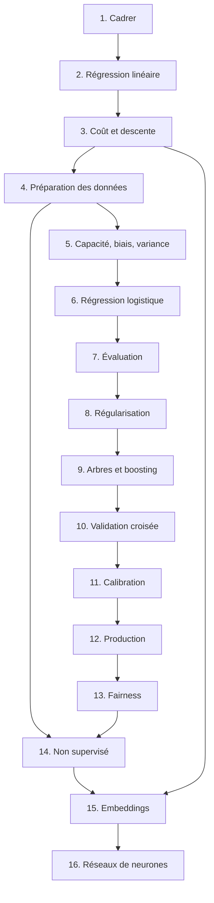

# Plan — Fondamentaux du Machine Learning

Document de travail, hors manuscrit. Il sert à valider le découpage avant la rédaction du chapitre 1. Les chapitres ne sont pas écrits.

## 1. Titre, public, promesse

**Titre.** Fondamentaux du Machine Learning. Le libellé « Priorité 1 » ne figure ni dans le titre, ni sur la couverture, ni dans les fichiers du livre.

**Public.** Ingénieur logiciel senior, à l'aise en Python, en systèmes et en API, sans cursus de mathématiques avancées ni de *machine learning*. Il veut **construire** des modèles : choisir une cible, préparer une table, entraîner, mesurer, régler, et mettre en service. Les LLM et les agents qu'il utilise déjà sont un cas de cette construction, pas le sujet du livre. Quand un lien avec eux est juste, le chapitre le dit ; il ne réécrit pas chaque notion comme un problème de prompt.

**Promesse.** À la fin du livre, le lecteur sait cadrer un problème, préparer des variables, ajuster une régression et une régression logistique, lire une descente de gradient, reconnaître un surapprentissage, mesurer sans fuite, régulariser, entraîner un arbre et un gradient boosting, chercher des hyperparamètres par validation croisée, calibrer une probabilité, détecter une dérive, voir un écart entre groupes, grouper ou compresser des données sans étiquette, et situer un embedding puis un réseau de neurones dans cette lignée.

**Autonomie.** Le livre se lit seul. Les lecteurs qui arrivent de *De l'assistant à l'agent* y trouvent le développement de ce que le chapitre 1 de ce livre-là esquisse. Aucun chapitre de celui-ci ne suppose l'autre.

**Langue et ton.** Français clair et professionnel. Le « vous » s'adresse à l'ingénieur. Chaque notion est définie à sa première occurrence. L'intuition précède la formule. Les limites et les pièges sont énoncés au moment où le mécanisme les rend visibles.

## 2. Ce que le dépôt impose, et ce qu'il ne contient pas

Le dépôt, sur `main`, contient un seul livre : `construire-agent-conversationnel/`. Il n'existe **aucun guide de style O'Reilly** (ni fichier, ni dossier, ni page de conventions partagées). Une recherche sur l'historique et sur les autres branches ne trouve pas non plus de tel guide.

Ce qui existe, et que ce livre reprend :

- Un dossier par livre, en kebab-case, avec un `README.md` qui tient lieu de table et de fiche. Pas de fichier de métadonnées (`book.json`, YAML, front matter). Le `README.md` racine enregistre la liste des livres.
- Un fichier Markdown par pièce, préfixé par deux chiffres dans l'ordre de lecture (`00-preface.md`, `01-partie1.md`, `02-ch01.md`, …). Les ouvertures de partie sont des fichiers distincts, courts.
- Des titres de niveau 1 de la forme `Chapitre N — Titre`, avec un tiret cadratin entouré d'espaces. La chaîne PDF, sur la branche non fusionnée `ML/pdf-du-livre`, découpe le libellé et le titre sur ce tiret, et n'assemble que les liens du README de la forme `- [Titre](NN-fichier.md)`.
- La typographie déjà en usage : **gras** pour le terme au moment de sa définition ; *italique* pour le terme anglais, les chemins et les URL ; « guillemets » pour un nom cité ; `chasse fixe` pour le code, les identifiants et les messages. Les sigles restent en romain.
- Les légendes en italique, seules sur leur ligne, immédiatement au-dessus de l'élément : `*Figure 1-1 — Titre*`, `*Tableau 1-1 — Titre*`, `*Exemple 3-1 — Titre*`. Une figure Mermaid est suivie d'une ligne `*Description du schéma :*` qui rend le dessin accessible.
- La fin de chapitre `## Ce qu'il faut retenir`, puis `## Références` (auteur, année, titre en italique, DOI ou URL).
- L'ouverture `Dans ce chapitre, vous…`.
- Trois degrés de certitude, utiles ici pour la production et la fairness : **établi**, **pratique courante**, **zone d'incertitude**.

La seule trace O'Reilly du dépôt est matérielle, pas rédactionnelle : `tools/pdf/style.css` sur `ML/pdf-du-livre` (absente de `main`) vise le format 7 × 9,19 in, le texte en 9,5 pt, le code en 8 pt, et des encadrés rendus par des citations Markdown dont le premier gras est le libellé. Les listings y sont conçus pour environ 81 caractères par ligne. Ce livre est écrit pour ce format, afin qu'une future génération PDF n'ait pas à réinventer la maquette.

## 3. Conventions O'Reilly appliquées

Faute de guide dans le dépôt, le manuscrit suivra les conventions O'Reilly standard, traduites en français et compatibles avec la maquette ci-dessus. Ces conventions restent celles de ce livre : pas de guide partagé ajouté au dépôt dans cette étape.

**Voix.** Deuxième personne, voix active, présent. Phrases tenues courtes. Un terme nouveau est défini à la première occurrence, mis en gras, avec l'anglais en italique entre parenthèses, puis repris au glossaire.

**Titres.** Casse de phrase. Le titre dit ce que la section fait ; pas de titre générique « Introduction » ou « Conclusion » à l'intérieur d'un chapitre. Les renvois dans le texte restent en français courant : « la figure 2-1 », « le chapitre 4 », « l'exemple 3-1 ». (L'usage O'Reilly anglophone met une capitale à *Figure* et *Chapter* ; ce livre suit la typographie française déjà en usage dans le dépôt.)

**Encadrés.** Cinq libellés, balisés comme dans l'autre livre pour que la même feuille de style les rende :

> **Note**
>
> Une précision utile qui n'est pas le fil du paragraphe.

> **Astuce**
>
> Le geste par défaut recommandé, l'équivalent du *Tip* O'Reilly.

> **Attention**
>
> Un piège coûteux : fuite de données, métrique trompeuse, coefficient illisible, seuil pris pour une vérité. L'équivalent du *Warning*.

> **Pour aller plus loin**
>
> Un développement facultatif (forme matricielle, référence). Le lecteur peut le passer sans perdre le fil.

> **Point clé**
>
> L'idée à retenir d'une section. Cet encadré est celui de l'autre livre du dépôt ; il complète les trois encadrés O'Reilly, il ne les remplace pas.

Les encadrés restent rares : un par section au plus, seulement quand le paragraphe seul ne porte pas l'avertissement.

**Formules.** Une phrase d'intuition, puis la formule, puis ce que chaque symbole désigne sur les nombres de l'exemple. Pas de démonstration. La forme matricielle de la régression, quand elle apparaît, est dans un encadré « Pour aller plus loin ». Une dérivée est présentée comme une pente : ce qui arrive au coût si l'on bouge un seul paramètre.

**Code.** Extraits courts, en Python, avec le langage indiqué sur la balise du bloc. Commentaires et textes en français, identifiants en anglais. La sortie réellement obtenue est reproduite sous le listing. Graine aléatoire fixée. Lignes visées à 81 caractères.

Un extrait écrit à la main n'apparaît que lorsqu'il montre un mécanisme que la bibliothèque cache : la forme close sur un exemple minuscule (chapitre 2), un pas de descente (chapitre 3), une frontière sur deux variables (chapitre 6), les résidus d'un boosting sur quelques points (chapitre 9), une passe avant d'un petit réseau (chapitre 16). Partout ailleurs, scikit-learn, avec le paramètre qui compte nommé et justifié.

Les listings portent sur un jeu synthétique (`make_regression`, `make_classification`, `make_blobs`, quelques points à la main) ou, quand la géométrie est le sujet, sur un jeu classique livré avec scikit-learn (`iris` pour un arbre, `digits` pour une PCA). Pas de téléchargement. Aucune application métier fictive ne revient de chapitre en chapitre.

Pile prévue, versions épinglées dans la préface au moment de la rédaction, après vérification : Python 3.11 ou plus, NumPy, scikit-learn, Matplotlib. Le chapitre 9 ajoute un listing XGBoost ; LightGBM est comparé dans le texte, sans second tutoriel d'API. Pas de dépôt compagnon.

**Mots évités.** « Simplement », « évidemment », « trivialement », « il suffit de ». Ils contredisent le public visé.

**Références.** Comme dans l'autre livre : auteur et année dans le texte, notice complète en fin de chapitre, DOI ou URL vérifiés au moment de l'écriture. Aucune référence inventée. Un retour d'expérience non publié est qualifié de pratique courante ou de zone d'incertitude, jamais d'établi.

## 4. Exemples, et le lien avec votre travail

Le livre ne suit pas de produit fictif. Le mécanisme s'apprend sur un exemple numérique petit, que l'on peut refaire. Le lien avec le travail du lecteur — construire un modèle, pas seulement appeler un LLM — est dit à part, dans chaque chapitre, sous deux formes :

- la ligne de plan **Pourquoi c'est utile pour vous**, qui nomme le geste de construction correspondant ;
- la section `## Ce que ça change en pratique`, qui donne le levier (quelle transformation, quel réglage, quel jeu de validation, quel signal) et le cas où ce levier ne s'applique pas.

Un lien avec un LLM ou un agent n'apparaît que lorsqu'il éclaire le même mécanisme (un logit, un learning rate, une fuite de benchmark, un embedding). Il ne remplace pas l'exemple numérique, et il n'est pas l'unique angle du chapitre.

Un exercice peut demander de reporter la notion sur un modèle que le lecteur entraîne ou met en service. Cet exercice parle de son travail ; il n'installe pas un scénario récurrent.

## 5. Ordre retenu

Seize chapitres, quatre parties. Chaque chapitre consomme une notion déjà vue et en fournit une à la suite. Rien de ce qui suit n'est renvoyé en annexe : l'annexe ne contient que les solutions.

1. **Cadrer avant d'ajuster.** La cible et les informations présentes au moment de la prédiction décident de tout le reste, y compris de savoir si le problème est supervisé.
2. **La somme pondérée avant la descente.** La forme close rend le modèle visible. La descente vient aussitôt après : c'est l'outil que réutiliseront la logistique, le boosting, les embeddings et les réseaux.
3. **La préparation des données après le premier modèle, pas avant.** Les chapitres 2 et 3 sont ajustés sur une table numérique propre, pour que le mécanisme ne se mélange pas aux recettes. Ils montrent déjà qu'une variable à grande échelle domine les coefficients et fait exploser un pas. Le chapitre 4 répare cela, et ajoute le nettoyage, les valeurs manquantes et l'encodage, dont tous les chapitres suivants ont besoin. Placer ces recettes avant le premier modèle les aurait privées de motif.
4. **La capacité tout de suite après la construction de variables.** Ajouter des colonnes polynomiales est du feature engineering qui change ce que le modèle peut mémoriser. Biais, variance, sous-apprentissage et surapprentissage sont nommés ici, une seule fois. Les arbres, le boosting et les réseaux y renvoient au lieu de recommencer le cours.
5. **La classification après ce vocabulaire.** La logistique est encore une somme pondérée, bornée. Les métriques de classe ont alors un objet. Le softmax et la température y sont le cas à plusieurs classes, pas un chapitre à part.
6. **Mesurer avant de contraindre, de chercher ou de mettre en service.** Le découpage train / validation / test et les métriques précèdent la régularisation, les arbres et la recherche d'hyperparamètres. Sans cela, chaque « amélioration » est un chiffre sans protocole.
7. **Régulariser avant les modèles à nombreux boutons.** L2, L1 et l'*early stopping* donnent le geste. La profondeur d'un arbre, le nombre d'arbres et le learning rate du boosting en sont des reprises.
8. **L'arbre et le boosting dans le même chapitre.** Le boosting n'a pas de sens sans l'arbre qui sert de base. Le gradient du chapitre 3 dit ce que chaque arbre ajouté apprend. Une forêt (bagging) est le contraste, en une section : moyenner des arbres n'est pas ajuster des résidus. Pas de second chapitre, qui répéterait le critère de coupe.
9. **La validation croisée et les hyperparamètres seulement une fois que les boutons existent** (force de L2, profondeur, nombre d'arbres, learning rate). Plus tôt, la recherche n'aurait qu'un modèle à régler et cacherait le propos. Le test du chapitre 7 reste scellé. La validation croisée emboîtée, qui évite de choisir et de publier sur les mêmes plis, est un encadré, pas un chapitre.
10. **Calibrer après avoir choisi le modèle.** La mise à l'échelle de Platt est une régression logistique sur les scores, donc le chapitre 6. Les scores d'un boosting en ont plus besoin que ceux d'une logistique. Calibrer chaque candidat puis garder le meilleur sur les mêmes données fuirait : on sélectionne par validation croisée, on calibre sur des données non utilisées pour ce choix, on touche le test une fois.
11. **La production puis la fairness, sur un modèle qu'on enverrait vraiment.** Le pipeline fige la préparation du chapitre 4. Le seuil s'appuie sur une probabilité calibrée. L'écart entre groupes reprend les métriques du chapitre 7. La fairness reste un chapitre : un encadré de production l'aurait réduite à une checklist.
12. **Le non supervisé après l'arc supervisé.** Il contraste avec une cible que le lecteur connaît maintenant. K-means exige l'échelle du chapitre 4, la PCA s'appuie sur la variance et les directions linéaires, les anomalies réutilisent la distance au groupe et l'erreur de reconstruction. Plus tôt, ce chapitre couperait le chemin qui va du premier modèle à un modèle qu'on peut régler et servir.
13. **Les embeddings après la PCA, avant le réseau.** La PCA est une représentation linéaire non supervisée. Un embedding est un vecteur qu'on associe à un objet, qu'on entraîne par la descente du chapitre 3, et qu'on réutilise comme variables du chapitre 2. Le réseau, en dernier, calcule ce vecteur au lieu de le chercher dans une table, et empile les pièces du livre. Un Transformer commence par l'embedding qu'on vient de voir ; l'attention est nommée et laissée de côté.

La lecture reste linéaire. Les flèches de côté rappellent deux dépendances qui ne sont pas le chapitre d'à côté : le non supervisé réutilise l'échelle du chapitre 4, les embeddings réutilisent la descente du chapitre 3.

Les thèmes 5 et 7 du brief initial restent répartis comme avant : le phénomène biais-variance est au chapitre 5, les métriques et les découpages au chapitre 7. La régularisation (chapitre 8) vient après la mesure.

## 6. Hors périmètre

Couvert désormais, et donc retiré de cette liste : arbres de décision, gradient boosting, XGBoost et LightGBM, préparation des données et feature engineering, k-means, PCA, détection d'anomalies, recherche d'hyperparamètres, validation croisée, calibration, embeddings.

Encore hors manuscrit, avec un renvoi en conclusion et pas de chapitre :

- machines à vecteurs de support ;
- forêts aléatoires au-delà du contraste avec le boosting (une section du chapitre 9 : moyenner des arbres n'est pas en ajuster le résidu) ;
- recherche bayésienne d'hyperparamètres (la grille et la recherche aléatoire suffisent ; une phrase dit ce que la recherche bayésienne change) ;
- *isolation forest* et auto-encodeurs comme méthodes d'anomalies (le chapitre 14 détecte par la distance au centre et par l'erreur de reconstruction d'une PCA, pour ne pas ouvrir une troisième famille dans le même chapitre) ;
- encodage par la cible (*target encoding*) comme technique à maîtriser : le chapitre 4 le signale comme fuite possible, le chapitre 7 montre comment un chiffre gonfle ;
- réseaux convolutionnels, le détail de l'attention, l'entraînement des grands modèles à l'échelle ;
- apprentissage par renforcement, au-delà de la carte du chapitre 1 ;
- théorie de la généralisation.

## 7. Volume

Une page est une page au format visé par la maquette du dépôt : 7 × 9,19 in, texte autour de 9,5 pt, soit environ 400 mots de prose, ou l'équivalent dès qu'un listing court et un encadré occupent la page. Les énoncés d'exercices sont dans le chapitre. Les solutions sont dans l'annexe A.

Le lien « pourquoi c'est utile pour vous » tient dans l'ouverture et dans « Ce que ça change en pratique ». Il est déjà compté ci-dessous.

| Pièce | Pages |
|---|---|
| Préface | 3 |
| Partie I, ouverture | 1 |
| Chapitre 1 — Cadrer | 8 |
| Chapitre 2 — Régression linéaire | 8 |
| Chapitre 3 — Coût et descente de gradient | 8 |
| Partie II, ouverture | 1 |
| Chapitre 4 — Préparation des données | 9 |
| Chapitre 5 — Polynômes, biais, variance | 8 |
| Chapitre 6 — Régression logistique | 8 |
| Chapitre 7 — Évaluation | 9 |
| Chapitre 8 — Régularisation | 6 |
| Partie III, ouverture | 1 |
| Chapitre 9 — Arbres et gradient boosting | 12 |
| Chapitre 10 — Validation croisée et hyperparamètres | 7 |
| Chapitre 11 — Calibration | 6 |
| Chapitre 12 — Production | 7 |
| Chapitre 13 — Fairness | 6 |
| Partie IV, ouverture | 1 |
| Chapitre 14 — Non supervisé | 9 |
| Chapitre 15 — Embeddings | 8 |
| Chapitre 16 — Réseaux de neurones | 8 |
| Conclusion | 2 |
| Annexe A — Solutions | 11 |
| Glossaire | 3 |
| **Total** | **150** |

Les chapitres totalisent 127 pages, l'appareil 23. La cible est 150. Si les 48 solutions de l'annexe s'écrivent plus long que prévu, le livre peut aller vers 155 : c'est le dépassement accepté, concentré sur les corrections, pas sur un chapitre supplémentaire. Les chapitres déjà présents dans le plan précédent ont été raccourcis pour laisser la place aux six sujets nouveaux sans annexe fourre-tout.

## 8. Gabarit de chaque chapitre

L'ordre est fixe.

1. Titre de niveau 1 : `Chapitre N — Titre`.
2. Ouverture : `Dans ce chapitre, vous…`, deux à quatre phrases. Elles disent le mécanisme, puis pourquoi il compte pour qui construit un modèle.
3. `## Objectifs` : quatre objectifs observables, à l'infinitif.
4. Corps : intuition, formule commentée, exemple numérique sur un jeu synthétique ou classique, code. Pas de scénario métier suivi d'un chapitre à l'autre.
5. `## Ce que ça change en pratique` : le levier quand vous construisez ou servez un modèle (transformation, hyperparamètre, protocole de validation, seuil, signal de surveillance), la décision qu'il permet, et le cas où il ne s'applique pas. Un lien avec un LLM ou un agent n'y figure que s'il éclaire le même levier.
6. `## Exercices` : trois exercices. L'énoncé tient dans le chapitre ; la solution développée est à l'annexe A. Un exercice peut demander de reporter la notion sur un modèle que le lecteur entraîne déjà.
7. `## Questions de compréhension` : quatre questions courtes. La réponse est dans le chapitre.
8. `## Ce qu'il faut retenir` : cinq à huit puces.
9. `## Références`, dès qu'un travail est cité.

## 9. Préface, parties, conclusion, annexe, glossaire

**Préface (3 pages).** À qui s'adresse le livre, ce qu'il suppose (Python, un appel d'API déjà écrit, aucune analyse), l'organisation en quatre parties, la façon dont les exemples numériques et les sections pratiques se répondent, la pile et la graine, les conventions, la façon dont le livre a été écrit. L'aide d'outils d'IA générative est dite, comme dans l'autre livre du dépôt.

**Ouvertures de partie (1 page chacune).** La question de la partie, ce que chaque chapitre consomme du précédent, ce que le lecteur sait construire en sortant.

- Partie I — Ajuster un modèle. Quelle décision, puis la somme pondérée et la descente qui trouve ses paramètres, sur une table encore propre.
- Partie II — Préparer, diagnostiquer, contraindre. Rendre une table utilisable, voir le modèle échouer quand on lui donne trop ou trop peu, passer à une classe, mesurer, limiter.
- Partie III — Choisir un modèle et s'y fier. Un modèle qui découpe au lieu de pondérer, la recherche des réglages, une probabilité qui veut dire ce qu'elle dit, la mise en service, l'écart entre groupes.
- Partie IV — Structure et représentations. Grouper et compresser sans étiquette, associer un vecteur à un objet, calculer ce vecteur par un réseau.

**Conclusion (2 pages).** Les leviers dans l'ordre d'un diagnostic (cadrage, fuite dans les variables, capacité, métrique, réglage, calibration, données servies, écart entre groupes). Une demi-page sur ce que le livre laisse ouvert. Pas de nouveau mécanisme.

**Annexe A — Solutions (11 pages).** Les quarante-huit exercices, par chapitre, avec le raisonnement. Les questions de compréhension n'y figurent pas. Ce choix reste arrêté : pas de solutions répétées en fin de chapitre.

**Glossaire (3 pages).** Tableau français / anglais / définition courte / chapitre. Entrées nées des termes en gras.

## 10. Les chapitres

### Chapitre 1 — Cadrer un problème avant d'entraîner quoi que ce soit

**8 pages.** Vocabulaire minimum et décision d'avant l'algorithme : quelle cible, quelles informations existeront au moment de la prédiction, à quoi on verra que le modèle est utile. Le supervisé est situé par rapport au non supervisé et au renforcement, sans les développer. L'exemple est un tableau de quelques lignes.

**Pourquoi c'est utile pour vous.** Construire un modèle commence par nommer la décision et ce qui sera connu à l'appel : prévoir une grandeur, classer un événement, grouper des objets, repérer un cas aberrant. La même discipline dit quand une colonne est une fuite, qu'il s'agisse d'un score métier ou d'un label d'évaluation écrit après coup.

**Objectifs.**

- Formuler un besoin comme une tâche, en nommant la cible et les variables connues au moment de la prédiction.
- Choisir la régression, la classification ou l'absence de cible.
- Reconnaître une information qui n'existera pas en production.
- Expliquer la différence entre mémoriser les exemples et généraliser.

**Sections.** Exemple, variable, cible, modèle, paramètre. Trois régimes, et ceux que le livre développe. Régression ou classification. Ce qui doit être connu à l'instant de la prédiction. Généraliser. Ce que ça change en pratique.

**Exercices.** Réécrire trois demandes de construction (prédire une grandeur, classer un événement, grouper des objets) en cible et variables. Marquer, sur six lignes, les colonnes indisponibles le jour de la prédiction. Dire ce qu'un modèle ajusté sur une table et un modèle de langage n'apprennent pas de la même façon.

### Chapitre 2 — La régression linéaire : une somme pondérée

**8 pages.** Prédiction égale à un décalage plus une somme pondérée. Forme close sur cinq points, puis scikit-learn sur `make_regression`. Une variable est à une échelle cent fois plus grande : les coefficients deviennent illisibles. La réparation attend le chapitre 4, pour que le lecteur voie le dégât avant la recette. La forme matricielle reste un encadré.

**Pourquoi c'est utile pour vous.** Une ligne de base, une tête linéaire sur des variables déjà prêtes, et la dernière couche d'un réseau calculent cette somme. Lire un coefficient, c'est voir quelle variable tire la prédiction, à condition que les échelles soient comparables. Un logit, avant un softmax, est la même somme : le chapitre 6 y revient.

**Objectifs.**

- Lire et écrire la prédiction comme décalage plus somme pondérée.
- Entraîner une régression linéaire avec scikit-learn et interpréter le signe d'un coefficient.
- Retrouver la forme close sur un jeu minuscule.
- Montrer qu'une variable d'échelle dominante rend les coefficients incomparables.

**Sections.** Une grandeur sur quelques points. La somme pondérée. Forme close, puis scikit-learn. L'échelle qui brouille la lecture. Ce que la droite ne représente pas. Ce que ça change en pratique.

**Exercices.** Interpréter les coefficients avant et après une mise à l'échelle faite à la main. Refaire la forme close sur les cinq points. Nommer deux endroits, dans un modèle que vous construisez, où la prédiction est une somme pondérée.

### Chapitre 3 — La fonction de coût et la descente de gradient

**8 pages.** L'erreur quadratique moyenne comme paysage, un pas dans le sens qui le diminue, batch, stochastique et mini-batch, sur le jeu du chapitre 2. Une variable mal échelonnée fait exploser le pas : le lien avec le chapitre 4 est explicite.

**Pourquoi c'est utile pour vous.** Tout modèle que vous entraînez vraiment — régression, boosting, embedding, réseau — déplace ses paramètres en descendant un coût. Le learning rate est la longueur du pas. Le mini-batch explique le bruit d'une courbe d'entraînement, y compris celle d'un fine-tuning.

**Objectifs.**

- Relier un coût à ce que le modèle est puni d'avoir raté.
- Décrire un pas de descente et le rôle du pas d'apprentissage.
- Distinguer batch, stochastique et mini-batch.
- Relier une courbe qui explose, stagne ou oscille à un levier : pas, échelle, nombre d'itérations.

**Sections.** De l'erreur d'un point au coût du jeu. La pente et un pas. Trois régimes. Lire une courbe. Ce que ça change en pratique.

**Exercices.** Calculer trois coûts à la main. Choisir un régime selon la taille du jeu. Proposer un correctif pour trois courbes, et reconnaître les mêmes formes sur un journal d'entraînement.

### Chapitre 4 — Préparer les données et construire les variables

**9 pages.** Nettoyage, valeurs manquantes, encodage des catégories, normalisation. Le chapitre reprend le modèle du chapitre 2 après mise à l'échelle et montre les coefficients redevenus lisibles. L'encodage one-hot est la représentation creuse qu'un embedding (chapitre 15) densifiera. L'encodage par la cible est signalé comme une fuite, mesurée au chapitre 7, pas enseigné comme une technique.

**Pourquoi c'est utile pour vous.** Le temps de construction d'un modèle passe d'abord dans la table : une valeur absente, une catégorie nouvelle le jour de l'appel, une colonne dont l'unité écrase les autres. Un pipeline qui réestime la moyenne à l'appel n'est plus le modèle que vous avez mesuré. Ce chapitre est celui que tous les suivants supposent.

**Objectifs.**

- Imputer une valeur manquante avec une statistique apprise sur l'entraînement seul.
- Encoder une catégorie sans utiliser la cible.
- Normaliser avec les statistiques de l'entraînement, et relire les coefficients du chapitre 2.
- Repérer une transformation qui fuirait si on l'ajustait sur toute la table.

**Sections.** Ce qu'une table brute empêche. Valeurs manquantes. Catégories. Échelle. Construire une colonne, et le risque d'y mettre la cible. Ce que ça change en pratique.

**Exercices.** Choisir une imputation et dire ce qui casse si on la calcule sur toute la table. Encoder une catégorie à trois niveaux et prédire la forme du tableau. Réentraîner la régression du chapitre 2 après normalisation et comparer les coefficients.

### Chapitre 5 — Polynômes, sous-apprentissage, surapprentissage

**8 pages.** Une régression polynomiale est une régression linéaire sur des colonnes construites, donc un cas du chapitre 4 qui change la capacité. Sous-apprentissage, surapprentissage, biais, variance, courbes d'apprentissage, sur une courbe synthétique bruitée. La contrainte elle-même attend le chapitre 8.

**Pourquoi c'est utile pour vous.** Ajouter des variables, approfondir un arbre ou allonger un entraînement peut faire baisser l'erreur d'entraînement et dégrader les exemples tenus à l'écart. La courbe d'apprentissage dit si le levier est plus de données, une forme plus riche, ou une contrainte. Un fine-tuning qui dégrade un modèle sur des prompts nouveaux est ce phénomène ; un benchmark déjà vu est une fuite, traitée au chapitre 7.

**Objectifs.**

- Construire une régression polynomiale comme une régression linéaire sur des puissances.
- Qualifier un échec par l'erreur d'entraînement et l'erreur sur des exemples nouveaux.
- Expliquer biais et variance, et dire laquelle plus de données peut réduire.
- Lire une courbe d'apprentissage pour choisir entre données, forme et contrainte.

**Sections.** Des colonnes construites. Le modèle trop rigide. Le modèle qui épouse le bruit. Biais et variance. Courbes d'apprentissage. Ce que ça change en pratique.

**Exercices.** Classer quatre paires d'erreurs. Pour un modèle dont l'erreur d'entraînement baisse et l'erreur tenue à l'écart monte, choisir le levier. Esquisser la courbe d'un degré trop élevé.

### Chapitre 6 — La régression logistique et la frontière de décision

**8 pages.** La sigmoïde borne la somme du chapitre 2. La frontière est le lieu du seuil. La log loss est montrée sur deux scores avant la formule. Entraînement sur `make_classification` à deux variables. Un listing applique un softmax à quatre logits et une température : le cas à plusieurs classes, sans entraîner de modèle de langage.

**Pourquoi c'est utile pour vous.** Dès que la cible est une classe, la sortie utile est un score borné, pas une grandeur. Vous vous en servez pour classer un événement, un ticket, un défaut. Le même softmax, appliqué à des logits, est la sortie d'un modèle à plusieurs classes, et aussi celle d'un LLM sur son vocabulaire : la température se règle au moment de tirer un token, elle ne change pas l'entraînement.

**Objectifs.**

- Choisir la régression logistique quand la cible est une classe.
- Lire un score entre 0 et 1 et la frontière au seuil.
- Expliquer ce que la log loss punit.
- Relier sigmoïde, softmax et température.

**Sections.** Une classe n'est pas une grandeur. La sigmoïde. La frontière. La log loss. Softmax et température. Ce que ça change en pratique.

**Exercices.** Dire pourquoi une régression du chapitre 2 entraînée sur 0/1 sort de \[0, 1\]. Placer une frontière sur un nuage. Comparer deux log loss, puis un softmax à deux températures.

### Chapitre 7 — Évaluer sans se tromper soi-même

**9 pages.** L'entraînement ajuste, la validation choisit, le test mesure une fois. Fuites sur un jeu synthétique : cible recopiée, prétraitement ajusté sur tout le jeu, doublons, ordre temporel cassé. Métriques de régression et de classification, matrice de confusion, précision, rappel, F1, ROC, précision-rappel sur une classe rare. Le biais-variance n'est pas réenseigné. La validation croisée est annoncée comme la réponse du chapitre 10 quand un seul découpage est trop bruité pour comparer des réglages ; elle n'est pas développée ici.

**Pourquoi c'est utile pour vous.** Le chiffre que vous annoncez pour un modèle construit de vos mains n'a de sens que si le test n'a servi ni à l'ajuster ni à le choisir. Précision et rappel traduisent le coût d'une alerte à tort et celui d'un cas manqué, pour un classifieur comme pour un agent qui agit ou s'abstient. Un item d'évaluation déjà présent dans l'entraînement, ou dans les exemples d'un prompt, est une fuite.

**Objectifs.**

- Tenir les trois rôles des trois ensembles et garder le test jusqu'à la mesure finale.
- Choisir précision, rappel ou F1 selon le coût des deux erreurs.
- Dire ce que ROC et précision-rappel montrent, et laquelle lire si la classe positive est rare.
- Repérer une fuite et dire quel chiffre elle gonfle.

**Sections.** Trois ensembles. Les fuites. Erreurs de régression et diagnostic du chapitre 5. Matrice, précision, rappel, F1. ROC et précision-rappel. Ce que ça change en pratique.

**Exercices.** Dire ce qu'un découpage aléatoire mélange dans une série ordonnée. Comparer le score avec et sans la colonne qui recopie la cible. Choisir une métrique dans deux rapports de coûts. Repérer un item d'évaluation déjà vu dans les exemples d'apprentissage.

### Chapitre 8 — Régulariser : L2, L1 et early stopping

**6 pages.** L2 rapetisse les coefficients, L1 peut les annuler, l'*early stopping* arrête dès que l'erreur de validation cesse de baisser. La force se choisit sur la validation. Le chapitre dit ce que cela laisse intact : mauvaise cible, fuite, variable absente le jour de la prédiction.

**Pourquoi c'est utile pour vous.** Avant d'empiler des arbres ou des couches, vous disposez de trois freins sur le modèle simple. Le weight decay d'un réseau joue le rôle de L2 ; avec AdamW il est découplé du gradient, ce que dit un encadré. L'*early stopping* est le même geste sur un fine-tuning ou sur un boosting. LoRA limite la capacité, comme un degré tenu bas : ce n'est pas une pénalité ajoutée au coût. Aucun de ces freins ne répare une fuite du chapitre 7.

**Objectifs.**

- Prédire l'effet de L2 et de L1 sur les coefficients.
- Décrire l'*early stopping* comme un arrêt guidé par la validation.
- Régler la force sur la validation et mesurer une fois sur le test.
- Distinguer une pénalité et une limite de capacité, et nommer un échec que ni l'une ni l'autre ne répare.

**Sections.** Une pénalité sur le coût. L2. L1. *Early stopping*. Ce que la régularisation laisse intact. Ce que ça change en pratique.

**Exercices.** Prédire quels coefficients synthétiques L1 annule et lesquels L2 rapetisse. Choisir un instant d'arrêt sur une courbe. Citer une fuite du chapitre 7 qu'aucune pénalité ne corrige.

### Chapitre 9 — Arbres de décision et gradient boosting

**12 pages.** Un arbre coupe l'espace en seuils, sans exiger l'échelle du chapitre 4. La profondeur rejoue le surapprentissage du chapitre 5. Une section courte oppose la forêt : moyenner des arbres tirés sur des échantillons, ce n'est pas ajuster un résidu. Le gradient boosting ajoute des arbres le long du gradient du chapitre 3 ; le learning rate et le nombre d'arbres reprennent le pas et l'*early stopping* du chapitre 8. Le mécanisme est montré avec scikit-learn sur quelques résidus, puis un listing XGBoost reprend le même jeu. LightGBM est décrit par ce qui change (coupes par histogramme, croissance feuille à feuille, catégories natives), sans second mode d'emploi.

**Pourquoi c'est utile pour vous.** Sur une table que vous avez préparée, l'arbre puis le boosting sont souvent le modèle que vous entraînez, pas la régression. Vous y retrouvez des boutons déjà nommés : profondeur, pas, arrêt. XGBoost et LightGBM sont les bibliothèques de ce geste. Une forêt qui moyenne et un boosting qui corrige le résidu ne se règlent pas de la même façon.

**Objectifs.**

- Lire une coupe d'arbre comme un seuil sur une variable, et relier la profondeur au surapprentissage.
- Distinguer une forêt, qui moyenne, d'un boosting, qui ajoute des arbres sur le résidu.
- Relier le gradient boosting à la descente du chapitre 3 et à l'*early stopping* du chapitre 8.
- Lancer un gradient boosting avec XGBoost sur le jeu du chapitre, et dire ce que LightGBM change à la même idée.

**Sections.** Une coupe, un seuil. La profondeur. Moyenner des arbres. Ajouter des arbres le long du gradient. XGBoost et LightGBM. Ce que ça change en pratique.

**Exercices.** Dire si un arbre profond surapprend ou sous-apprend, à partir de deux erreurs. Expliquer, sur trois résidus, ce que le deuxième arbre cherche à corriger. Choisir entre une forêt et un boosting pour un jeu bruité et un jeu où l'ordre des corrections compte, et justifier.

### Chapitre 10 — Validation croisée et hyperparamètres

**7 pages.** Un seul découpage de validation, défini au chapitre 7, devient bruité dès qu'on compare des dizaines de réglages : force de L2, profondeur, nombre d'arbres, learning rate. La validation croisée estime l'erreur de choix sur plusieurs plis. Grille et recherche aléatoire. Le test reste hors de la boucle. Un encadré dit ce que la validation emboîtée change, et ce qu'une recherche bayésienne changerait, sans les dérouler. Chercher le nombre d'arbres à la grille et, en plus, couper par *early stopping* sur les mêmes plis est signalé comme un double usage des données.

**Pourquoi c'est utile pour vous.** Construire un modèle, c'est comparer des réglages. Le chapitre vous donne une boucle qui choisit sans ouvrir le test : les plis servent au choix, un ensemble tenu à l'écart sert à la calibration du chapitre 11, le test ne sert qu'à la fin. La même boucle vaut pour la profondeur d'un arbre, le pas d'un boosting, ou le learning rate d'un réseau.

**Objectifs.**

- Dire pourquoi un seul jeu de validation ne suffit plus quand les réglages se multiplient.
- Mettre en place une validation croisée stratifiée pour une classification.
- Distinguer grille et recherche aléatoire, et nommer les hyperparamètres déjà vus que l'on y place.
- Garder le test hors de la recherche, et ne pas réutiliser les mêmes plis pour choisir et pour couper l'entraînement.

**Sections.** Du découpage unique aux plis. Ce qu'on a le droit de chercher. Grille et tirage aléatoire. Ce que la recherche ne doit pas toucher. Ce que ça change en pratique.

**Exercices.** Dire quel chiffre est optimiste si le test a servi à choisir la profondeur. Proposer les hyperparamètres à chercher pour le boosting du chapitre 9, et ceux qu'il faut laisser fixes. Repérer un protocole qui coupe par *early stopping* et choisit le nombre d'arbres sur les mêmes plis.

### Chapitre 11 — Calibrer une probabilité

**6 pages.** Un score qui classe bien peut mentir comme probabilité. Diagramme de fiabilité et score de Brier, sur les sorties de la logistique et du boosting. La mise à l'échelle de Platt est une régression logistique sur le score, donc une reprise du chapitre 6. L'isotonique est nommée en un paragraphe. La température reprend celle du softmax, appliquée aux logits. On calibre après le choix du chapitre 10, sur des données qui n'ont pas servi à ce choix.

**Pourquoi c'est utile pour vous.** Un seuil de production, un coût d'erreur, une abstention : tout cela suppose qu'un score de 0,8 arrive environ huit fois sur dix. Les scores d'un boosting sont souvent mal calibrés ; ceux d'une logistique le sont moins. Vous calibrez le modèle retenu, vous ne choisissez pas le modèle d'après la calibration calculée sur les mêmes lignes. La température d'échantillonnage d'un LLM est le même levier sur d'autres logits ; elle ne remplace pas une calibration de classifieur.

**Objectifs.**

- Distinguer un score qui ordonne et une probabilité fiable, sur un diagramme de fiabilité.
- Ajuster une mise à l'échelle de Platt et dire pourquoi c'est une logistique.
- Placer la calibration après la sélection du modèle, sur des données neuves pour ce choix.
- Dire dans quel usage un score non calibré reste suffisant : ordonner, pas décider.

**Sections.** Ordonner n'est pas prévoir une fréquence. Le diagramme et le score de Brier. Platt, et l'isotonique en regard. La température sur des logits. Ce que ça change en pratique.

**Exercices.** Lire un diagramme où les scores à 0,9 n'arrivent que six fois sur dix. Dire pourquoi calibrer tous les candidats puis garder le meilleur sur les mêmes lignes fausse le choix. Appliquer deux températures à quatre logits et dire laquelle concentre la masse.

### Chapitre 12 — Production : pipeline, dérive et pièges

**7 pages.** Le prétraitement du chapitre 4 fait partie du modèle servi. Un contre-exemple recalcule la mise à l'échelle à l'appel. Versions, graine, identifiant du modèle. Écart entre entraînement et service, dérive du mélange des exemples. Le seuil s'appuie sur le coût et sur la probabilité calibrée du chapitre 11, pas sur 0,5.

**Pourquoi c'est utile pour vous.** Le modèle que vous mettez derrière une API est le pipeline entier : transformations figées, poids, version. Un changement de schéma, de codage ou de version entre la mesure et l'appel est un écart d'entraînement et de service. La dérive, c'est le mélange des requêtes qui bouge, ou un modèle remplacé sous le même nom. Vous surveillez un taux choisi d'avance — alertes, abstentions, erreurs — pas le score d'entraînement. Les mêmes écarts existent quand le modèle servi est un LLM : template, corpus retrouvé, identifiant du modèle.

**Objectifs.**

- Décrire un chemin où le prétraitement de l'appel est celui de l'entraînement.
- Distinguer un écart train/service et une dérive, avec un signal pour chacun.
- Fixer un seuil à partir d'un coût et d'une probabilité calibrée.
- Rattacher fuite temporelle, entrée absente, métrique unique et modèle non versionné au contrôle qui les révèle.

**Sections.** Le pipeline est le modèle. Versions. Écart et dérive. Le seuil. Pièges. Ce que ça change en pratique.

**Exercices.** Repérer une statistique recalculée à l'appel. Proposer un signal quand la part d'un type de requête double, et un autre quand l'identifiant servi change. Choisir un seuil pour un coût du chapitre 7.

### Chapitre 13 — Fairness : ce que les données transmettent

**6 pages.** Trois sources : les variables, la cible historique, l'écart de performance entre groupes. Calcul d'un écart de faux négatifs sur une matrice à deux groupes A et B. Retirer la colonne du groupe laisse les variables qui la reconstruisent. Une contrainte d'équité est un choix, pas un réglage automatique. Le règlement européen, s'il est cité, reste un encadré de contexte.

**Pourquoi c'est utile pour vous.** Un modèle que vous entraînez peut désavantager un groupe parce que la table, ou l'étiquette historique, concentre déjà une décision humaine. Vous mesurez l'écart avec les métriques du chapitre 7, sur le modèle que vous vous apprêtez à servir. Le même calcul vaut pour un LLM qui répond moins bien ou refuse davantage selon la langue ou la mention d'un groupe : retirer un mot du prompt ne retire pas les proxies du contexte. Le chiffre ne choisit pas la politique du produit.

**Objectifs.**

- Distinguer biais des variables, biais de la cible, écart de performance.
- Calculer un écart de taux de faux négatifs entre deux groupes.
- Expliquer la reconstruction d'une colonne retirée par d'autres variables.
- Formuler la limite d'une métrique d'équité.

**Sections.** D'où vient l'écart. Le mesurer. La colonne retirée. Ce qu'une métrique ne décide pas. Ce que ça change en pratique.

**Exercices.** Classer quatre situations selon les trois sources. Calculer l'écart de rappel entre A et B. Proposer une variable qui sert de proxy à une colonne retirée.

### Chapitre 14 — Apprentissage non supervisé : groupes, axes, anomalies

**9 pages.** Sans cible, contrairement à tout l'arc précédent. K-means sur `make_blobs`, après un rappel : sans l'échelle du chapitre 4, une variable domine la distance. PCA comme directions de variance maximale, sur `digits` ou un nuage synthétique, avec l'erreur de reconstruction. Les anomalies sont les points loin de leur centre, ou ceux que la PCA reconstruit mal : pas une troisième famille d'algorithmes. L'*isolation forest* est nommée en une phrase.

**Pourquoi c'est utile pour vous.** Vous construisez aussi des modèles sans étiquette : segmenter des objets, compresser des descripteurs avant un modèle supervisé, faire remonter des cas éloignés de la masse. K-means et PCA sont ces deux outils, et l'anomalie en est une lecture, pas un produit séparé. L'échelle du chapitre 4 décide du résultat. Un embedding du chapitre 15 est une autre façon d'obtenir des coordonnées ; la PCA en est le cas linéaire, sans entraînement par étiquette.

**Objectifs.**

- Grouper avec k-means et dire ce que l'échelle des variables change aux distances.
- Décrire une composante principale comme une direction de variance, et l'erreur de reconstruction comme ce qu'on a perdu.
- Marquer comme anomalies les points loin d'un centre ou mal reconstruits, et dire ce que ce critère ne voit pas.
- Choisir le non supervisé quand il n'y a pas de cible, et le supervisé quand il y en a une.

**Sections.** Pas de cible. K-means et l'échelle. Axes et variance. Anomalies par distance et par reconstruction. Ce que ça change en pratique.

**Exercices.** Prédire le changement des groupes si une variable passe de \[0, 1\] à \[0, 10 000\] sans normalisation. Dire ce qu'une PCA à deux axes garde et jette sur un nuage allongé. Proposer un critère d'anomalie qui réutilise le k-means du chapitre, et un cas qu'il manquera.

### Chapitre 15 — Embeddings et représentations

**8 pages.** Le one-hot du chapitre 4 est le vecteur creux. Un embedding est un vecteur dense associé à un objet, entraîné par la descente du chapitre 3 pour une tâche du chapitre 6, puis réutilisé comme variables du chapitre 2. La similarité cosinus compare deux vecteurs. La PCA du chapitre 14 est le cas linéaire obtenu sans étiquette. Un listing apprend un embedding de dimension 2 sur quelques catégories synthétiques, pour qu'on puisse le dessiner. Utiliser un vecteur déjà calculé — y compris un embedding de texte — comme colonnes d'un modèle linéaire est le second geste, distinct de l'entraînement.

**Pourquoi c'est utile pour vous.** Vous construisez des représentations pour réutiliser un objet (un identifiant, un document, un produit) dans un autre modèle, au lieu de réencoder toute la table. Vous les entraînez quand vous avez une tâche, ou vous en consommez qui ont été entraînées ailleurs. Un embedding de LLM est une source de vecteurs parmi d'autres ; le mécanisme est le même que pour un vecteur appris sur vos identifiants. La qualité se mesure avec les outils du chapitre 7, sur la tâche d'aval, pas sur le vecteur seul.

**Objectifs.**

- Distinguer un one-hot et un embedding dense.
- Entraîner un petit embedding par descente et l'utiliser comme variables d'une régression ou d'une logistique.
- Comparer deux vecteurs par similarité cosinus, et situer la PCA comme embedding linéaire non supervisé.
- Séparer le fait d'entraîner une représentation et celui de réutiliser une représentation déjà calculée.

**Sections.** Du vecteur creux au vecteur court. L'entraîner. Le comparer. S'en servir comme variables. Ce que ça change en pratique.

**Exercices.** Dire ce qu'un one-hot de mille catégories coûte face à un embedding de taille 8. Esquisser la perte qui déplace deux vecteurs dont la tâche est « ces deux objets vont ensemble ». Nommer une mesure du chapitre 7 pour juger un embedding utilisé comme variables, et dire pourquoi la norme des vecteurs seule ne juge pas la tâche.

### Chapitre 16 — Réseaux de neurones : de la couche au Transformer

**8 pages.** Un neurone est la somme du chapitre 2 passée dans la fonction du chapitre 6. Une couche en empile. La rétropropagation est la descente du chapitre 3 appliquée couche par couche, sans dérivation complète. La profondeur construit des représentations, là où le chapitre 5 les fabriquait à la main et où le chapitre 15 les stockait dans une table. Un petit réseau est comparé à la logistique sur le même jeu synthétique. La dernière section pose un bloc Transformer : l'embedding du chapitre 15 en entrée, des couches déjà vues, et l'attention nommée comme la pièce que le livre ne développe pas.

**Pourquoi c'est utile pour vous.** Quand la table et les arbres ne suffisent plus, ou quand l'entrée est déjà un vecteur du chapitre 15, vous empilez des couches au lieu d'ajouter des colonnes à la main. Vous y reconnaissez le coût, le pas, l'*early stopping*, l'évaluation. Un Transformer, et donc un LLM, commence par l'embedding que vous venez de construire et empile ces couches ; l'attention reste à étudier ailleurs. Les questions des chapitres 7, 12 et 13 — mesure, dérive, écart entre groupes — portent encore sur le système une fois le réseau entraîné.

**Objectifs.**

- Relier un neurone aux chapitres 2 et 6, et une première couche à l'embedding du chapitre 15.
- Décrire la rétropropagation comme le gradient calculé couche par couche.
- Dire ce que la profondeur ajoute par rapport aux colonnes construites du chapitre 5.
- Sur un schéma de bloc, marquer ce que le livre a déjà vu et ce qu'il laisse ouvert.

**Sections.** Un neurone, déjà vu. Empiler. La rétropropagation, sans dérivée complète. Représentations calculées. Le même jeu, en réseau et en logistique. Où commence un Transformer. Ce que ça change en pratique.

**Exercices.** Réécrire un neurone à deux entrées avec les symboles du chapitre 6. Indiquer quelle courbe l'*early stopping* du chapitre 8 surveille sur trois couches. Sur un schéma de bloc, marquer l'embedding et la couche linéaire comme déjà lus, et l'attention comme hors du livre.

## 11. Décisions arrêtées

1. **Titre.** Fondamentaux du Machine Learning.
2. **Pas de fil rouge fictif.** Exemples synthétiques ou jeux classiques de scikit-learn. La rubrique « Pourquoi c'est utile pour vous » parle de construire un modèle ; les LLM et les agents n'y figurent que lorsque le mécanisme est le même.
3. **Solutions.** Annexe A.
4. **Arbres et boosting.** Intégrés au chapitre 9. La décision antérieure de les laisser hors manuscrit est remplacée par celle-ci. Les forêts restent un contraste d'une section.
5. **Code.** Extraits dans le livre. Pas de dépôt compagnon. XGBoost seulement pour un listing du chapitre 9.
6. **Guide de style.** Conventions de la section 3, pour ce livre seul.
